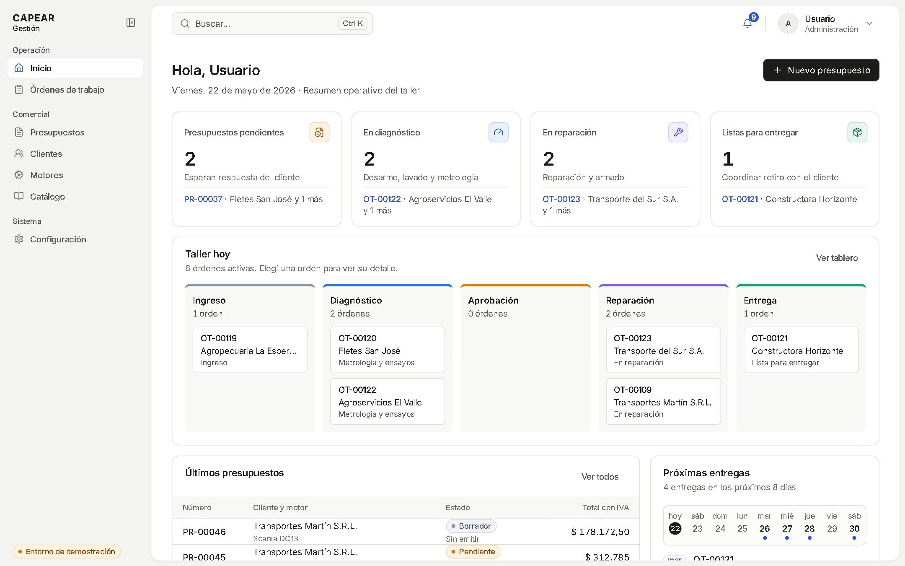

# CAPEAR Gestión

Sistema web de gestión de presupuestos y órdenes de trabajo para **Rectificaciones CAPEAR**, un taller de rectificación de motores. Proyecto de Prácticas Profesionalizantes del Instituto La Salette, 6.º año, orientación Computación, desarrollado entre agosto y noviembre de 2026. Está en uso real en el taller desde el 12/11/2026.

## Entregables

| Entregable | Dónde está |
|---|---|
| Plan de Desarrollo de Software, Manual del Usuario e Informe Técnico-Funcional (entrega grupal) | [CAPEAR_Gestion_Documentacion_PP.pdf](documentacion/CAPEAR_Gestion_Documentacion_PP.pdf) |
| Entregas individuales | [Santiago Postiglione](documentacion/CAPEAR_Gestion_Documentacion_PP_Santiago_Postiglione.pdf) · [Ricardo Hernández](documentacion/CAPEAR_Gestion_Documentacion_PP_Ricardo_Hernandez.pdf) · [Thiago Soria](documentacion/CAPEAR_Gestion_Documentacion_PP_Thiago_Soria.pdf) |
| Las partes del documento, para leer en GitHub | [Plan de Desarrollo](documentacion/fuente/01-plan-de-desarrollo.md) · [Manual del Usuario](documentacion/fuente/02-manual-de-usuario.md) · [Informe Técnico-Funcional](documentacion/fuente/03-informe-tecnico-funcional.md) |
| Presentación web del proyecto | **https://presentacion-capear.valiora.app** (fuente en [documentacion/web/](documentacion/web/)) |
| Muestra del código | [muestra-de-codigo/](muestra-de-codigo/) |
| Licencia | [LICENSE](LICENSE) |

## Aplicación en línea

El sistema funciona en su entorno de prueba, con una base de datos de validación y datos ficticios:

**https://prueba-capear.valiora.app**

## Qué hace

- **Clientes y motores**, con categoría comercial y carga del motor por marca, modelo y lista de precios.
- **Catálogo** de mano de obra, repuestos, ensayos y servicios, con historial de precios y la lista orientadora FACRA.
- **Presupuestos** con asistente, cálculo exacto (descuento, recargo interno, IVA), documento para el cliente, envío por PDF o WhatsApp y registro de la decisión del cliente.
- **Órdenes de trabajo** creadas automáticamente, y una sola vez, al aceptarse el presupuesto; seguimiento por etapas, islas del taller y piezas; diagnóstico, seña y hoja de taller sin importes.
- **Recepción de piezas** con constancia imprimible y **fotos** desde el celular.
- **Roles** de administración, gerencia y planta, con control de acceso en la base de datos.

## Código

El código completo se mantiene en un repositorio privado de trabajo, protegido por la licencia comercial: unas 111.000 líneas de aplicación, 194.000 líneas de pruebas automáticas y 79 migraciones de base de datos. La carpeta [`muestra-de-codigo/`](muestra-de-codigo/) publica una selección representativa, con sus pruebas: el cálculo decimal exacto, la decisión del cliente que crea la orden de trabajo, la máquina de estados de las islas del taller, la seguridad por rol en la base de datos y una pantalla de la aplicación.

**Tecnologías:** React 19, TypeScript estricto, Vite, React Router, React Hook Form y Zod; Supabase (PostgreSQL con seguridad por fila, autenticación, almacenamiento y Edge Functions); Cloudflare Workers; Vitest, Testing Library, PGlite y Playwright.

## Equipo

| Integrante | Rol |
|---|---|
| Santiago Postiglione | Líder de proyecto, visión de producto y desarrollo full stack |
| Ricardo Hernández | Planificación y diseño UX/UI |
| Thiago Soria | Base de datos y calidad (QA) |

Docente: Hugo Rodríguez. Empresa: Rectificaciones CAPEAR.

## Licencia

Software propietario bajo la **Licencia Comercial de Valiora**: todos los derechos reservados. Los docentes y evaluadores de las Prácticas Profesionalizantes pueden acceder, ejecutar y revisar el contenido solo para evaluar la práctica. Ver [`LICENSE`](LICENSE).
