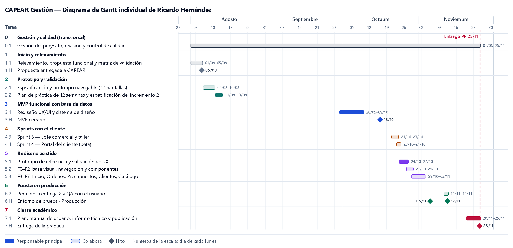

# Participación individual

Esta edición individual corresponde a **Ricardo Hernández**, integrante del equipo del proyecto CAPEAR Gestión junto con Santiago Postiglione y Thiago Soria. Contiene la documentación completa del proyecto (Partes I a III) y, en esta sección, el detalle de mi participación: rol, responsabilidades, tareas a cargo, planificación temporal individual y aportes, con su evidencia en el repositorio.

## 1. Rol en el equipo

Me desempeñé como **responsable de la planificación y del diseño UX/UI**. Santiago Postiglione fue el líder del proyecto, responsable de la visión de producto y del desarrollo full stack, y Thiago Soria tuvo a cargo la base de datos y la calidad. La matriz completa de participación por área está en la sección 5.1 de la Parte I.

## 2. Responsabilidades

- Elaborar y seguir el plan de desarrollo: desglose de tareas, cronograma, diagrama de Gantt e hitos, con registro de avances y desvíos.
- Diseñar la experiencia y la interfaz: maquetas, flujos de pantalla y sistema visual.
- Revisar las capturas de cada pantalla durante el rediseño y la puesta en producción.
- Colaborar en el relevamiento con CAPEAR y en la validación de las pantallas con el usuario.
- Redactar el manual del usuario y coordinar el armado de la documentación final.

## 3. Tareas a cargo

Participé en 12 de las 22 tareas del cronograma: en 4 como responsable principal y en 8 como colaborador. La numeración coincide con la estructura de desglose del trabajo (Parte I, sección 7) y con el cronograma general (Parte I, sección 8).

| ID | Tarea | Fechas | Días | Participación | Entregable |
|---|---|---|---:|---|---|
| **0** | **Gestión y calidad (transversal)** | | | | |
| 0.1 | Gestión del proyecto, revisión y control de calidad | 01/08/2026 a 25/11/2026 | 117 | Colabora (responsable: Santiago) | Registro de decisiones, revisiones de PR |
| **1** | **Inicio y relevamiento** | | | | |
| 1.1 | Relevamiento, propuesta funcional y matriz de validación | 01/08/2026 a 05/08/2026 | 5 | Colabora (responsable: Santiago) | Propuesta funcional v1.1, matriz y anexo de maquetas |
| **2** | **Prototipo y validación** | | | | |
| 2.1 | Especificación y prototipo navegable (17 pantallas) | 06/08/2026 a 10/08/2026 | 5 | Colabora (responsable: Santiago) | Prototipo con datos de prueba |
| 2.2 | Plan de práctica de 12 semanas y especificación del incremento 2 | 11/08/2026 a 13/08/2026 | 3 | Responsable principal | Plan de 12 semanas |
| **3** | **MVP funcional con base de datos** | | | | |
| 3.1 | Rediseño UX/UI y sistema de diseño | 30/09/2026 a 09/10/2026 | 10 | Responsable principal | PR #1 |
| **4** | **Sprints con el cliente** | | | | |
| 4.3 | Sprint 3 — Lote comercial y taller | 21/10/2026 a 23/10/2026 | 3 | Colabora (responsable: Santiago) | PR #14 |
| 4.4 | Sprint 4 — Portal del cliente (beta) | 23/10/2026 a 24/10/2026 | 2 | Colabora (responsable: Santiago) | PR #16 |
| **5** | **Rediseño asistido** | | | | |
| 5.1 | Prototipo de referencia y validación de UX | 24/10/2026 a 27/10/2026 | 4 | Responsable principal | Especificación del rediseño |
| 5.2 | F0–F2: base visual, navegación y componentes | 27/10/2026 a 29/10/2026 | 3 | Colabora (responsable: Santiago) | PR #17 |
| 5.3 | F3–F7: Inicio, Órdenes, Presupuestos, Clientes, Catálogo | 29/10/2026 a 03/11/2026 | 6 | Colabora (responsable: Santiago) | PR #18 a #23 |
| **6** | **Puesta en producción** | | | | |
| 6.2 | Perfil de la entrega 2 y QA con el usuario | 11/11/2026 a 12/11/2026 | 2 | Colabora (responsable: Thiago) | Informe de QA, PR #27 a #33 |
| **7** | **Cierre académico** | | | | |
| 7.1 | Plan, manual de usuario, informe técnico y publicación | 20/11/2026 a 25/11/2026 | 6 | Responsable principal | Este documento y el repositorio |

## 4. Planificación temporal individual

El diagrama muestra mis tareas sobre el calendario del proyecto. Las barras llenas son tareas en las que fui responsable principal; las claras, tareas en las que colaboré con el responsable indicado en la tabla anterior.

**Dedicación.** Unas 10 horas semanales, como el resto del equipo: alrededor de 170 horas entre agosto y noviembre de 2026. No se llevó un registro de horas por tarea: la cifra surge de la dedicación semanal acordada.

## 5. Aportes principales

| Aporte | Tareas | Evidencia en el repositorio |
|---|---|---|
| Plan de práctica de 12 semanas: tareas, hitos y muestras mensuales, base del cronograma del proyecto. | 2.2 | Plan de 12 semanas |
| Rediseño UX/UI y sistema de diseño: tipografía, colores, componentes y diseño de las pantallas del personal. | 3.1 | PR #1 |
| Prototipo de referencia y validación de UX del rediseño, con las reglas de diseño P1 a P12. | 5.1 | Documento de diseño del rediseño |
| Diseño de las pantallas del lote comercial, la hoja de taller y el portal del cliente. | 4.3, 4.4 | PR #14 y #16 |
| Revisión de las pantallas rediseñadas y del recorrido de calidad con el usuario. | 5.2, 5.3, 6.2 | PR #17 a #23, informe de QA |
| Plan de desarrollo, cronograma, diagrama de Gantt y manual del usuario de esta entrega. | 7.1 | Este documento |

El repositorio de trabajo del proyecto es privado y está en la cuenta de GitHub de Santiago Postiglione, que integra los cambios del equipo. La entrega se publica en el repositorio **Santyy08/capear-gestion**.

## 6. Entregables de esta edición

| Consigna | Dónde está |
|---|---|
| Plan de Desarrollo de Software: requerimientos, alcance, roles, tareas, cronograma y diagrama de Gantt. | Parte I de este documento; mi parte, en esta sección. |
| Publicación en GitHub con la codificación. | Repositorio del equipo Santyy08/capear-gestion, publicado en la cuenta de Santiago Postiglione: documentación, presentación web, muestra del código (`muestra-de-codigo/`) y licencia. El código completo está en el repositorio privado de trabajo y el sistema funciona en línea en su entorno de prueba. |
| Manual del Usuario. | Parte II de este documento y `documentacion/fuente/02-manual-de-usuario.md` en el repositorio. |
| Informe Técnico-Funcional del Desarrollador. | Parte III de este documento y `documentacion/fuente/03-informe-tecnico-funcional.md` en el repositorio. |
| Licencia. | Archivo `LICENSE` del repositorio: Licencia Comercial de Valiora. |
