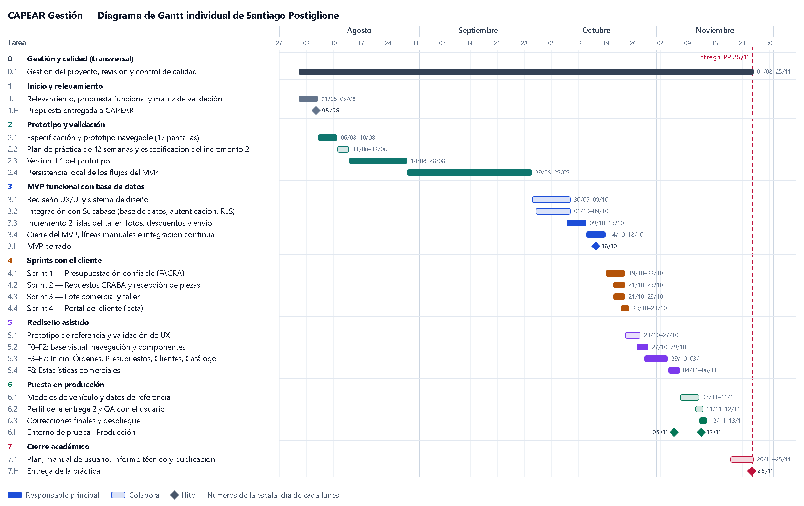

# Participación individual

Esta edición individual corresponde a **Santiago Postiglione**, integrante del equipo del proyecto CAPEAR Gestión junto con Ricardo Hernández y Thiago Soria. Contiene la documentación completa del proyecto (Partes I a III) y, en esta sección, el detalle de mi participación: rol, responsabilidades, tareas a cargo, planificación temporal individual y aportes, con su evidencia en el repositorio.

## 1. Rol en el equipo

Me desempeñé como **líder de proyecto, responsable de la visión de producto y desarrollador full stack**. Ricardo Hernández tuvo a cargo la planificación y el diseño UX/UI, y Thiago Soria, la base de datos y la calidad. La matriz completa de participación por área está en la sección 5.1 de la Parte I.

## 2. Responsabilidades

- Definir la visión del producto y la arquitectura del sistema, y sostenerlas a lo largo de las entregas.
- Coordinar al equipo y ser el nexo con CAPEAR: relevamiento, validación del alcance y demostraciones.
- Priorizar el trabajo de cada entrega: el MVP, los cuatro sprints con el cliente, el rediseño y la puesta en producción.
- Desarrollar la interfaz web (React y TypeScript) y la lógica del servidor (reglas, funciones y seguridad en la base de datos).
- Revisar e integrar los cambios del equipo mediante pull requests.
- Desplegar los entornos de prueba y de producción, y verificarlos después de cada publicación.

## 3. Tareas a cargo

Participé en las 22 tareas del cronograma: en 15 como responsable principal y en 7 como colaborador. La numeración coincide con la estructura de desglose del trabajo (Parte I, sección 7) y con el cronograma general (Parte I, sección 8).

| ID | Tarea | Fechas | Días | Participación | Entregable |
|---|---|---|---:|---|---|
| **0** | **Gestión y calidad (transversal)** | | | | |
| 0.1 | Gestión del proyecto, revisión y control de calidad | 01/08/2026 a 25/11/2026 | 117 | Responsable principal | Registro de decisiones, revisiones de PR |
| **1** | **Inicio y relevamiento** | | | | |
| 1.1 | Relevamiento, propuesta funcional y matriz de validación | 01/08/2026 a 05/08/2026 | 5 | Responsable principal | Propuesta funcional v1.1, matriz y anexo de maquetas |
| **2** | **Prototipo y validación** | | | | |
| 2.1 | Especificación y prototipo navegable (17 pantallas) | 06/08/2026 a 10/08/2026 | 5 | Responsable principal | Prototipo con datos de prueba |
| 2.2 | Plan de práctica de 12 semanas y especificación del incremento 2 | 11/08/2026 a 13/08/2026 | 3 | Colabora (responsable: Ricardo) | Plan de 12 semanas |
| 2.3 | Versión 1.1 del prototipo | 14/08/2026 a 28/08/2026 | 15 | Responsable principal | Prototipo v1.1 |
| 2.4 | Persistencia local de los flujos del MVP | 29/08/2026 a 29/09/2026 | 32 | Responsable principal | Flujos que sobreviven a la recarga |
| **3** | **MVP funcional con base de datos** | | | | |
| 3.1 | Rediseño UX/UI y sistema de diseño | 30/09/2026 a 09/10/2026 | 10 | Colabora (responsable: Ricardo) | PR #1 |
| 3.2 | Integración con Supabase (base de datos, autenticación, RLS) | 01/10/2026 a 09/10/2026 | 9 | Colabora (responsable: Thiago) | PR #2 |
| 3.3 | Incremento 2, islas del taller, fotos, descuentos y envío | 09/10/2026 a 13/10/2026 | 5 | Responsable principal | PR #3 a #10 |
| 3.4 | Cierre del MVP, líneas manuales e integración continua | 14/10/2026 a 18/10/2026 | 5 | Responsable principal | MVP cerrado, CI |
| **4** | **Sprints con el cliente** | | | | |
| 4.1 | Sprint 1 — Presupuestación confiable (FACRA) | 19/10/2026 a 23/10/2026 | 5 | Responsable principal | PR #11 |
| 4.2 | Sprint 2 — Repuestos CRABA y recepción de piezas | 21/10/2026 a 23/10/2026 | 3 | Responsable principal | PR #13 |
| 4.3 | Sprint 3 — Lote comercial y taller | 21/10/2026 a 23/10/2026 | 3 | Responsable principal | PR #14 |
| 4.4 | Sprint 4 — Portal del cliente (beta) | 23/10/2026 a 24/10/2026 | 2 | Responsable principal | PR #16 |
| **5** | **Rediseño asistido** | | | | |
| 5.1 | Prototipo de referencia y validación de UX | 24/10/2026 a 27/10/2026 | 4 | Colabora (responsable: Ricardo) | Especificación del rediseño |
| 5.2 | F0–F2: base visual, navegación y componentes | 27/10/2026 a 29/10/2026 | 3 | Responsable principal | PR #17 |
| 5.3 | F3–F7: Inicio, Órdenes, Presupuestos, Clientes, Catálogo | 29/10/2026 a 03/11/2026 | 6 | Responsable principal | PR #18 a #23 |
| 5.4 | F8: Estadísticas comerciales | 04/11/2026 a 06/11/2026 | 3 | Responsable principal | PR #25 |
| **6** | **Puesta en producción** | | | | |
| 6.1 | Modelos de vehículo y datos de referencia | 07/11/2026 a 11/11/2026 | 5 | Colabora (responsable: Thiago) | PR #26 |
| 6.2 | Perfil de la entrega 2 y QA con el usuario | 11/11/2026 a 12/11/2026 | 2 | Colabora (responsable: Thiago) | Informe de QA, PR #27 a #33 |
| 6.3 | Correcciones finales y despliegue | 12/11/2026 a 13/11/2026 | 2 | Responsable principal | PR #34 a #39, sistema en producción |
| **7** | **Cierre académico** | | | | |
| 7.1 | Plan, manual de usuario, informe técnico y publicación | 20/11/2026 a 25/11/2026 | 6 | Colabora (responsable: Ricardo) | Este documento y el repositorio |

## 4. Planificación temporal individual

El diagrama muestra mis tareas sobre el calendario del proyecto. Las barras llenas son tareas en las que fui responsable principal; las claras, tareas en las que colaboré con el responsable indicado en la tabla anterior.

**Dedicación.** Unas 10 horas semanales, como el resto del equipo: alrededor de 170 horas entre agosto y noviembre de 2026. El trabajo fue más intenso entre el 19/10 y el 13/11, con los sprints con el cliente, el rediseño y la puesta en producción. No se llevó un registro de horas por tarea: la cifra surge de la dedicación semanal acordada.

## 5. Aportes principales

| Aporte | Tareas | Evidencia en el repositorio |
|---|---|---|
| Arquitectura por capas con repositorios intercambiables: el prototipo con datos de prueba pasó a la base de datos real sin rehacer las pantallas. | 3.2 | PR #2 |
| Núcleo de presupuestación: lista FACRA versionada, precio sugerido por lista del motor, cálculo exacto y documento para el cliente. | 4.1 | PR #11 |
| Orden de trabajo única al aceptar, diagnóstico y revisiones, islas del taller, fotos y seña. | 3.3, 4.3 | PR #3 a #10 y #14 |
| Portal del cliente (beta) con una única puerta pública de acceso a los datos. | 4.4 | PR #16 |
| Rediseño asistido de todas las pantallas del personal. | 5.2 a 5.4 | PR #17 a #25 |
| Puesta en producción del 12/11/2026 y correcciones finales. | 6.3 | PR #34 a #39 |

El repositorio de trabajo del proyecto, privado, está en mi cuenta personal de GitHub y registra la integración de los pull requests del desarrollo, del #1 al #39. La entrega se publica, también en mi cuenta, en el repositorio **Santyy08/capear-gestion**.

## 6. Entregables de esta edición

| Consigna | Dónde está |
|---|---|
| Plan de Desarrollo de Software: requerimientos, alcance, roles, tareas, cronograma y diagrama de Gantt. | Parte I de este documento; mi parte, en esta sección. |
| Publicación en la cuenta personal de GitHub con la codificación. | Repositorio Santyy08/capear-gestion: documentación, presentación web, muestra del código (`muestra-de-codigo/`) y licencia. El código completo está en el repositorio privado de trabajo y el sistema funciona en línea en su entorno de prueba. |
| Manual del Usuario. | Parte II de este documento y `documentacion/fuente/02-manual-de-usuario.md` en el repositorio. |
| Informe Técnico-Funcional del Desarrollador. | Parte III de este documento y `documentacion/fuente/03-informe-tecnico-funcional.md` en el repositorio. |
| Licencia. | Archivo `LICENSE` del repositorio: Licencia Comercial de Valiora. |
