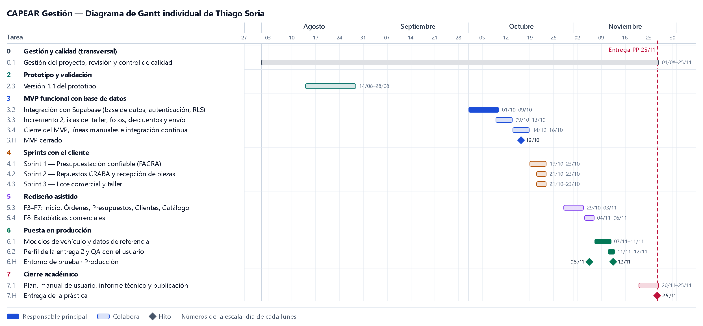

# Participación individual

Esta edición individual corresponde a **Thiago Soria**, integrante del equipo del proyecto CAPEAR Gestión junto con Santiago Postiglione y Ricardo Hernández. Contiene la documentación completa del proyecto (Partes I a III) y, en esta sección, el detalle de mi participación: rol, responsabilidades, tareas a cargo, planificación temporal individual y aportes, con su evidencia en el repositorio.

## 1. Rol en el equipo

Me desempeñé como **responsable de la base de datos y de la calidad (QA)**. Santiago Postiglione fue el líder del proyecto, responsable de la visión de producto y del desarrollo full stack, y Ricardo Hernández tuvo a cargo la planificación y el diseño UX/UI. La matriz completa de participación por área está en la sección 5.1 de la Parte I.

## 2. Responsabilidades

- Diseñar el modelo de datos: entidades, relaciones, migraciones y reglas de acceso por rol.
- Integrar la base de datos real: autenticación, seguridad por fila y funciones transaccionales.
- Definir y ejecutar las pruebas: casos de las reglas críticas, pruebas de la base de datos y recorridos de extremo a extremo.
- Registrar los hallazgos de calidad y hacer su seguimiento hasta la corrección.
- Cargar los datos de referencia de producción y colaborar en la puesta en marcha.

## 3. Tareas a cargo

Participé en 13 de las 22 tareas del cronograma: en 3 como responsable principal y en 10 como colaborador. La numeración coincide con la estructura de desglose del trabajo (Parte I, sección 7) y con el cronograma general (Parte I, sección 8).

| ID | Tarea | Fechas | Días | Participación | Entregable |
|---|---|---|---:|---|---|
| **0** | **Gestión y calidad (transversal)** | | | | |
| 0.1 | Gestión del proyecto, revisión y control de calidad | 01/08/2026 a 25/11/2026 | 117 | Colabora (responsable: Santiago) | Registro de decisiones, revisiones de PR |
| **2** | **Prototipo y validación** | | | | |
| 2.3 | Versión 1.1 del prototipo | 14/08/2026 a 28/08/2026 | 15 | Colabora (responsable: Santiago) | Prototipo v1.1 |
| **3** | **MVP funcional con base de datos** | | | | |
| 3.2 | Integración con Supabase (base de datos, autenticación, RLS) | 01/10/2026 a 09/10/2026 | 9 | Responsable principal | PR #2 |
| 3.3 | Incremento 2, islas del taller, fotos, descuentos y envío | 09/10/2026 a 13/10/2026 | 5 | Colabora (responsable: Santiago) | PR #3 a #10 |
| 3.4 | Cierre del MVP, líneas manuales e integración continua | 14/10/2026 a 18/10/2026 | 5 | Colabora (responsable: Santiago) | MVP cerrado, CI |
| **4** | **Sprints con el cliente** | | | | |
| 4.1 | Sprint 1 — Presupuestación confiable (FACRA) | 19/10/2026 a 23/10/2026 | 5 | Colabora (responsable: Santiago) | PR #11 |
| 4.2 | Sprint 2 — Repuestos CRABA y recepción de piezas | 21/10/2026 a 23/10/2026 | 3 | Colabora (responsable: Santiago) | PR #13 |
| 4.3 | Sprint 3 — Lote comercial y taller | 21/10/2026 a 23/10/2026 | 3 | Colabora (responsable: Santiago) | PR #14 |
| **5** | **Rediseño asistido** | | | | |
| 5.3 | F3–F7: Inicio, Órdenes, Presupuestos, Clientes, Catálogo | 29/10/2026 a 03/11/2026 | 6 | Colabora (responsable: Santiago) | PR #18 a #23 |
| 5.4 | F8: Estadísticas comerciales | 04/11/2026 a 06/11/2026 | 3 | Colabora (responsable: Santiago) | PR #25 |
| **6** | **Puesta en producción** | | | | |
| 6.1 | Modelos de vehículo y datos de referencia | 07/11/2026 a 11/11/2026 | 5 | Responsable principal | PR #26 |
| 6.2 | Perfil de la entrega 2 y QA con el usuario | 11/11/2026 a 12/11/2026 | 2 | Responsable principal | Informe de QA, PR #27 a #33 |
| **7** | **Cierre académico** | | | | |
| 7.1 | Plan, manual de usuario, informe técnico y publicación | 20/11/2026 a 25/11/2026 | 6 | Colabora (responsable: Ricardo) | Este documento y el repositorio |

## 4. Planificación temporal individual

El diagrama muestra mis tareas sobre el calendario del proyecto. Las barras llenas son tareas en las que fui responsable principal; las claras, tareas en las que colaboré con el responsable indicado en la tabla anterior.

**Dedicación.** Unas 10 horas semanales, como el resto del equipo: alrededor de 170 horas entre agosto y noviembre de 2026. No se llevó un registro de horas por tarea: la cifra surge de la dedicación semanal acordada.

## 5. Aportes principales

| Aporte | Tareas | Evidencia en el repositorio |
|---|---|---|
| Integración con la base de datos real: esquema, autenticación, seguridad por fila según el rol y decisión del cliente como operación atómica. | 3.2 | PR #2 |
| Pruebas de la base de datos sobre un Postgres embebido y pruebas de las reglas críticas en cada entrega. | 3.4, 4.1 a 4.3 | Integración continua, PR #11, #13 y #14 |
| Modelos de vehículo y datos de referencia para producción. | 6.1 | PR #26 |
| Recorrido de calidad con el usuario: informe de hallazgos y seguimiento de las correcciones. | 6.2 | Informe de QA, PR #27 a #33 |
| Consultas de las estadísticas comerciales y revisión de las pantallas rediseñadas. | 5.3, 5.4 | PR #18 a #25 |

El repositorio de trabajo del proyecto es privado y está en la cuenta de GitHub de Santiago Postiglione, que integra los cambios del equipo. La entrega se publica en el repositorio **Santyy08/capear-gestion**.

## 6. Entregables de esta edición

| Consigna | Dónde está |
|---|---|
| Plan de Desarrollo de Software: requerimientos, alcance, roles, tareas, cronograma y diagrama de Gantt. | Parte I de este documento; mi parte, en esta sección. |
| Publicación en GitHub con la codificación. | Repositorio del equipo Santyy08/capear-gestion, publicado en la cuenta de Santiago Postiglione: documentación, presentación web, muestra del código (`muestra-de-codigo/`) y licencia. El código completo está en el repositorio privado de trabajo y el sistema funciona en línea en su entorno de prueba. |
| Manual del Usuario. | Parte II de este documento y `documentacion/fuente/02-manual-de-usuario.md` en el repositorio. |
| Informe Técnico-Funcional del Desarrollador. | Parte III de este documento y `documentacion/fuente/03-informe-tecnico-funcional.md` en el repositorio. |
| Licencia. | Archivo `LICENSE` del repositorio: Licencia Comercial de Valiora. |
