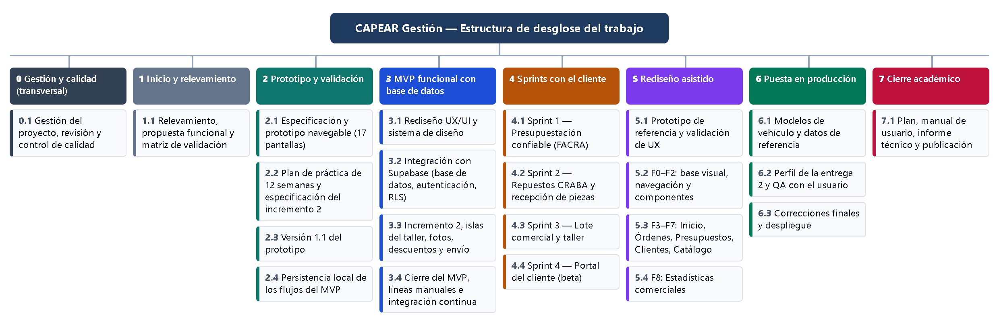
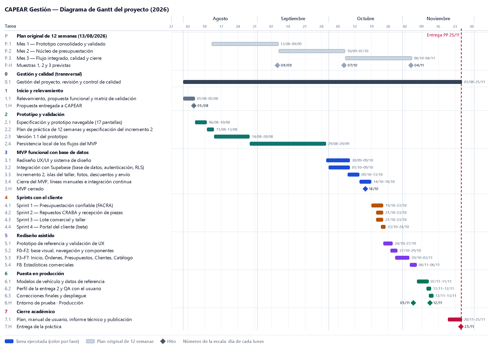

# Parte I — Plan de Desarrollo de Software

## 1. Introducción

### 1.1 Propósito del documento

Este documento es el Plan de Desarrollo de Software del proyecto **CAPEAR Gestión**, realizado en el marco de las Prácticas Profesionalizantes. Describe qué se construyó y para quién (requerimientos y alcance), quiénes participan y con qué responsabilidades (roles), cómo se trabajó (metodología y herramientas), qué tareas componen el proyecto y cómo se distribuyeron en el tiempo (planificación), qué riesgos se identificaron y con qué criterios se considera aceptado el resultado.

El plan se redacta con el proyecto ya avanzado: el sistema fue especificado, implementado y puesto en funcionamiento en etapas entre agosto y noviembre de 2026. Por eso, además de los requerimientos y el alcance previstos, el documento indica **en qué entrega se implementó cada requerimiento** y **en qué estado se encuentra**, de modo que pueda leerse tanto como plan como memoria de lo efectivamente realizado.

Los lectores previstos son el docente tutor, los integrantes del grupo y, eventualmente, el referente de la empresa. Las decisiones y reglas que se citan con un código (por ejemplo, D-49 o BR-01) se explican en el mismo documento.

### 1.2 La empresa

**Rectificaciones CAPEAR** es un taller de rectificación de motores. Recibe motores de clientes particulares, mecánicos, empresas y transportistas, los desarma y lava, mide y ensaya sus piezas (cigüeñales, tapas de cilindros, bielas, entre otras), propone los trabajos necesarios y, una vez aprobados por el cliente, los ejecuta en distintas estaciones o «islas» del taller; luego reúne las piezas, arma el motor y lo entrega.

Según el relevamiento realizado con la empresa, el funcionamiento previo al proyecto era el siguiente:

- Los **presupuestos** se confeccionaban de forma manual, consultando, recordando o reescribiendo operaciones, repuestos y valores.
- El **libro de caja diario**, el registro de operaciones y la entrada de motores se llevaban en buena parte en cuadernos. Las cuentas corrientes ya estaban digitalizadas.
- Para presupuestar la mano de obra se usa una **lista orientadora de precios por operación** publicada por una federación del rubro, en la que cada motor corresponde a una lista numerada (del 1 al 13), sobre la cual la empresa ajusta a criterio. Los repuestos se consultan en una lista de precios de referencia de un proveedor.
- Existen **condiciones comerciales distintas según el tipo de cliente** (particulares, mecánicos, empresas y transporte).
- Los motores suelen ingresar armados y sucios, de modo que hay **dos presupuestos**: uno inicial, antes del desarme, y uno definitivo, después del desarme, lavado y mediciones.

El flujo real informado por la empresa es: solicitud de presupuesto, presupuesto inicial, aceptación, ingreso del motor con número de entrada y fotos de llegada, desarme, lavado y medición, presupuesto definitivo, segunda decisión del cliente (si rechaza, se cobran los trabajos de diagnóstico realizados), orden de trabajo con seña, trabajo por islas (incluido trabajo externo), armado y empaque, y facturación, cobro y entrega.

### 1.3 Problema y oportunidad

El mayor cuello de botella informado por la empresa es la **realización de presupuestos**. La elaboración manual provoca pérdida de tiempo, repetición de tareas, dificultad para mantener valores uniformes y riesgo de errores de cálculo. Además, cuando el cliente acepta, la información debe cargarse otra vez en la orden de trabajo y acompañar el diagnóstico posterior.

La **oportunidad** es digitalizar el núcleo de presupuestación sobre un catálogo tipificado de mano de obra, repuestos, ensayos y servicios, y conectarlo con el inicio y el seguimiento básico de la orden de trabajo, con trazabilidad de precios, decisiones y estados. La empresa espera, además, que el trabajo sea el punto de partida de un sistema integral futuro (operación, economía, informes), pero la primera versión debe mantenerse deliberadamente acotada: no se trata de un ERP genérico.

### 1.4 Definiciones y abreviaturas

| Término | Definición |
|---|---|
| CAPEAR | Rectificaciones CAPEAR, empresa para la que se desarrolla el sistema. |
| MVP | Producto mínimo viable: primer incremento funcional (pantallas 01 a 17 del anexo de maquetas). |
| Presupuesto inicial | Estimación previa al ingreso o al diagnóstico completo del motor. |
| Presupuesto definitivo / revisión | Propuesta posterior al desarme, lavado y mediciones; en el sistema se modela como revisión versionada de la orden. |
| OT | Orden de trabajo. Se crea automáticamente, y una sola vez, al aceptarse un presupuesto inicial (BR-01). |
| PR / OT (numeración) | Números correlativos únicos de presupuestos (PR-00001) y órdenes (OT-00001) (BR-07). |
| Isla | Estación o sector del taller (por ejemplo cigüeñales, tapa de cilindros, bielas). |
| Snapshot | Copia histórica de descripción, unidad y precio de una línea al momento de presupuestar (BR-04). |
| FACRA | Lista orientadora de precios de mano de obra por operación, con 13 listas según el motor. |
| CRABA | Lista de precios de repuestos usada como referencia al presupuestar. No implica compras ni stock. |
| Seña | Anticipo registrado sobre una orden de trabajo (D-49). |
| Hoja de taller | Documento imprimible por orden con las operaciones por isla, sin ningún importe. |
| RLS | *Row Level Security*: reglas de seguridad por fila de la base de datos PostgreSQL. |
| RPC | Función de la base de datos invocada por la aplicación para operaciones críticas y transaccionales. |
| TDD | *Test-driven development*: desarrollo guiado por pruebas. |
| PR (pull request) | Solicitud de integración de cambios en GitHub, sujeta a revisión (no confundir con el prefijo PR- de presupuesto). |
| E2E | Pruebas de extremo a extremo, ejecutadas sobre un navegador real. |
| EDT | Estructura de desglose del trabajo. |
| Decisión D-xx, pregunta Q-xx | Registro numerado de decisiones y preguntas abiertas del proyecto. |
| Códigos de casos de uso (AUTH-, CLI-, MOT-, CAT-, PRE-, DEC-, OT-, AUD-, EST-, POR-) | Identificadores de los casos de uso del documento de producto; se conservan como referencia cruzada. |
| Reglas P1 a P12 | Doce reglas de diseño de la interfaz del rediseño; por ejemplo, una sola próxima acción por registro, estado real y acciones que se pueden deshacer. |
| Fases F0 a F8 | Fases de implementación del rediseño: F0 a F2, base visual, navegación y componentes; F3 a F7, pantallas; F8, estadísticas. |
| Asistido | La interfaz guía al usuario con un resumen y la próxima acción sugerida, calculados con reglas fijas a partir de los datos registrados. |
| PP | Prácticas Profesionalizantes. |

## 2. Objetivos

### Objetivo general

Desarrollar e implantar una aplicación web de escritorio que permita a CAPEAR generar presupuestos de forma rápida, ordenada y estandarizada a partir de un catálogo tipificado, asociarlos a clientes y motores, convertir el presupuesto inicial aceptado en una orden de trabajo y realizar su seguimiento básico, con trazabilidad de precios, decisiones y estados.

### Objetivos específicos

Cada objetivo tiene un indicador verificable. Cuando la meta numérica depende de datos que la empresa aún no entregó, se indica expresamente.

| N.º | Objetivo específico | Indicador de cumplimiento |
|---|---|---|
| OE-1 | Registrar clientes, motores y catálogo (mano de obra, repuestos, ensayos y servicios) con baja lógica e historial de precios. | Alta, edición, búsqueda y desactivación sin pérdida de historial; el precio vigente cambia sin alterar presupuestos ya emitidos. |
| OE-2 | Automatizar el armado y el cálculo del presupuesto inicial. | El mismo conjunto de líneas produce siempre el mismo total; cálculos con decimales exactos y cubiertos por pruebas automatizadas (BR-09, BR-10). |
| OE-3 | Eliminar la doble carga entre presupuesto y orden. | La aceptación de un presupuesto inicial genera exactamente una orden que hereda cliente, motor y líneas; una segunda aceptación no genera otra (BR-01, BR-15). |
| OE-4 | Conservar trazabilidad y auditoría de las acciones críticas. | Emisión, decisión, cambio de precio, cambio de estado y anulación registran usuario y fecha; los documentos emitidos se anulan, no se borran (BR-06, BR-19). |
| OE-5 | Proteger la información económica frente al personal de planta. | El rol de planta no recibe precios, impuestos, descuentos, recargos, seña ni totales, ni desde la interfaz ni desde la capa de datos (BR-18). |
| OE-6 | Dar seguimiento básico y detallado a la orden de trabajo. | Estado general, responsable, próxima acción, islas, piezas y fotos consultables y actualizables según el rol. |
| OE-7 | Reducir el tiempo de elaboración de un presupuesto. | Meta cuantitativa a acordar con CAPEAR una vez medida la línea base: tiempo medio por presupuesto antes y después de usar el sistema. |
| OE-8 | Poner el sistema en funcionamiento real en la empresa. | Aplicación publicada, con base de datos de producción, datos iniciales cargados y recorrido completo verificado (entrega 2). |

## 3. Requerimientos

### 3.1 Partes interesadas y tipos de usuario

| Parte interesada | Interés y participación |
|---|---|
| Responsable de CAPEAR (referente de la empresa) | Actúa como dueño del producto: aporta el relevamiento, valida el alcance y las reglas, y usa el sistema como administración. |
| Personal administrativo del taller | Arma y emite presupuestos, registra decisiones, gestiona clientes y órdenes. |
| Gerencia | Mismas capacidades comerciales, con control de anulaciones y estadísticas. |
| Personal de planta | Consulta órdenes y hoja de taller, registra avances y fotos, sin ver información económica. |
| Clientes de CAPEAR | No son usuarios del sistema; reciben documentos (PDF, constancia de recepción) y mensajes, y, en la versión beta del portal, consultan el estado de su orden con un enlace privado. |
| Equipo de desarrollo | Analiza, diseña, implementa, prueba y documenta. |
| Docente tutor | Evalúa el proceso y los entregables de las Prácticas Profesionalizantes. |

Los tipos de usuario del sistema se detallan en la sección 5.3.

### 3.2 Requerimientos funcionales

Las columnas «Entrega» y «Estado» indican cuándo se implementó el requerimiento y su situación actual. Las entregas se describen en la sección 4.1. «Implementado, desactivado en producción» significa que el código y los datos existen, pero el módulo está oculto en la versión entregada a la empresa por decisión del dueño del producto (D-62, D-63, D-70, D-72 y D-78); mostrarlo de nuevo no requiere desarrollo, solo una nueva compilación.

| ID | Requerimiento | Prioridad | Entrega | Estado |
|---|---|---|---|---|
| RF-01 | Inicio de sesión con correo y contraseña, con opción «Recordarme» (AUTH-01). | Alta | MVP | Implementado |
| RF-02 | Roles (administración, gerencia, planta) aplicados en la interfaz y en la capa de datos (AUTH-02). | Alta | MVP | Implementado |
| RF-03 | Desactivar un usuario sin perder las acciones históricas que realizó (AUTH-04). | Alta | MVP | Implementado |
| RF-04 | Pantalla de administración de usuarios. | Baja | — | Fuera de alcance (diferido por decisión del dueño del producto; hoy los usuarios se crean en el proveedor de autenticación) |
| RF-05 | Alta, edición, consulta y búsqueda de clientes (persona o empresa; CUIT obligatorio para empresas), con aviso de CUIT duplicado (CLI-01 a CLI-03). | Alta | MVP | Implementado |
| RF-06 | Ficha de cliente con sus motores, presupuestos y órdenes; desactivación sin eliminar historial (CLI-04, CLI-05). | Alta | MVP | Implementado |
| RF-07 | Categorías comerciales de cliente, con porcentaje de descuento configurable (D-29, BR-24). | Alta | Ampliaciones de octubre | Implementado |
| RF-08 | Alta, edición, búsqueda y vínculo de motores con cliente; número interno único (MOT-01 a MOT-04). | Alta | MVP | Implementado |
| RF-09 | Carga asistida del motor en cascada marca, modelo y motor del nomenclador FACRA, que completa lista, cilindros y válvulas cuando el dato existe (D-57). | Media | Sprint 1; ampliación de noviembre | Implementado |
| RF-10 | Catálogo con cuatro tipos (mano de obra, repuesto, ensayo/medición, servicio), código único, categoría, unidad, precio vigente, historial de precios y desactivación lógica (CAT-01 a CAT-04). | Alta | MVP | Implementado |
| RF-11 | Búsqueda y filtro del catálogo por código, descripción, tipo y categoría (CAT-05). | Media | MVP | Implementado |
| RF-12 | Importación versionada de la lista FACRA y sugerencia de precio y cantidad por operación según la lista del motor, con opción de aceptar o cambiar el precio (BR-39). | Alta | Sprint 1 | Implementado |
| RF-13 | Referencia de precios de repuestos CRABA: carga, comparación y activación de versiones por administración, y búsqueda al presupuestar con alta como línea manual (CAT-07, D-46, BR-42). | Media | Sprint 2 | Implementado |
| RF-14 | «Elegir de la planilla»: tildar operaciones y materiales agrupados como la planilla de la empresa, con orden de grupos editable (PRE-13, BR-45). | Media | Sprint 2 | Implementado |
| RF-15 | Asistente de presupuesto inicial: cliente y motor obligatorios, líneas del catálogo, cantidades, notas y resumen (PRE-01, PRE-02, PRE-03). | Alta | MVP; real desde octubre | Implementado |
| RF-16 | Cada línea conserva un snapshot de descripción, unidad, precio, contexto tributario y origen del precio; cambios del catálogo no alteran lo emitido (PRE-04, BR-04). | Alta | MVP | Implementado |
| RF-17 | Guardar y reanudar borradores de presupuesto (PRE-07). | Alta | Ampliaciones de octubre | Implementado |
| RF-18 | Cálculo automático de subtotal, descuento por categoría (solo ítems elegibles), IVA opcional y total, con decimales exactos (PRE-06, BR-10, BR-40, BR-41). | Alta | MVP; Sprint 1 | Implementado |
| RF-19 | Recargo interno por presupuesto, con motivo obligatorio, que el cliente nunca ve (PRE-14, BR-46). | Media | Sprint 3 | Implementado |
| RF-20 | Líneas manuales (fuera del catálogo) y precio modificado por línea, sin alterar el catálogo (BR-37). | Alta | Ampliaciones de octubre | Implementado |
| RF-21 | Emisión del presupuesto: número único, documento congelado, vigencia configurable (7 días por defecto) y estado «vencido» calculado (PRE-08, BR-05, BR-07, BR-08, BR-33). | Alta | MVP; cierre del MVP | Implementado |
| RF-22 | Vista previa y PDF reproducible del documento del cliente (solo precios finales, datos del taller, «no válido como factura») y envío por WhatsApp o correo (PRE-09, D-33). | Alta | MVP; Ampliaciones de octubre | Implementado |
| RF-23 | Anular un presupuesto inicial con motivo, y duplicarlo como presupuesto nuevo a precios actuales (BR-06, BR-34). | Media | Cierre del MVP | Implementado |
| RF-24 | Registrar la decisión del cliente (aceptación o rechazo) con fecha, medio, persona que confirma, observación y usuario registrador (DEC-01, BR-13). | Alta | MVP | Implementado |
| RF-25 | Creación automática, idempotente y transaccional de una única orden al aceptar un presupuesto inicial (DEC-02, OT-01, BR-01, BR-15). | Alta | MVP | Implementado |
| RF-26 | Motivo de rechazo obligatorio, elegido de una lista configurable (DEC-04, BR-47). | Media | Sprint 3 | Implementado |
| RF-27 | Listado y ficha de órdenes con estado general, responsable, fechas y próxima acción; cambios de estado válidos y auditados (OT-01 a OT-04). | Alta | MVP | Implementado |
| RF-28 | Cancelar una orden abierta con motivo, sin borrarla (BR-36). | Media | Cierre del MVP | Implementado |
| RF-29 | Diagnóstico estructurado y mediciones con tolerancias (OT-06, OT-07). | Media | Incremento 2 | Implementado |
| RF-30 | Revisión de presupuesto (definitivo) con versionado, comparación contra el inicial, envío y decisión; bloqueo por aprobación pendiente (PRE-11, PRE-12, OT-08). | Media | Incremento 2 | Implementado |
| RF-31 | Islas del taller: ruta por orden, seguimiento por isla, trabajo externo y carga por isla. | Media | Ampliaciones de octubre | Implementado |
| RF-32 | Seguimiento por pieza o componente, con ubicación, envío a terceros, reunión para el armado y destino al entregar (D-34, BR-25 a BR-31). | Media | Ampliaciones de octubre | Implementado |
| RF-33 | Registro de procesos de texto libre en la orden (OT-03). | Baja | MVP | Implementado, desactivado en producción (D-72) |
| RF-34 | Reloj de tiempos reales por isla. | Baja | Ampliaciones de octubre | Implementado, desactivado en producción (D-70) |
| RF-35 | Fotos de la orden: carga desde el celular, administración desde escritorio, internas hasta que administración las publica (D-29, D-30). | Alta | Ampliaciones de octubre | Implementado |
| RF-36 | «Recepción rápida» de piezas sueltas con «estado al recibir» y constancia de recepción congelada, con fotos, para imprimir y enviar (OT-09, BR-43, BR-54). | Media | Sprint 2 | Implementado |
| RF-37 | Control de entrega y de cancelación que avisa sin bloquear (BR-44). | Media | Sprint 2 | Implementado |
| RF-38 | Presupuesto vigente de la orden, registro de la seña y saldo, con aviso que no bloquea (OT-10, BR-48). | Media | Sprint 3 | Implementado |
| RF-39 | Hoja de taller imprimible por orden y por isla, sin ningún importe, accesible a los tres roles (OT-11, D-51). | Media | Sprint 3 | Implementado |
| RF-40 | «Avisar al cliente» por WhatsApp con mensajes armados sin importes, y selección de hasta 10 fotos para compartir (OT-12, D-52). | Media | Sprint 3 | Implementado |
| RF-41 | Campana de avisos por usuario con la lista «Para hoy», datos recargados al volver a la pestaña y cada 5 minutos (OT-13, D-52, D-55). | Media | Sprint 3; rediseño asistido | Implementado |
| RF-42 | Estadísticas comerciales: importes presupuestados y aceptados (sin IVA), tasas, tiempos y motivos de rechazo; nunca lo cobrado ni la ganancia (EST-01, BR-49). | Baja | Sprint 3; rediseño (fase 8) | Implementado, desactivado en producción (D-62) |
| RF-43 | Portal del cliente beta: enlace privado y revocable por orden, página de solo lectura con estado, presupuestos con precios finales, fotos publicadas y contacto por WhatsApp, y «visto por el cliente» (POR-01 a POR-03, BR-50 a BR-53). | Baja | Sprint 4 | Implementado, desactivado en producción (D-62) |
| RF-44 | Capa asistida del rediseño: resumen y «Para hoy» en Inicio, lecturas de cada lista, «próxima acción» calculada por una única regla de dominio y vista de evidencia (reglas P1 a P12). | Media | Rediseño asistido | Implementado, desactivado en producción (D-63); la tarjeta de próxima acción de la orden y del presupuesto permanece activa |
| RF-45 | Configuración de parámetros del sistema (vigencia, IVA, datos del taller, motivos, categorías) y de la sección «Sistema» con la descripción de permisos por rol. | Media | MVP; Sprint 1 a 3 | Implementado (la sección «Sistema» está desactivada en producción, D-78) |
| RF-46 | Auditoría de clientes, motores, catálogo, presupuestos y órdenes: quién, cuándo y qué campos cambiaron (AUD-01, BR-19). | Alta | MVP; cierre del MVP | Implementado |
| RF-47 | Facturación fiscal e integración tributaria. | — | — | Fuera de alcance |
| RF-48 | Inventario, movimientos de stock y compras a proveedores. | — | — | Fuera de alcance |
| RF-49 | Pagos, cobranzas, libro de caja y cuentas corrientes (se exceptúa el registro de la seña, RF-38). | — | — | Fuera de alcance |
| RF-50 | Aceptación digital de presupuestos desde el portal, cuentas de cliente, firma digital y mensajería dentro del sistema. | — | — | Fuera de alcance |
| RF-51 | Aplicación móvil dedicada y trabajo sin conexión. | — | — | Fuera de alcance |

### 3.3 Requerimientos no funcionales

| ID | Categoría | Requerimiento | Criterio de aceptación |
|---|---|---|---|
| RNF-01 | Usabilidad (escritorio) | La aplicación se diseña para escritorio, con viewport de aceptación de 1600×1000 y ancho mínimo soportado de 1280 px (BR-22). | Cada pantalla se revisa a 1600 y a 1280 px sin desbordes ni texto cortado, y con revisión humana de capturas. |
| RNF-02 | Usabilidad (móvil) | Exactamente tres pantallas funcionan en el celular: inicio de sesión, carga de fotos y portal del cliente (D-30, D-54). | Revisión a 390×844 en vertical; el portal además a 1280 y 1600 px. |
| RNF-03 | Usabilidad | Interfaz coherente, con reglas comunes de asistencia (una sola próxima acción por registro, estado honesto, pasos finales que se deshacen, reglas P1 a P12) y estilos solo a partir de tokens de diseño. | Revisión de capturas contra el sistema de diseño; ningún control habilitado que no haga nada. |
| RNF-04 | Accesibilidad | Navegación por teclado y contraste razonable; iconos vectoriales, sin emoji como íconos. | Controles interactivos accesibles; verificación automatizada de accesibilidad en las pantallas principales. |
| RNF-05 | Rendimiento | Las acciones habituales responden en 2 segundos o menos bajo carga normal, una vez conectado el servidor. | Medición en el entorno de validación con datos de prueba. |
| RNF-06 | Seguridad y roles | Autorización en la capa de datos mediante RLS y funciones RPC por rol; las restricciones de la interfaz son una defensa adicional, no la barrera. | Pruebas que verifican que planta no obtiene datos económicos y que las operaciones sin permiso son rechazadas por la base. |
| RNF-07 | Seguridad | La aplicación del navegador usa solo una clave pública; las claves secretas nunca se incluyen en el código ni en el repositorio; el registro público de usuarios está deshabilitado. | Revisión del repositorio y de la configuración del proyecto alojado; el arranque rechaza claves secretas. |
| RNF-08 | Privacidad | Los datos de desarrollo, pruebas, capturas y demostraciones son exclusivamente ficticios o anonimizados (BR-20). El portal expone solo una lista blanca de datos de su orden. | Búsqueda de datos reales en el repositorio sin hallazgos; pruebas de fuga de datos sobre el portal. |
| RNF-09 | Auditoría y trazabilidad | Las acciones críticas registran actor y fecha fijados por el servidor; no se eliminan presupuestos emitidos ni órdenes (BR-06, BR-19). | Pruebas de integración sobre la auditoría; ausencia de borrado físico de documentos emitidos. |
| RNF-10 | Integridad | La aceptación de un presupuesto inicial es idempotente y transaccional: doble clic o reintento no duplica la orden (BR-01). | Prueba automatizada de doble aceptación. |
| RNF-11 | Precisión monetaria | Los importes se calculan con aritmética decimal exacta y redondeo mitad hacia arriba a dos decimales, igual en TypeScript, demostración y SQL (BR-09, BR-10). | Pruebas unitarias tabulares; resultados idénticos entre capas. |
| RNF-12 | Formatos regionales | Fechas `dd/mm/aaaa`, localidad `es-AR`, zona horaria America/Argentina/Buenos_Aires, moneda ARS configurable. | Pruebas de formato y de vencimientos con reloj controlado. |
| RNF-13 | Mantenibilidad | TypeScript en modo estricto, módulos por funcionalidad, reglas de negocio como funciones puras, repositorios intercambiables y reglas variables centralizadas (BR-21). | Compilación, análisis estático y pruebas en verde antes de integrar cada cambio. |
| RNF-14 | Calidad | Cambios de comportamiento con pruebas automatizadas (unitarias, de componente, de extremo a extremo y de base de datos), ejecutadas de nuevo antes de dar una tarea por terminada. | Suites ejecutadas en cada entrega y en la integración continua. |
| RNF-15 | Compatibilidad | Aplicación web para navegadores de escritorio actuales. | Verificada en Microsoft Edge (Chromium), el navegador de las pruebas automatizadas; otros navegadores basados en Chromium comparten el mismo motor. |
| RNF-16 | Disponibilidad y respaldo | Entorno de validación separado del de producción; despliegue verificable. | Verificación posterior a cada despliegue. Respaldos cifrados de la base de producción: el mecanismo existe pero falta activarlo (Parte III, sección 14.1). |

### 3.4 Reglas de negocio principales

Las reglas completas se encuentran en el documento de reglas de negocio del repositorio y prevalecen sobre cualquier texto ilustrativo de las maquetas. Las más importantes son:

- **BR-01 y BR-02 — Orden única.** Aceptar un presupuesto inicial crea como máximo una orden; antes de la aceptación, un presupuesto inicial no tiene orden asociada.
- **BR-04 — Snapshot histórico.** Cada línea conserva descripción, unidad, precio y contexto tributario; el catálogo cambia sin afectar documentos emitidos.
- **BR-05 y BR-06 — Emisión y anulación.** Un presupuesto emitido queda congelado y no vuelve a borrador; los presupuestos emitidos y las órdenes no se eliminan, se anulan o cancelan con motivo y auditoría.
- **BR-07 y BR-08 — Numeración y vigencia.** Números PR y OT únicos, secuenciales y no reutilizables; la validez del presupuesto sale de un parámetro (7 días provisionales). El estado «vencido» se calcula y bloquea la decisión (BR-33).
- **BR-09 y BR-10 — Dinero y fórmula.** Aritmética decimal exacta; el descuento comercial se aplica antes del IVA y solo a las líneas elegibles, y luego el recargo interno a todas las líneas.
- **BR-13 y BR-14 — Decisión del cliente.** Se registran resultado, fecha, medio, persona y observación; un rechazo es un hecho histórico que no se sobrescribe.
- **BR-17 — Estado general más etapas.** La orden mantiene un estado general; las islas son una capa de detalle configurable, no un recorrido rígido.
- **BR-18 — Planta sin economía.** El personal de planta no recibe precios, impuestos, descuentos, recargos, seña, saldo ni totales; la hoja de taller se entrega sin ningún importe.
- **BR-19 y BR-20 — Auditoría y datos ficticios.** Acciones críticas con actor y fecha; todo dato de desarrollo y demostración es ficticio.
- **BR-23 — El descuento y el recargo interno nunca se muestran al cliente.** El cliente recibe precios finales, sin rastro de ajustes.
- **BR-39 — Precio sugerido FACRA.** El servidor sugiere precio y cantidad; solo el guardado de un borrador recalcula, y emitir no recalcula nada.
- **BR-46 a BR-49 — Lote comercial.** Recargo interno con motivo, motivo de rechazo obligatorio, presupuesto vigente y seña como excepción acotada, y estadísticas de lo presupuestado y aceptado, nunca de lo cobrado ni de la ganancia.
- **BR-50 a BR-53 — Portal del cliente.** Un enlace activo por orden, anulable, con vigencia posterior al cierre y lista blanca de contenido.

## 4. Alcance

### 4.1 Incluido

El alcance se organiza por entregas. Las fechas corresponden a la documentación de diseño de cada una.

**MVP (agosto a octubre de 2026).** Inicio de sesión y roles; clientes; motores; catálogo con historial de precios; asistente de presupuesto inicial, cálculo, emisión y vista previa; decisión del cliente; creación idempotente de una orden por aceptación; listado y ficha de órdenes con estado general, responsable y procesos básicos; auditoría mínima. La base técnica fue un prototipo navegable de las pantallas 01 a 17 con datos de prueba deterministas, seguido de persistencia local y, desde el 01/10/2026, de la integración con una base de datos relacional con autenticación y reglas de seguridad por fila, además de una renovación de la experiencia visual.

**Incremento 2.** Diagnóstico estructurado con mediciones, revisión de presupuesto (el presupuesto definitivo posterior al desarme), comparación entre inicial y revisión, bloqueo hasta la aprobación del cliente y etapas configurables.

**Ampliaciones de octubre de 2026.** Fotos de las órdenes (carga desde el celular); islas del taller; presupuesto inicial real y descuentos por categoría comercial; seguimiento por componente; cierre del MVP (anulación de emitidos, cancelación de órdenes, vencimiento calculado, auditoría ampliada); líneas manuales, precio modificado y robustez (manejo de errores, análisis estático e integración continua).

**Sprint 1 — Presupuestación confiable (19/10/2026).** Lista FACRA versionada con precio y cantidad sugeridos por operación; carga asistida del motor; descuento solo sobre ítems elegibles; IVA opcional; documento del cliente con los datos del taller.

**Sprint 2 — Repuestos y recepción (21/10/2026).** Referencia CRABA; «Elegir de la planilla»; recepción rápida de piezas, constancia de recepción congelada con fotos y control de entrega sin bloqueo.

**Sprint 3 — Lote comercial y taller (21/10/2026).** Recargo interno con motivo; motivo de rechazo obligatorio; presupuesto vigente, seña y saldo; hoja de taller; campana de avisos; «Avisar al cliente» por WhatsApp y compartir fotos; estadísticas comerciales.

**Sprint 4 — Portal del cliente beta (23/10/2026).** Enlace privado y revocable por orden y página de solo lectura para el cliente, con una única puerta pública de acceso a los datos.

**Rediseño asistido (24 al 27/10/2026 el diseño; fases de implementación hasta noviembre).** Rediseño de todas las pantallas del personal con reglas comunes P1 a P12: resumen inicial y próxima acción calculada por una sola regla, lista «Para hoy», estado real, acciones que se pueden deshacer, fichas y formularios unificados, y estadísticas rediseñadas. No agrega datos de negocio nuevos.

**Entrega 2 — puesta en producción (noviembre de 2026).** Versión alojada para la empresa con un perfil de entrega que **oculta, sin eliminar**, los módulos Estadísticas y portal del cliente (D-62), la capa asistida (D-63), el reloj de tiempos de isla (D-70), los procesos de texto libre (D-72) y la sección «Sistema» de configuración (D-78). Permanecen activos catálogo, listas FACRA y CRABA, presupuestos con revisiones y diagnóstico, órdenes, islas, piezas, fotos, recepción, seña y hoja de taller. Se cargaron la lista FACRA y los catálogos iniciales de la empresa, y se realizó una revisión completa del flujo con un recorrido de calidad en el rol de administración.

### 4.2 Excluido explícitamente

Se excluyen de forma expresa, aunque aparezcan en maquetas o documentos de origen antiguos:

- Aplicación móvil y diseños móviles específicos, salvo las tres pantallas indicadas en RNF-02.
- Trabajo sin conexión.
- Inventario y movimientos de stock; compras a proveedores. La referencia CRABA es solo de precios.
- Pagos, cobranzas, libro de caja y cuentas corrientes, salvo registrar la seña de una orden.
- Facturación fiscal e integraciones con organismos tributarios.
- Reportes económicos, rentabilidad y ganancia; solo existen estadísticas comerciales de lo presupuestado y aceptado.
- Automatización de garantías.
- Aceptación o firma digital desde el portal, cuentas o contraseñas de clientes, chat y mensajería dentro del sistema.
- Pantalla de administración de usuarios (diferida).
- Etiquetas o códigos QR de piezas, integración con WhatsApp mediante API, atención automática por voz y comparación automática con precios web: ideas planteadas por la empresa, mantenidas en exploración y no aprobadas como requisito.

### 4.3 Supuestos y restricciones

**Supuestos**

- La empresa participa como fuente de requisitos y validación durante todo el proyecto; las preguntas no bloqueantes se resuelven con valores provisorios configurables hasta recibir respuesta (por ejemplo IVA, vigencia de 7 días y nombres de etapas).
- Los datos reales no se usan en desarrollo: solo ficticios o anonimizados, salvo la carga controlada de datos de la propia empresa en producción.
- El taller trabaja con una sola cuenta de administración mientras la gestión de usuarios esté diferida.
- La seña del 50 % mencionada por la empresa no está confirmada como regla universal; la aplicación registra una seña como dato de la orden, sin imponer porcentaje (pendiente de la empresa).

**Restricciones**

- Plataforma web de escritorio, con las tres excepciones móviles indicadas.
- Los valores de documentos legales, datos institucionales y plantilla definitiva del PDF quedan reemplazables hasta recibir un documento de origen anonimizado.
- Los datos de las listas de precios de terceros se usan como referencia, con exclusiones expresas sobre su uso (BR-42).
- Dedicación del equipo: unas 10 horas semanales por integrante, alrededor de 30 horas semanales en total, compatibles con el cursado de 6.º año. Entre agosto y noviembre de 2026 eso suma unas 500 horas de trabajo.
- La entrega final de las Prácticas Profesionalizantes vence el 25/11/2026.

## 5. Roles y responsabilidades

### 5.1 Equipo de desarrollo

El equipo está formado por tres alumnos de 6.º año, orientación Computación, del Instituto La Salette. Cada integrante tiene un área de responsabilidad principal, en la que toma las decisiones y responde por el resultado, y colabora en las áreas de los demás.

| Integrante | Rol | Responsabilidades principales |
|---|---|---|
| **Santiago Postiglione** | Líder de proyecto, visión de producto y desarrollo full stack | Define la visión del producto y la arquitectura del sistema. Coordina al equipo y es el nexo con CAPEAR: relevamiento, validación del alcance y demostraciones. Prioriza el trabajo de cada entrega. Desarrolla la interfaz y la lógica del servidor, revisa e integra los cambios y realiza los despliegues. |
| **Ricardo Hernández** | Planificación y diseño UX/UI | Elabora y sigue el plan de desarrollo: desglose de tareas, cronograma, diagrama de Gantt e hitos, con registro de avances y desvíos. Diseña la experiencia y la interfaz: maquetas, flujos de pantalla y sistema visual, y revisa las capturas de cada pantalla. Redacta el manual del usuario. |
| **Thiago Soria** | Base de datos y calidad (QA) | Diseña el modelo de datos: entidades, relaciones, migraciones y reglas de acceso por rol. Define y ejecuta las pruebas: casos de las reglas críticas, pruebas de la base de datos y recorridos de extremo a extremo, con registro y seguimiento de los hallazgos. |

La matriz siguiente muestra la participación de cada integrante por área de trabajo.

| Área | Santiago Postiglione | Ricardo Hernández | Thiago Soria |
|---|:---:|:---:|:---:|
| Visión de producto y arquitectura | **R** | C | C |
| Relevamiento y vínculo con CAPEAR | **R** | C | C |
| Planificación, cronograma y seguimiento | C | **R** | — |
| Diseño UX/UI | C | **R** | — |
| Desarrollo de la interfaz | **R** | C | — |
| Desarrollo de la lógica del servidor | **R** | — | C |
| Modelo de datos, migraciones y seguridad por rol | C | — | **R** |
| Pruebas y control de calidad | C | C | **R** |
| Despliegue y puesta en producción | **R** | — | C |
| Plan de desarrollo | C | **R** | C |
| Manual del usuario | C | **R** | C |
| Informe técnico-funcional | **R** | — | C |

**R**: responsable; C: colabora; —: sin participación directa.

### 5.2 Partes interesadas externas

| Parte | Rol en el proyecto |
|---|---|
| Referente de CAPEAR (dueño del producto) | Aporta el relevamiento, responde las preguntas de validación, aprueba el alcance y las reglas y confirma el resultado en la empresa. |
| Personal del taller | Participa en el relevamiento y en las simulaciones del flujo; usuario final de administración y de planta. |
| Docente tutor: Hugo Rodríguez (Instituto La Salette) | Orienta y evalúa el proceso, el alcance y los entregables de las Prácticas Profesionalizantes. |

### 5.3 Roles de usuario del sistema

El sistema define tres roles de usuario: `admin` (Administración), `manager` (Gerencia) y `plant` (Planta), equivalentes a los perfiles administrativo, gerente y planta de la propuesta funcional.

| Rol | Capacidades principales |
|---|---|
| Administración (`admin`) | Clientes, motores, catálogo, listas FACRA y CRABA, presupuestos, decisiones, órdenes, anulaciones, seña, recargo interno, motivos de rechazo, portal y parámetros de configuración. Es el único que modifica ciertos parámetros del sistema, como los días de vigencia del enlace del portal. |
| Gerencia (`manager`) | Las mismas capacidades comerciales y de órdenes que administración; ve estadísticas y configuración, con alcance de modificación más acotado. |
| Planta (`plant`) | Consulta las órdenes y su hoja de taller, actualiza estados, procesos, islas, piezas y fotos según permiso, **sin recibir ninguna información económica** (BR-18); no ve la existencia del recargo, los motivos de rechazo ni la seña. |
| Cliente (no es usuario) | Accede, sin cuenta, solo a la página del portal por medio de un enlace privado, que es la llave y la única puerta; el rol anónimo no tiene acceso a la base. |

## 6. Metodología y herramientas

**Enfoque.** El proyecto siguió un desarrollo **iterativo e incremental**. En una primera etapa se organizó en tres ciclos mensuales con una muestra prevista al final de cada uno (base operativa, presupuestación completa y flujo integrado con la presentación final), según el plan original de 12 semanas. Al incorporarse la persistencia real, los pedidos concretos de la empresa y la puesta en producción, el trabajo pasó a organizarse en **ampliaciones y sprints** temáticos (sprints 1 a 4, rediseño asistido por fases y entrega 2), cada uno con su documento de diseño.

**Ciclo de trabajo de cada entrega.**

1. **Análisis y diseño:** documento con objetivo, decisiones, reglas y preguntas abiertas, validado con el dueño del producto. Las decisiones se registran con número (D-xx) y las dudas con valores provisorios configurables (Q-xx).
2. **Planificación:** división en tareas con sus pruebas y criterios de aceptación.
3. **Implementación con pruebas primero (TDD):** prueba que falla, mínima implementación, refactor.
4. **Revisión por pull request:** cada bloque de trabajo se integra mediante una solicitud de integración revisada antes de pasar a la rama principal.
5. **Verificación:** análisis estático, compilación, pruebas unitarias, de componente, de base de datos y de extremo a extremo, y revisión visual de capturas cuando cambia la interfaz.
6. **Despliegue y verificación posterior** en el entorno de validación y, con aprobación, en producción.

**Herramientas.**

| Ámbito | Herramienta |
|---|---|
| Control de versiones y colaboración | Git y GitHub (ramas, pull requests, revisión) |
| Interfaz | React 19, TypeScript estricto, Vite, React Router, React Hook Form, Zod, Radix con estilos propios, Lucide |
| Datos y autenticación | Supabase: PostgreSQL con RLS, funciones RPC, autenticación, almacenamiento de imágenes y funciones de borde |
| Alojamiento | Cloudflare (aplicación web); entornos de validación y de producción separados |
| Pruebas | Vitest y Testing Library; Playwright sobre Microsoft Edge; pruebas de la base de datos |
| Calidad | ESLint, compilación estricta de TypeScript e integración continua |
| Diseño y documentación | Markdown versionado en el repositorio, sistema de diseño con tokens propios |

## 7. Tareas del proyecto (EDT)

La estructura de desglose del trabajo (EDT) organiza el proyecto en siete fases sucesivas y una fase transversal de gestión y calidad que acompaña a todas. Cada paquete de trabajo termina en un entregable verificable: un documento, una versión del prototipo o una o más solicitudes de integración (*pull requests*, PR) revisadas e integradas en la rama principal del repositorio. Los números de PR permiten rastrear en GitHub el código exacto de cada paquete.

La tabla siguiente detalla las actividades de cada paquete y sus responsables, según los roles de la sección 5.1. Cuando hay más de un nombre, el primero es el responsable principal.

| ID | Paquete de trabajo | Actividades principales | Responsables | Entregable |
|---|---|---|---|---|
| **0** | **Gestión y calidad (transversal)** | | | |
| 0.1 | Gestión del proyecto, revisión y control de calidad | Planificación de cada entrega, priorización con el referente de CAPEAR, registro de decisiones (D-xx) y preguntas abiertas (Q-xx), revisión de cada pull request y verificación (pruebas, análisis estático, compilación) antes de integrar. | Santiago, Thiago y Ricardo | Registro de decisiones, revisiones de PR |
| **1** | **Inicio y relevamiento** | | | |
| 1.1 | Relevamiento, propuesta funcional y matriz de validación | Relevamiento del proceso actual de presupuestación y de órdenes con la empresa; redacción de la propuesta funcional, de la matriz de validación de reglas y permisos y del anexo de maquetas; envío a CAPEAR para su validación. | Santiago y Ricardo | Propuesta funcional v1.1, matriz y anexo de maquetas |
| **2** | **Prototipo y validación** | | | |
| 2.1 | Especificación y prototipo navegable (17 pantallas) | Especificación del MVP de escritorio; prototipo React de las 17 pantallas con datos ficticios deterministas; recorrido de extremo a extremo automatizado. | Santiago y Ricardo | Prototipo con datos de prueba |
| 2.2 | Plan de práctica de 12 semanas y especificación del incremento 2 | Plan mensual con tres muestras; diseño del diagnóstico estructurado y de las revisiones de presupuesto; presentación del proyecto en el repositorio. | Ricardo y Santiago | Plan de 12 semanas |
| 2.3 | Versión 1.1 del prototipo | Auditoría de la base, correcciones de vocabulario y validaciones, ajustes visuales y de navegación. | Santiago y Thiago | Prototipo v1.1 |
| 2.4 | Persistencia local de los flujos del MVP | Decisión de persistencia; los flujos del MVP se guardan en el navegador y sobreviven a la recarga, detrás de las mismas interfaces de repositorio. | Santiago | Flujos que sobreviven a la recarga |
| **3** | **MVP funcional con base de datos** | | | |
| 3.1 | Rediseño UX/UI y sistema de diseño | Especificación del rediseño profesional y de la experiencia visual; tokens de diseño, estructura de la aplicación, movimiento y rediseño de todas las pantallas. | Ricardo y Santiago | PR #1 |
| 3.2 | Integración con Supabase (base de datos, autenticación, RLS) | Modelo relacional y migraciones, autenticación, seguridad por fila según el rol, funciones transaccionales, repositorios Supabase y pruebas de la base de datos. | Thiago y Santiago | PR #2 |
| 3.3 | Incremento 2, islas del taller, fotos, descuentos y envío | Diagnóstico estructurado con mediciones y revisión versionada del presupuesto; ruta de islas por orden, carga de fotos desde el celular, descuentos por categoría de cliente, envío del presupuesto en PDF, seguimiento por pieza y endurecimiento del servidor. | Santiago y Thiago | PR #3 a #10 |
| 3.4 | Cierre del MVP, líneas manuales e integración continua | Anulación de emitidos, cancelación de órdenes, vencimiento calculado y auditoría ampliada; líneas manuales y precio modificado; análisis estático e integración continua. | Santiago y Thiago | MVP cerrado, CI |
| **4** | **Sprints con el cliente** | | | |
| 4.1 | Sprint 1 — Presupuestación confiable (FACRA) | Lista FACRA versionada y sincronizada, precio y cantidad sugeridos por operación, carga del motor desde el nomenclador, IVA opcional y documento con los datos del taller. | Santiago y Thiago | PR #11 |
| 4.2 | Sprint 2 — Repuestos CRABA y recepción de piezas | Lista CRABA (carga de la planilla, comparación y activación), «Elegir de la planilla», recepción rápida con constancia y fotos, control de entrega. | Santiago y Thiago | PR #13 |
| 4.3 | Sprint 3 — Lote comercial y taller | Recargo interno con motivo, motivos de rechazo, seña y saldo, hoja de taller sin importes, campana de avisos, aviso al cliente por WhatsApp y estadísticas comerciales. | Santiago, Ricardo y Thiago | PR #14 |
| 4.4 | Sprint 4 — Portal del cliente (beta) | Enlace privado y revocable por orden, página pública de solo lectura y función de borde como única puerta de acceso a los datos. | Santiago y Ricardo | PR #16 |
| **5** | **Rediseño asistido** | | | |
| 5.1 | Prototipo de referencia y validación de UX | Prototipo de referencia, validación de usabilidad sobre el flujo real y especificación con las reglas comunes P1 a P12. | Ricardo y Santiago | Especificación del rediseño |
| 5.2 | F0–F2: base visual, navegación y componentes | Tokens y base visual, navegación, componentes compartidos y regla única de «próxima acción». | Santiago y Ricardo | PR #17 |
| 5.3 | F3–F7: Inicio, Órdenes, Presupuestos, Clientes, Catálogo | Rediseño de Inicio, Órdenes, Presupuestos, Clientes y Motores, Catálogo y Configuración, con revisión visual a 1600 y 1280 px. | Santiago, Ricardo y Thiago | PR #18 a #23 |
| 5.4 | F8: Estadísticas comerciales | Rediseño de las estadísticas comerciales: importes presupuestados y aceptados, tasas, tiempos y motivos de rechazo. | Santiago y Thiago | PR #25 |
| **6** | **Puesta en producción** | | | |
| 6.1 | Modelos de vehículo y datos de referencia | Importación y depuración de modelos de vehículo con su motor, cascada marca → modelo → motor y datos de referencia FACRA. | Thiago y Santiago | PR #26 |
| 6.2 | Perfil de la entrega 2 y QA con el usuario | Perfil de entrega que oculta módulos sin borrarlos; recorrido de calidad completo en el rol de administración y corrección de los hallazgos prioritarios. | Thiago, Santiago y Ricardo | Informe de QA, PR #27 a #33 |
| 6.3 | Correcciones finales y despliegue | Estado de las piezas al recibir, ajustes de impresión y de configuración; base de datos de producción con datos de referencia y publicación del sitio. | Santiago | PR #34 a #39, sistema en producción |
| **7** | **Cierre académico** | | | |
| 7.1 | Plan, manual de usuario, informe técnico y publicación | Plan de desarrollo, manual del usuario con capturas, informe técnico-funcional, licencia y publicación del repositorio. | Ricardo, Santiago y Thiago | Este documento y el repositorio |

## 8. Planificación temporal

### 8.1 Plan original de 12 semanas

El 13/08/2026 el equipo aprobó un plan de práctica de doce semanas organizado en tres ciclos mensuales, cada uno cerrado con una muestra de 10 a 15 minutos ante los docentes y el personal de CAPEAR. El plan suponía que el sistema seguiría funcionando con datos de prueba en memoria hasta decidir, en la semana 5, cómo persistir la información.

| Ciclo | Semanas | Fechas | Objetivo | Muestra prevista |
|---|---|---|---|---|
| Mes 1 — Prototipo consolidado y validado | 1 a 4 | 13/08/2026 a 09/09/2026 | Auditar la base, validar el flujo y el vocabulario con CAPEAR y fortalecer los datos maestros. | Muestra 1: inicio de sesión, navegación, cliente, motor y catálogo. |
| Mes 2 — Núcleo de presupuestación | 5 a 8 | 10/09/2026 a 07/10/2026 | Decidir la persistencia, hacer confiables la selección y los cálculos, completar borrador, emisión y vista previa. | Muestra 2: presupuesto completo hasta la emisión. |
| Mes 3 — Flujo integrado, calidad y cierre | 9 a 12 | 08/10/2026 a 04/11/2026 | Decisión del cliente y orden única, seguimiento y permisos, estabilización y presentación. | Muestra 3: recorrido completo hasta el seguimiento de la orden. |

### 8.2 Cronograma de ejecución

El cronograma registra lo efectivamente ejecutado. Las fechas de inicio y fin salen del historial del repositorio (fecha de integración de cada PR) y de la fecha de los documentos de diseño y planificación de cada entrega. Una tarea puede empezar antes de que termine su predecesora (por ejemplo, los sprints 2 y 3 junto al sprint 1) o el mismo día en que esta termina. La duración se expresa en días corridos, incluidos los extremos. En la columna «Responsables», el primer nombre es el responsable principal.

| ID | Tarea | Inicio | Fin | Días | Predecesora | Responsables | Entregable |
|---|---|---|---|---:|---|---|---|
| **0** | **Gestión y calidad (transversal)** | | | | | | |
| 0.1 | Gestión del proyecto, revisión y control de calidad | 01/08/2026 | 25/11/2026 | 117 | — | Santiago, Thiago y Ricardo | Registro de decisiones, revisiones de PR |
| **1** | **Inicio y relevamiento** | | | | | | |
| 1.1 | Relevamiento, propuesta funcional y matriz de validación | 01/08/2026 | 05/08/2026 | 5 | — | Santiago y Ricardo | Propuesta funcional v1.1, matriz y anexo de maquetas |
| 1.H | Hito: Propuesta entregada a CAPEAR | 05/08/2026 | | 0 | | | |
| **2** | **Prototipo y validación** | | | | | | |
| 2.1 | Especificación y prototipo navegable (17 pantallas) | 06/08/2026 | 10/08/2026 | 5 | 1.1 | Santiago y Ricardo | Prototipo con datos de prueba |
| 2.2 | Plan de práctica de 12 semanas y especificación del incremento 2 | 11/08/2026 | 13/08/2026 | 3 | 2.1 | Ricardo y Santiago | Plan de 12 semanas |
| 2.3 | Versión 1.1 del prototipo | 14/08/2026 | 28/08/2026 | 15 | 2.2 | Santiago y Thiago | Prototipo v1.1 |
| 2.4 | Persistencia local de los flujos del MVP | 29/08/2026 | 29/09/2026 | 32 | 2.3 | Santiago | Flujos que sobreviven a la recarga |
| **3** | **MVP funcional con base de datos** | | | | | | |
| 3.1 | Rediseño UX/UI y sistema de diseño | 30/09/2026 | 09/10/2026 | 10 | 2.4 | Ricardo y Santiago | PR #1 |
| 3.2 | Integración con Supabase (base de datos, autenticación, RLS) | 01/10/2026 | 09/10/2026 | 9 | 2.4 | Thiago y Santiago | PR #2 |
| 3.3 | Incremento 2, islas del taller, fotos, descuentos y envío | 09/10/2026 | 13/10/2026 | 5 | 3.2 | Santiago y Thiago | PR #3 a #10 |
| 3.4 | Cierre del MVP, líneas manuales e integración continua | 14/10/2026 | 18/10/2026 | 5 | 3.3 | Santiago y Thiago | MVP cerrado, CI |
| 3.H | Hito: MVP cerrado | 16/10/2026 | | 0 | | | |
| **4** | **Sprints con el cliente** | | | | | | |
| 4.1 | Sprint 1 — Presupuestación confiable (FACRA) | 19/10/2026 | 23/10/2026 | 5 | 3.4 | Santiago y Thiago | PR #11 |
| 4.2 | Sprint 2 — Repuestos CRABA y recepción de piezas | 21/10/2026 | 23/10/2026 | 3 | 4.1 | Santiago y Thiago | PR #13 |
| 4.3 | Sprint 3 — Lote comercial y taller | 21/10/2026 | 23/10/2026 | 3 | 4.1 | Santiago, Ricardo y Thiago | PR #14 |
| 4.4 | Sprint 4 — Portal del cliente (beta) | 23/10/2026 | 24/10/2026 | 2 | 4.3 | Santiago y Ricardo | PR #16 |
| **5** | **Rediseño asistido** | | | | | | |
| 5.1 | Prototipo de referencia y validación de UX | 24/10/2026 | 27/10/2026 | 4 | 4.4 | Ricardo y Santiago | Especificación del rediseño |
| 5.2 | F0–F2: base visual, navegación y componentes | 27/10/2026 | 29/10/2026 | 3 | 5.1 | Santiago y Ricardo | PR #17 |
| 5.3 | F3–F7: Inicio, Órdenes, Presupuestos, Clientes, Catálogo | 29/10/2026 | 03/11/2026 | 6 | 5.2 | Santiago, Ricardo y Thiago | PR #18 a #23 |
| 5.4 | F8: Estadísticas comerciales | 04/11/2026 | 06/11/2026 | 3 | 5.3 | Santiago y Thiago | PR #25 |
| **6** | **Puesta en producción** | | | | | | |
| 6.1 | Modelos de vehículo y datos de referencia | 07/11/2026 | 11/11/2026 | 5 | 5.4 | Thiago y Santiago | PR #26 |
| 6.2 | Perfil de la entrega 2 y QA con el usuario | 11/11/2026 | 12/11/2026 | 2 | 6.1 | Thiago, Santiago y Ricardo | Informe de QA, PR #27 a #33 |
| 6.3 | Correcciones finales y despliegue | 12/11/2026 | 13/11/2026 | 2 | 6.2 | Santiago | PR #34 a #39, sistema en producción |
| 6.H | Hito: Entorno de prueba · Producción | 05/11/2026 · 12/11/2026 | | 0 | | | |
| **7** | **Cierre académico** | | | | | | |
| 7.1 | Plan, manual de usuario, informe técnico y publicación | 20/11/2026 | 25/11/2026 | 6 | 6.3 | Ricardo, Santiago y Thiago | Este documento y el repositorio |
| 7.H | Hito: Entrega de la práctica | 25/11/2026 | | 0 | | | |

### 8.3 Diagrama de Gantt

El diagrama superpone el plan original de doce semanas (barras grises) a la ejecución real, coloreada por fase. Los rombos marcan los hitos y la línea discontinua, la fecha de entrega de la práctica.

### 8.4 Hitos

| Fecha | Hito | Evidencia |
|---|---|---|
| 05/08/2026 | Propuesta funcional v1.1 entregada a CAPEAR para su validación. | Propuesta funcional, matriz de validación y anexo de maquetas. |
| 10/08/2026 | Prototipo navegable de las 17 pantallas con datos de prueba. | Primer registro del repositorio. |
| 13/08/2026 | Plan de práctica de 12 semanas aprobado. | Documento del plan en el repositorio. |
| 09/10/2026 | Rediseño visual e integración con la base de datos real. | PR #1 y #2. |
| 16/10/2026 | MVP cerrado: anulaciones, cancelaciones, vencimiento y auditoría. | Integración del cierre del MVP. |
| 24/10/2026 | Sprints 1 a 4 integrados. | PR #11 a #16. |
| 05/11/2026 | Entorno de prueba publicado para validar con la empresa. | Versión alojada de validación. |
| 06/11/2026 | Rediseño asistido completo (fases F0 a F8). | PR #17 a #25. |
| 12/11/2026 | Sistema en producción para CAPEAR (entrega 2). | PR #26 a #36 y versión alojada de producción. |
| 25/11/2026 | Entrega de las Prácticas Profesionalizantes. | Este documento y el repositorio publicado. |

### 8.5 Comparación entre lo planificado y lo ejecutado

- **Mes 1 se cumplió en término.** El prototipo de las 17 pantallas existía al 10/08 y la versión 1.1 se cerró el 28/08, antes de la primera muestra prevista.
- **La decisión de persistencia amplió el alcance técnico.** El plan dejaba abierta, para la semana 5, la elección entre datos de demostración, persistencia local o una base de datos real. Primero se implementó la persistencia local (29/09) y luego, entre el 01/10 y el 09/10, la integración con una base de datos relacional con autenticación y seguridad por fila. Esto desplazó parte del núcleo de presupuestación del mes 2 al comienzo del mes 3, pero evitó rehacer el trabajo más adelante.
- **El MVP se cerró antes de lo previsto.** El recorrido completo (presupuesto, decisión, orden única y seguimiento) quedó cerrado el 16/10, casi tres semanas antes de la muestra final prevista para el 04/11.
- **Los pedidos de la empresa reorientaron el último tramo.** CAPEAR planteó necesidades concretas (listas de precios de referencia, recepción de piezas, seña, hoja de taller, aviso al cliente) que se organizaron en cuatro sprints cortos entre el 19/10 y el 24/10, seguidos del rediseño asistido entre el 24/10 y el 06/11.
- **El objetivo final se amplió.** En lugar de una demostración con datos ficticios, el proyecto terminó con el sistema funcionando en producción para la empresa desde el 12/11, con base de datos propia y datos de referencia cargados.
- **La actividad fue más intensa en el último tramo**, entre el 19/10 y el 13/11. El riesgo de ese ritmo se mitigó con entregas acotadas por sprint, pruebas automatizadas, revisión de cada PR y un perfil de entrega que oculta, sin borrarlos, los módulos que la empresa todavía no validó.

## 9. Gestión de riesgos

| Riesgo | Probabilidad | Impacto | Mitigación aplicada |
|---|---|---|---|
| Alcance creciente por pedidos adicionales o ideas de maquetas antiguas (WhatsApp por API, caja, facturación). | Alta | Alto | Lista de exclusiones explícita en el alcance; prioridades por sprint; ideas no aprobadas quedan en exploración; decisiones registradas. |
| Reglas de negocio ambiguas o aún no confirmadas por la empresa (IVA, seña, vigencia, etapas, tolerancias). | Alta | Medio | Valores provisorios configurables, preguntas abiertas registradas y no bloqueantes; reglas centralizadas para cambiarlas sin reprogramar. |
| Modelo de proceso incorrecto: crear la orden demasiado pronto o confundir la aprobación del presupuesto inicial con la del definitivo. | Media | Alto | Orden creada solo al aceptar el inicial (BR-01, BR-02); revisión vinculada a la orden como segundo evento auditable (BR-03, BR-16). |
| Pérdida de consistencia de precios históricos al cambiar catálogos o listas. | Media | Alto | Snapshot por línea y emisión que congela el documento (BR-04, BR-05); emitir no recalcula (BR-39). |
| Fuga de información económica al personal de planta o de datos internos al cliente. | Media | Alto | Autorización en la base (RLS y RPC), hoja de taller sin importes, lista blanca del portal y pruebas específicas de fuga (BR-18, BR-23, BR-52). |
| Uso de datos reales o secretos en el repositorio. | Baja | Alto | Datos ficticios (BR-20); variables de entorno para credenciales y rechazo de claves secretas en el arranque; revisión previa a publicar. |
| Errores de cálculo monetario. | Baja | Alto | Aritmética decimal exacta, mismas reglas en TypeScript y SQL, pruebas unitarias tabulares (BR-09). |
| Dependencia de servicios alojados de terceros (disponibilidad, límites del plan, costos). | Media | Medio | Entorno de validación separado; repositorios intercambiables; despliegue verificable; política de respaldos pendiente de definir. |
| Falta de información real de la empresa (catálogo, listas, formatos de documentos, línea base de tiempos). | Alta | Medio | Marcadores de reemplazo en los documentos, plantillas reemplazables y carga asistida de catálogos; la meta de tiempo queda condicionada a la línea base. |
| Complejidad creciente y deuda técnica por la velocidad de entrega. | Media | Medio | Módulos pequeños por funcionalidad, análisis estático, integración continua, revisión por pull request y verificación de cada entrega. |
| Dependencia de pocas personas con conocimiento del dominio. | Media | Medio | Documentación de producto y de ingeniería versionada, registro de decisiones y roles definidos con cobertura mutua. |
| Disponibilidad limitada del equipo y de la empresa para validar en las fechas previstas. | Media | Medio | Seguimiento continuo con la empresa, validación por simulación del flujo y alcance acotado por incrementos. |

## 10. Criterios de aceptación y entregables

### Criterios de aceptación

El MVP se considera listo para su demostración a CAPEAR cuando se cumple todo lo siguiente:

- Las pantallas 01 a 17 siguen el diseño aprobado y fueron revisadas visualmente en los viewports de aceptación.
- Existe un recorrido de extremo a extremo aprobado: inicio de sesión, cliente, motor, presupuesto, emisión, decisión, orden y seguimiento.
- Los cálculos son reproducibles y están probados.
- La doble aceptación no duplica la orden.
- Cambiar un precio del catálogo no modifica presupuestos históricos.
- El rol de planta no obtiene datos económicos desde la capa de datos que usa la interfaz.
- La compilación, el análisis estático y las pruebas pasan al ejecutarse de nuevo sobre la versión final.
- La demostración usa solo datos ficticios.

Para cada entrega posterior se aplican los criterios de su documento de diseño y, en la entrega 2, la verificación del flujo completo en la versión alojada, con los módulos ocultos según el perfil acordado. La **validación final** corresponde a que CAPEAR ejecute el caso de aceptación junto con su personal: un administrativo inicia sesión, selecciona o crea cliente y motor, arma y emite el presupuesto desde el catálogo, registra la aceptación y obtiene una orden asociada que planta puede consultar sin ver precios.

### Entregables

| Entregable | Descripción |
|---|---|
| Aplicación CAPEAR Gestión | Código fuente versionado, base de datos con migraciones y versión alojada para la empresa. |
| Documentación de producto | Contexto, requerimientos, reglas de negocio, estados, registro de decisiones y preguntas, contrato de datos de prueba. |
| Documentación de ingeniería y diseño | Arquitectura, modelo de datos, estrategia de pruebas, seguridad y privacidad, guía de operación del entorno y sistema de diseño. |
| Documentos de diseño y planificación por entrega | Documento de diseño y plan de cada sprint y del rediseño. |
| Evidencia de verificación | Resultados de pruebas, capturas de revisión visual e informe del recorrido de calidad. |
| Plan de Desarrollo de Software (este documento) | Requerimientos, alcance, roles, tareas y planificación temporal. |
| Muestras y presentación final | Demostraciones con datos ficticios y guion de 10 a 15 minutos. |
