# Parte II — Manual del Usuario

## 1. Introducción

### 1.1 Para qué sirve CAPEAR Gestión

CAPEAR Gestión es una aplicación web que reúne en un solo lugar el trabajo administrativo de una rectificadora de motores: el registro de **clientes** y **motores**, el **catálogo** de operaciones y repuestos con su precio vigente, los **presupuestos** y las **órdenes de trabajo** que nacen cuando el cliente acepta un presupuesto.

La aplicación resuelve cuatro necesidades del taller:

- armar un presupuesto sin errores de cálculo, a partir de precios guardados en un catálogo;
- dejar registrada la respuesta del cliente (aceptó o rechazó, quién lo confirmó y por qué medio);
- crear la orden de trabajo automáticamente al aceptarse el presupuesto, sin volver a cargar los datos;
- seguir el trabajo en el taller: etapas, islas de trabajo, piezas recibidas, fotos y entrega.

### 1.2 A quién va dirigido

Este manual está escrito para las personas que usan el sistema todos los días:

- **Administración y gerencia**, que cargan clientes, motores y presupuestos, registran la decisión del cliente y siguen las órdenes.
- **Personal de planta**, que consulta las órdenes, actualiza el avance del trabajo y sube fotos desde el celular. Planta nunca ve importes.

No hace falta conocimiento técnico de informática. Se espera que quien lo lea conozca el trabajo del taller.

### 1.3 Convenciones del manual

- Los nombres de botones, menús, campos y pantallas se escriben entre comillas angulares y con el texto exacto que muestra la aplicación, por ejemplo «Nuevo presupuesto».
- Los pasos de un procedimiento están numerados y se realizan en orden.
- Las fechas se muestran como dd/mm/aaaa. Los importes están en pesos argentinos y se escriben con punto para los miles y coma para los decimales (por ejemplo, $ 1.234,50).
- Los recuadros de **Importante** señalan reglas del sistema que conviene conocer antes de actuar.
- Las capturas de pantalla fueron tomadas con datos ficticios en un entorno de demostración. Por eso en el pie del menú lateral puede verse la etiqueta «Entorno de demostración», que no forma parte del trabajo diario. Los nombres, importes y números que aparecen en las imágenes son de ejemplo, y la fecha del entorno de demostración está fija.

## 2. Requisitos y acceso

### 2.1 Requisitos

| Requisito | Detalle |
|---|---|
| Navegador | Una versión actual de Google Chrome, Microsoft Edge, Mozilla Firefox o Safari. |
| Resolución de pantalla | El uso diario está pensado para computadora de escritorio o notebook, con un ancho de ventana de **1280 píxeles o más**. Con menos ancho, algunas pantallas pueden verse cortadas. |
| Conexión | Conexión a internet estable. Si se corta, la aplicación no permite seguir trabajando hasta que vuelva. |
| Cuenta | Un correo electrónico y una contraseña que entrega la administración del taller. |
| Impresión | Para imprimir los documentos (presupuesto, constancia de recepción, hoja de taller) se usa la impresión del navegador sobre hoja A4. |

### 2.2 Pantallas que funcionan en el celular

La aplicación está pensada para la computadora. **Dos pantallas** también funcionan en un celular, en posición vertical:

1. la pantalla de **ingreso al sistema** (sección 3);
2. la pantalla de **carga de fotos** (sección 13), que usa la planta para subir fotos de las órdenes.

Todas las demás pantallas deben usarse desde una computadora.

## 3. Ingreso al sistema

1. Abra el navegador y entre a la dirección de la aplicación que le indicó la administración.
2. Escriba su correo electrónico en el campo «Correo electrónico».
3. Escriba su contraseña en el campo «Contraseña». El ícono del ojo, a la derecha del campo, permite ver u ocultar lo que escribió.
4. Si trabaja en una computadora que solo usa usted, puede tildar «Recordarme» para no tener que ingresar de nuevo en cada visita. En una computadora compartida no lo haga.
5. Presione «Ingresar».

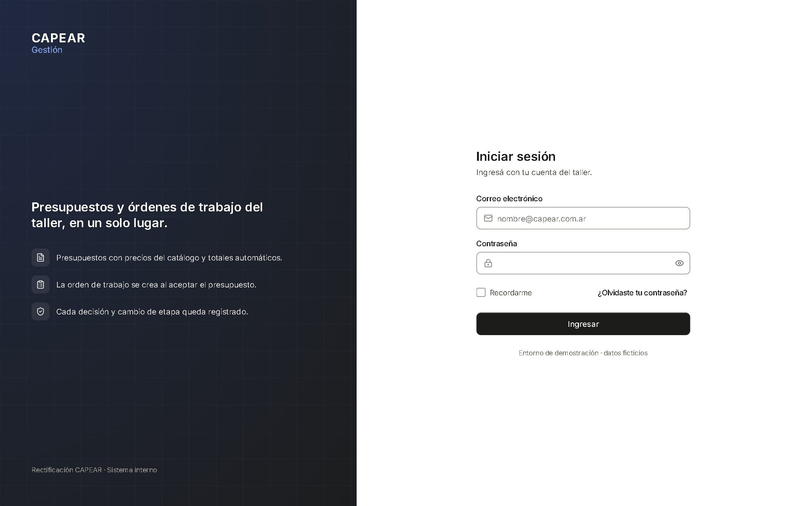

Según su rol, el sistema lo lleva a una pantalla distinta:

- **Administración y gerencia** llegan a «Inicio».
- **Planta** llega directamente a «Órdenes de trabajo».
- Si ingresa desde un **celular**, el sistema lo lleva a la carga de fotos (sección 13).

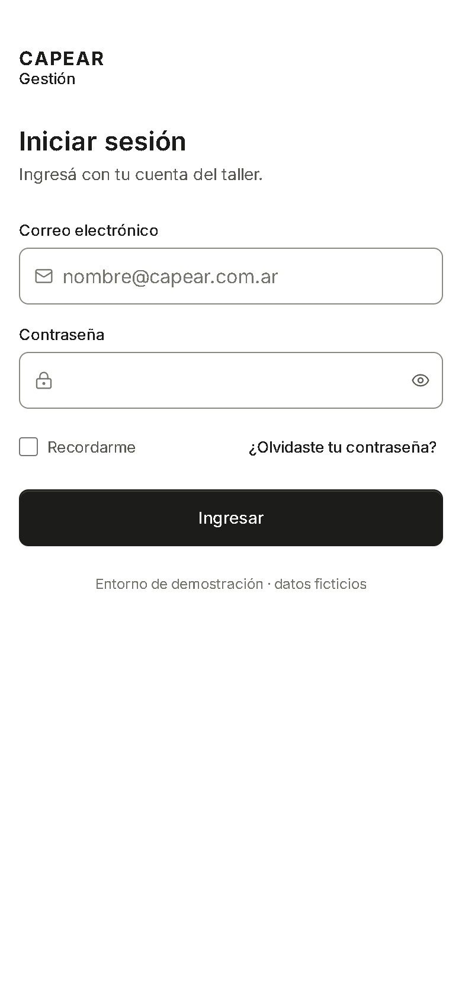

**Si se equivoca de contraseña**, el sistema muestra el mensaje «Correo o contraseña incorrectos.». Revise lo que escribió y vuelva a intentar. Si olvidó su contraseña, presione «¿Olvidaste tu contraseña?»: el sistema abre el aviso «Recuperar acceso», que indica que por ahora el restablecimiento lo hace un administrador del taller. Pídale que le genere una clave nueva.

Para salir del sistema, abra el menú de usuario (sección 4.3) y elija «Cerrar sesión». Hágalo siempre que deje la computadora desatendida.

## 4. Pantalla de inicio y navegación

### 4.1 La pantalla de inicio

«Inicio» es la primera pantalla de administración y gerencia. Resume el estado del taller del día:

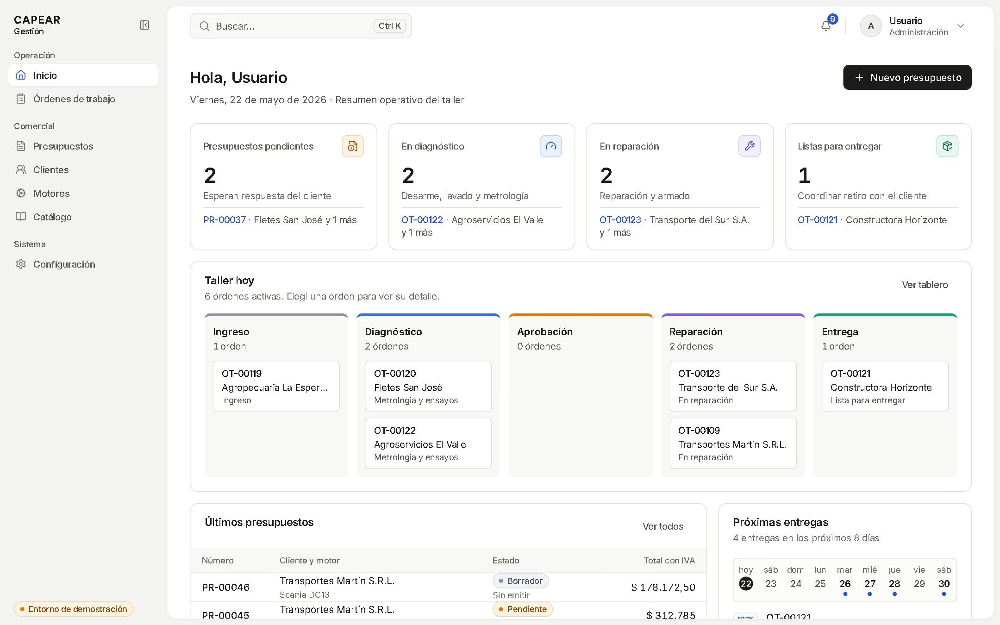

- **Saludo y botón «Nuevo presupuesto»**, para empezar un presupuesto sin pasar por el menú.
- **Cuatro tarjetas de resumen**: «Presupuestos pendientes» (esperan respuesta del cliente), «En diagnóstico», «En reparación» y «Listas para entregar». Cada una muestra la cantidad y enlaces a los primeros casos.
- **«Taller hoy»**: las órdenes activas ordenadas por etapa (Ingreso, Diagnóstico, Aprobación, Reparación, Entrega). Al pasar el cursor sobre una orden se ve un resumen con motor, etapa, responsable y fecha de entrega. El enlace «Ver tablero» abre el tablero completo.
- **«Últimos presupuestos»**, con su estado y el total con IVA, y el enlace «Ver todos».
- **«Próximas entregas»**, un calendario corto con las entregas estimadas de los próximos días.

### 4.2 El menú lateral

El menú de la izquierda está dividido en tres grupos:

| Grupo | Opciones |
|---|---|
| Operación | «Inicio», «Órdenes de trabajo» |
| Comercial | «Presupuestos», «Clientes», «Motores», «Catálogo» |
| Sistema | «Configuración» |

La opción en la que se encuentra aparece resaltada. El botón con el ícono de panel, junto al nombre «CAPEAR Gestión», permite contraer el menú para ganar espacio.

### 4.3 La barra superior

La barra superior acompaña todas las pantallas e incluye tres elementos.

**Buscador.** Escriba en «Buscar…» o presione **Ctrl + K** desde cualquier pantalla. Muestra, mientras escribe, órdenes, motores, clientes y presupuestos que coinciden. Use las flechas del teclado para moverse, **Enter** para abrir el resultado y **Esc** para cerrar.

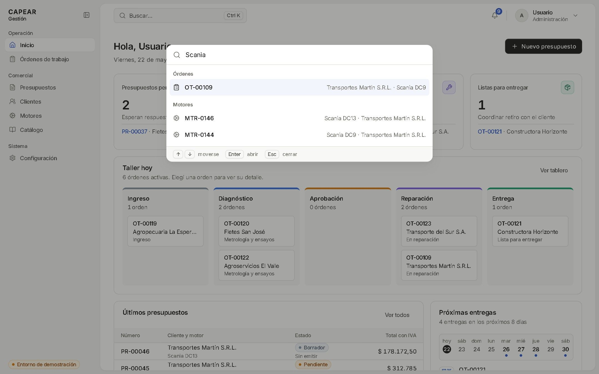

**Campana de notificaciones.** El número indica los avisos pendientes. Al presionarla se abre «Notificaciones», una lista de tareas que requieren atención, como recordar un presupuesto por vencer o terminar una isla de trabajo. Cada aviso lleva a la pantalla donde se resuelve. El botón «Marcar todo como leído» limpia la lista.

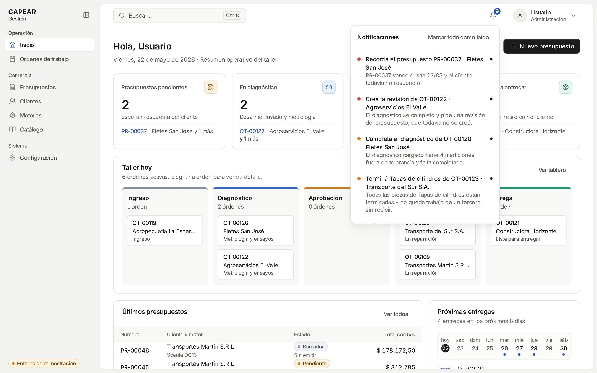

**Menú de usuario.** A la derecha, con su nombre y su rol. Al presionarlo se despliegan «Configuración», «Atajos de teclado» (la lista de combinaciones de teclas disponibles) y «Cerrar sesión».

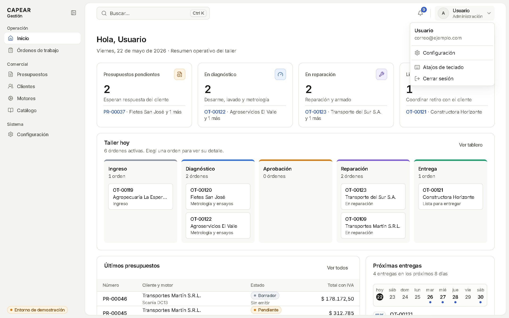

## 5. Clientes

La pantalla «Clientes» registra a las empresas y personas que traen motores al taller.

### 5.1 Lista de clientes

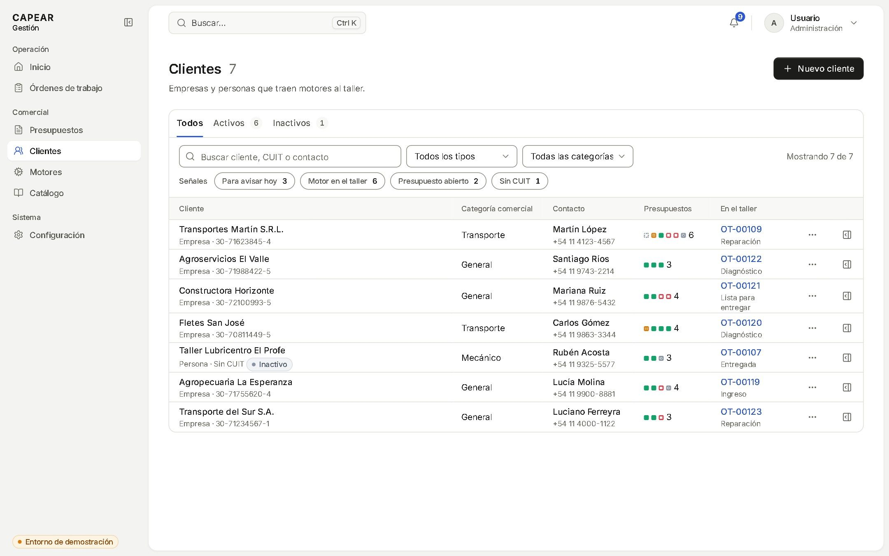

Arriba de la lista están los filtros:

- «Todos», «Activos» e «Inactivos».
- «Buscar clientes», para buscar por nombre, CUIT u otro dato.
- Los desplegables de tipo (empresas o personas) y de categoría comercial.
- Las «Señales», botones que filtran a los clientes que necesitan atención: «Para avisar hoy», «Motor en el taller», «Presupuesto abierto» y «Sin CUIT».

Cada fila muestra razón social, tipo y CUIT, categoría comercial, contacto, cantidad de presupuestos y la orden que tiene en el taller, si la hay.

### 5.2 Ficha del cliente

Al presionar un cliente se abre su ficha, con todo lo que se sabe de él:

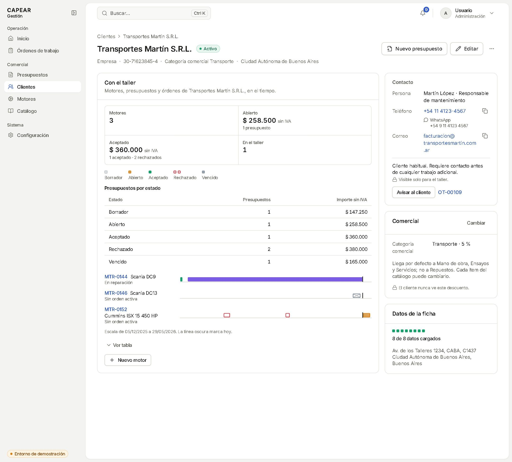

- **«Con el taller»**: cantidad de motores, importes abierto y aceptado (sin IVA), presupuestos por estado y una línea de tiempo de cada motor.
- **«Contacto»**: persona, teléfono, correo y notas internas, con botones para copiar el teléfono o el correo y para «Avisar al cliente».
- **«Comercial»**: la categoría comercial del cliente y el descuento que lleva. El cliente nunca ve este descuento.
- **«Datos de la ficha»**: cuántos datos están cargados y cuáles faltan.

En la parte superior hay tres botones: «Nuevo presupuesto» (ya con este cliente elegido), «Editar» y el menú «…», con las opciones «Copiar CUIT» y «Desactivar».

### 5.3 Alta de un cliente

1. En «Clientes», presione «Nuevo cliente».
2. En «Tipo de cliente» elija **Empresa** (razón social y CUIT) o **Persona** (nombre y documento).
3. Complete los datos fiscales. La razón social (o el nombre) es obligatoria. El CUIT es obligatorio para las empresas y el sistema controla su dígito verificador. La dirección, localidad, provincia y código postal son opcionales.
4. Elija la «Categoría comercial». Esa categoría determina el descuento con el que se arman los presupuestos del cliente.
5. Cargue los datos de contacto: persona, teléfono y correo. El teléfono se usa para enviar mensajes por WhatsApp, por lo que conviene cargarlo con código de área.
6. Presione «Crear cliente». Si prefiere el teclado, **Ctrl + Enter** también guarda.

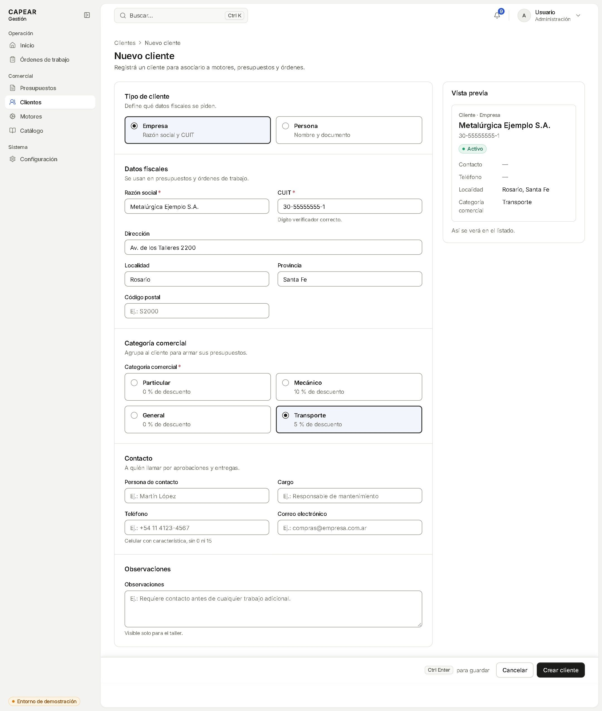

A la derecha, la «Vista previa» muestra cómo se verá el cliente en el listado a medida que completa los datos. Si carga un CUIT que ya existe, el sistema lo advierte.

**Editar** un cliente es igual: presione «Editar» en la ficha, cambie lo necesario y guarde.

> **Importante.** Un cliente no se borra. «Desactivar» lo oculta de las listas de trabajo, pero conserva todo su historial de presupuestos y órdenes. Puede volver a activarse más adelante.

## 6. Motores

La pantalla «Motores» registra cada motor que ingresa al taller y lo asocia con un cliente.

### 6.1 Lista de motores

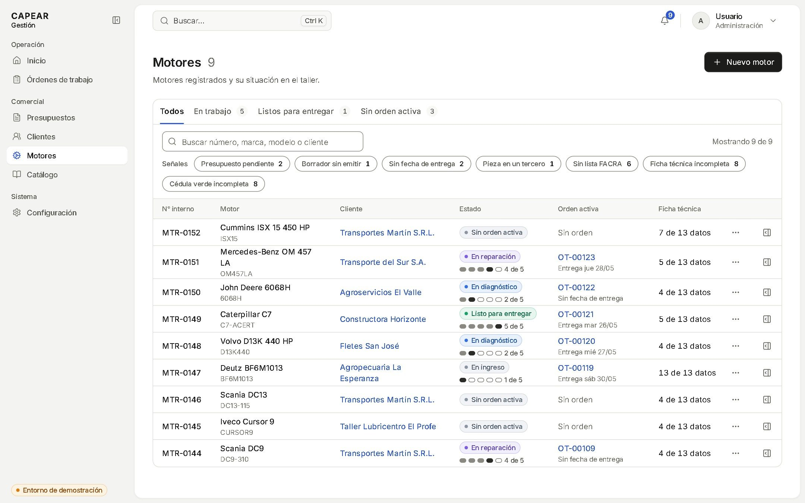

Los filtros «Todos», «En trabajo», «Listos para entregar» y «Sin orden activa» separan los motores según su situación. El buscador encuentra por número interno, marca, modelo o cliente. Las «Señales» muestran los motores que necesitan atención, por ejemplo con presupuesto pendiente, con borrador sin emitir, sin fecha de entrega o con la ficha técnica incompleta.

Cada fila muestra el número interno (MTR-0152, por ejemplo), el motor, el cliente, el estado, la orden activa con su avance y cuántos datos de la ficha técnica están cargados.

### 6.2 Ficha del motor

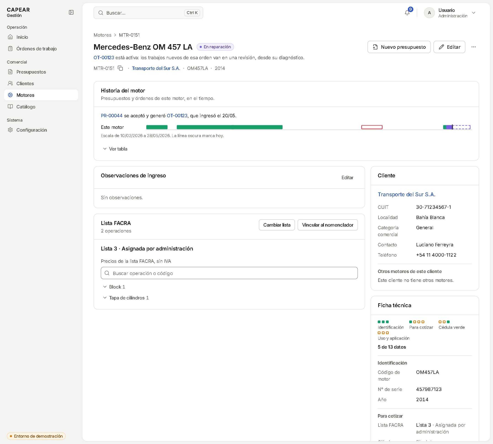

La ficha reúne los datos técnicos del motor, su cliente y sus presupuestos y órdenes anteriores y actuales.

### 6.3 Alta de un motor

1. En «Motores», presione «Nuevo motor».
2. En «Cliente asociado», elija al dueño del motor. Si no está en la lista, use el enlace «Nuevo cliente» que aparece debajo.
3. Opcional: use «Buscar en el nomenclador FACRA» para encontrar el motor por código o descripción. Si lo elige, se completan solos la marca, el motor y la lista FACRA.
4. En «Identificación», el «N° interno» se asigna solo. Si necesita otro número, presione «Cambiar número».
5. Elija o escriba la «Marca». A medida que escribe, el sistema propone las marcas ya registradas.

   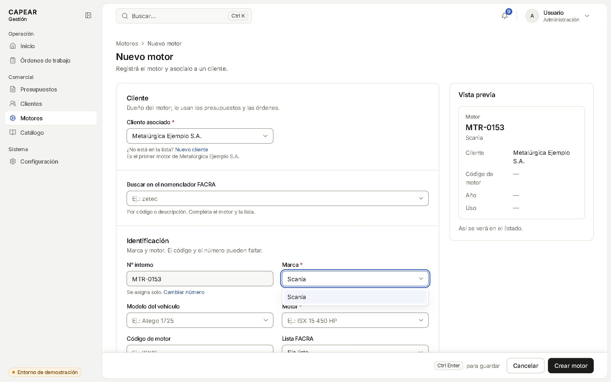

6. Elija el «Modelo del vehículo» (opcional) y el «Motor». Si el motor que busca no existe en la lista, escriba su nombre y elija la opción que empieza con «Agregar».
7. Complete el «Código de motor». Los datos de la «Lista FACRA» y de la cédula verde (dominio y número de motor) pueden quedar vacíos y completarse más tarde.
8. En «Datos técnicos» puede cargar cilindros, válvulas, tapas, uso, año y número de serie. Son opcionales, pero ayudan a planificar el trabajo.
9. Presione «Crear motor».

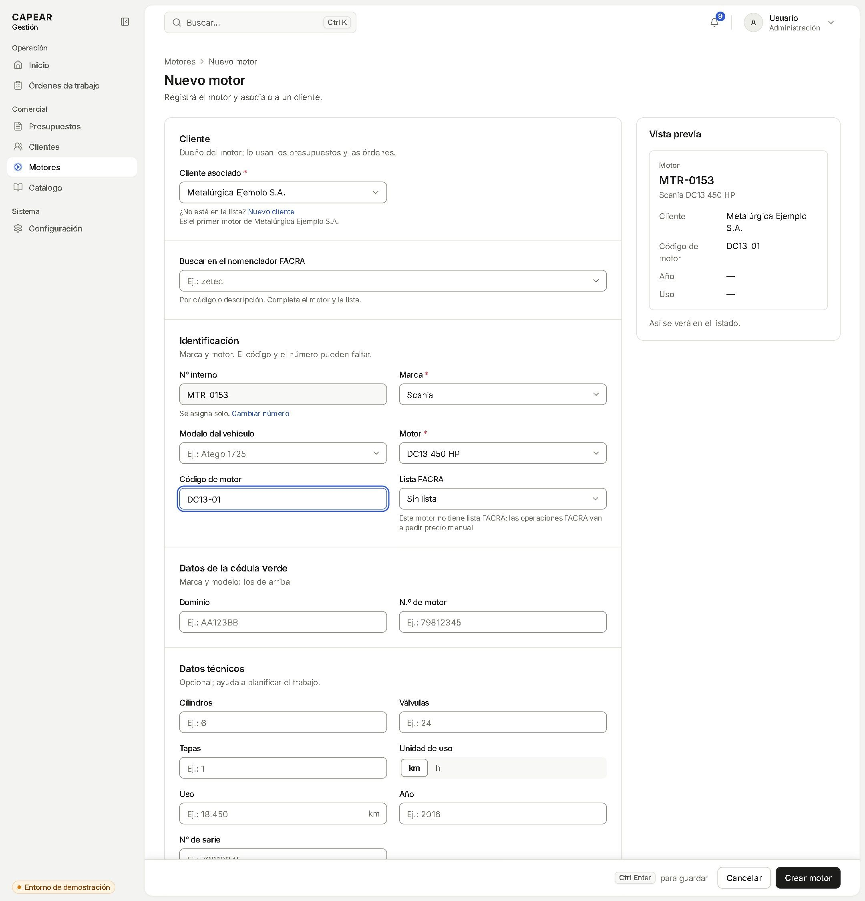

## 7. Catálogo

El «Catálogo» guarda las operaciones y los repuestos que se usan para armar presupuestos, con su precio vigente sin IVA.

### 7.1 Lista del catálogo

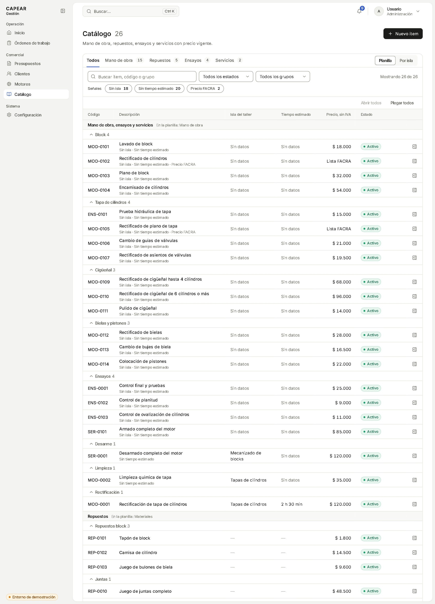

Los ítems se agrupan en cuatro tipos, que se pueden filtrar con las pestañas: «Mano de obra», «Repuestos», «Ensayos» y «Servicios». Dentro de cada tipo están los grupos de la planilla (por ejemplo «Block», «Tapa de cilindros» o «Cigüeñal»). Use «Abrir todos» y «Plegar todos» para desplegar o contraer los grupos. El botón «Por isla» reordena el catálogo según la isla del taller que realiza cada operación.

También puede buscar por ítem, código o grupo, y filtrar por estado. Las «Señales» muestran, por ejemplo, los ítems «Sin isla» o «Sin tiempo estimado».

### 7.2 Ficha de un ítem

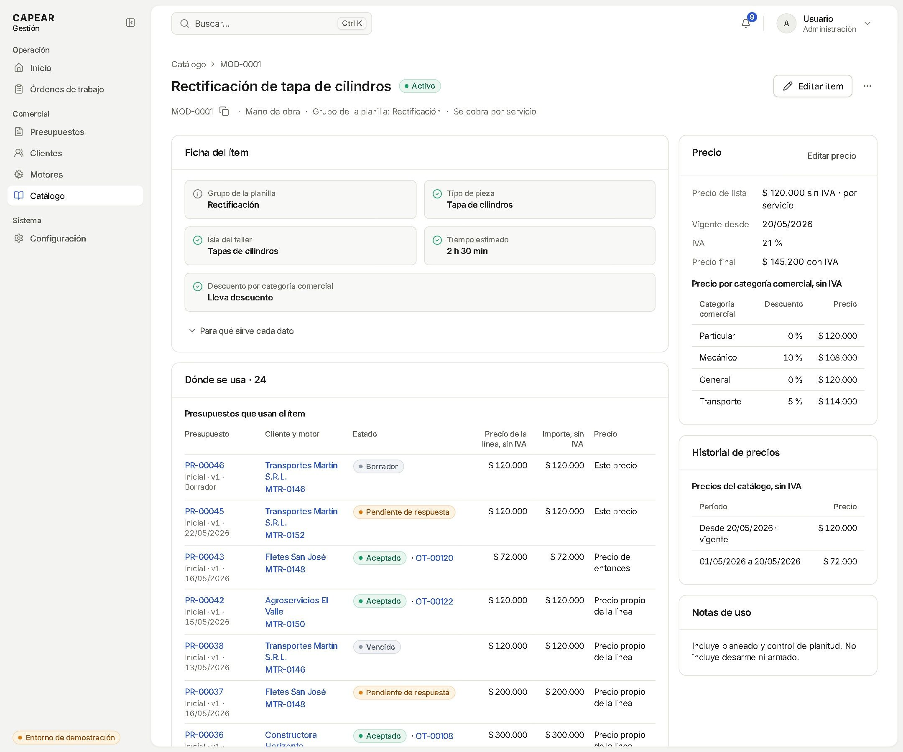

La ficha muestra el tipo, el grupo, la isla del taller, el tiempo estimado, el precio de lista (sin IVA y con IVA), el precio que corresponde a cada categoría comercial, el **historial de precios** y los presupuestos donde se usó el ítem.

Para cambiar un precio, presione «Editar precio». El precio anterior queda guardado en el historial.

> **Importante.** Los presupuestos ya emitidos conservan el precio que tenían al momento de emitirse. Cambiar el precio del catálogo no modifica presupuestos anteriores.

### 7.3 Alta de un ítem

1. Presione «Nuevo ítem».
2. Escriba el «Código» (debe ser único) y la «Descripción».
3. Elija el «Grupo de la planilla» y la «Unidad».
4. Escriba el «Precio vigente», sin IVA.
5. Presione «Crear ítem».

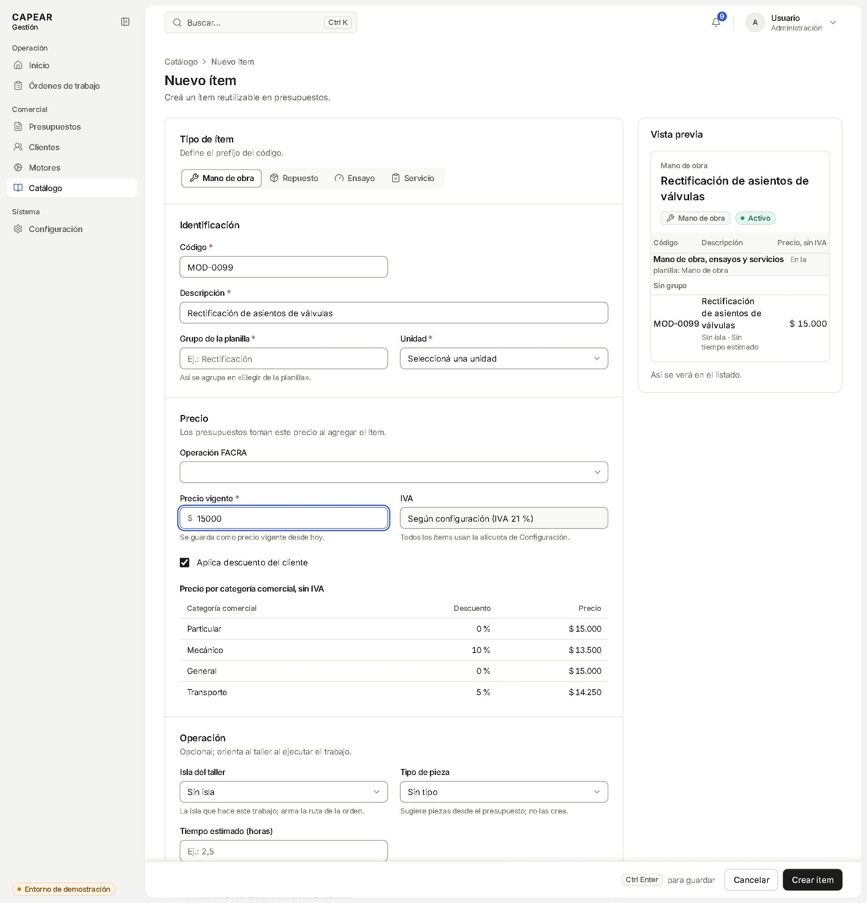

Un ítem no se borra: se desactiva desde su ficha y deja de ofrecerse en los presupuestos nuevos.

## 8. Presupuestos

### 8.1 Estados de un presupuesto

Un presupuesto pasa por los siguientes estados:

| Estado | Qué significa |
|---|---|
| Borrador | Se está armando. Puede editarse y todavía no tiene fecha de validez. |
| Emitido / Pendiente de respuesta | Ya tiene número y fecha de validez; se envió o se envía al cliente y espera su respuesta. |
| Aceptado | El cliente aceptó. En ese momento se crea la orden de trabajo. |
| Rechazado | El cliente rechazó. Queda registrado el motivo. |
| Vencido | Pasó su fecha de validez sin respuesta. No admite decisión ni envío. |
| Anulado | Se canceló con un motivo. Queda en el historial. |

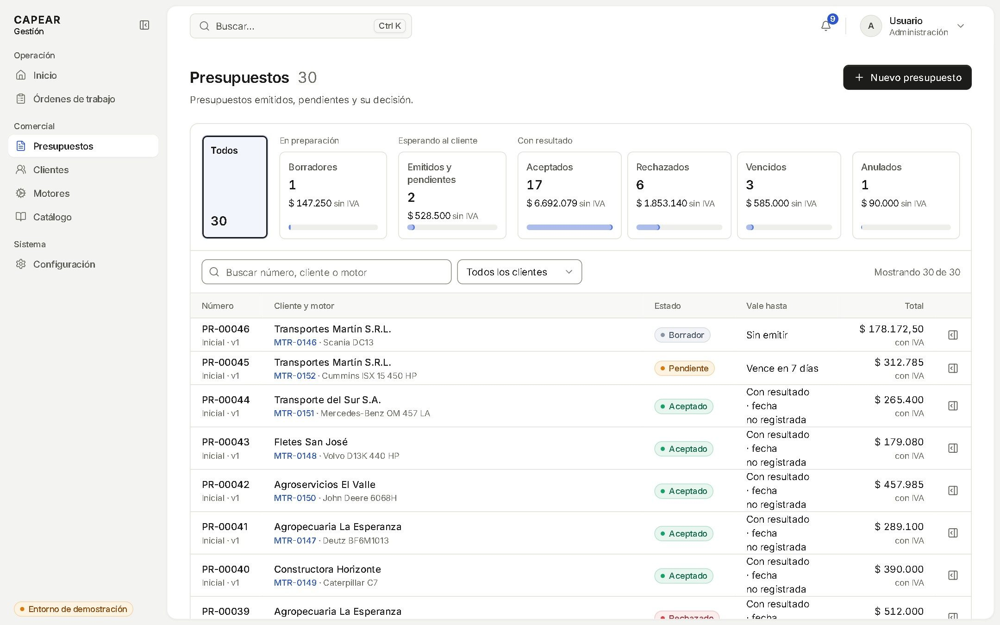

La pantalla «Presupuestos» agrupa las tarjetas por etapa: «Borradores», «Emitidos y pendientes», «Aceptados», «Rechazados», «Vencidos» y «Anulados», cada una con su cantidad y su importe sin IVA. Se puede filtrar por cliente y buscar por número.

### 8.2 Crear un presupuesto con el asistente

Un presupuesto inicial se arma en cuatro pasos. Para empezar, presione «Nuevo presupuesto» (en «Presupuestos», en «Inicio» o en la ficha de un cliente).

**Paso 1: Cliente y motor**

1. En «Cliente», elija el cliente. Si no existe, use «Nuevo cliente».
2. En «Motor», elija uno de los motores de ese cliente. Si no existe, use «Nuevo motor».
3. El «Tipo de presupuesto» debe quedar en **Inicial**. La opción «Revisión» se usa solo a partir de una orden ya creada (sección 9.7).
4. Si lo desea, escriba «Notas para el cliente» (salen en el documento) y «Observaciones internas» (nunca salen del taller).
5. Presione «Continuar a ítems». El sistema guarda el borrador y le asigna un número (PR-00047, por ejemplo).

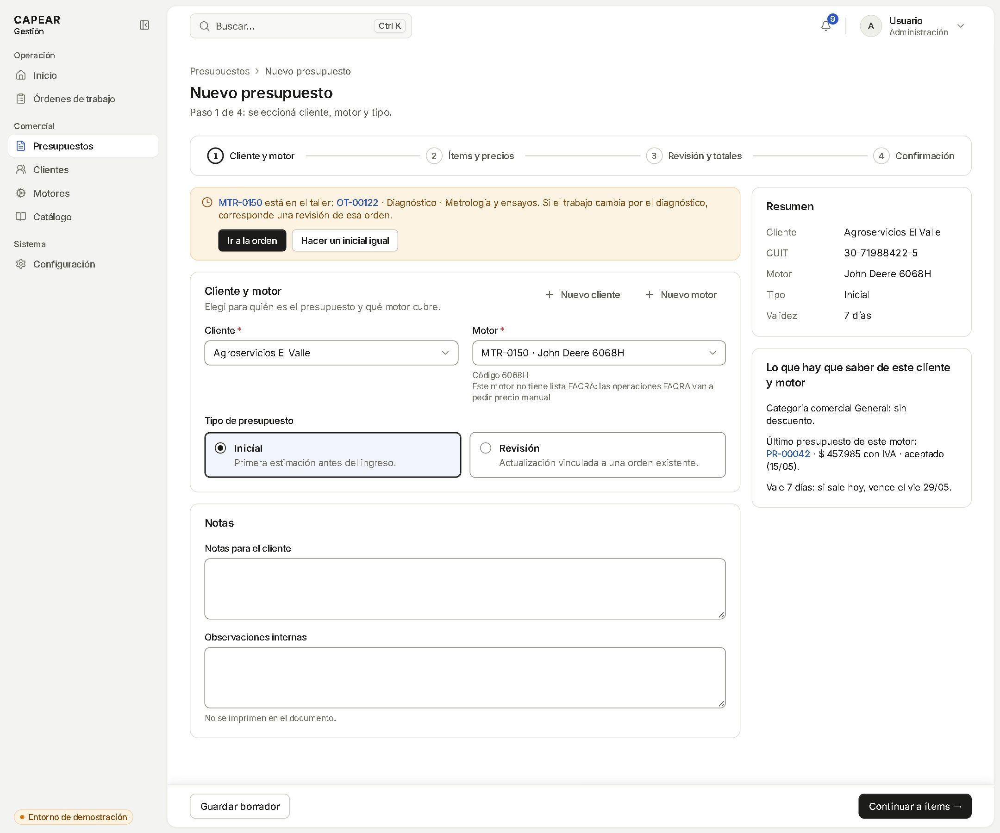

El panel «Resumen» de la derecha muestra el cliente, el CUIT, el motor, el tipo y la validez (7 días por defecto). Debajo, «Lo que hay que saber de este cliente y motor» muestra la categoría comercial y avisa si el motor ya está en el taller.

**Paso 2: Ítems y precios**

1. En el panel «Catálogo» de la derecha, escriba un código o una descripción en «Buscar ítem o código».
2. Presione el botón **+** del ítem para agregarlo. Aparece en la tabla «Ítems del presupuesto». El aviso «Agregaste este ítem» tiene un enlace «Deshacer» por si fue un error.
3. Ajuste la «Cantidad» de cada línea. Si es necesario, también puede cambiar el «Precio de lista» de una línea.
4. Para agregar varios ítems de una vez, use «Elegir de la planilla». Para un trabajo que no está en el catálogo, use «Agregar línea manual» e ingrese la descripción, la cantidad y el precio.
5. El ícono del tacho elimina una línea del borrador.
6. Presione «Continuar →».

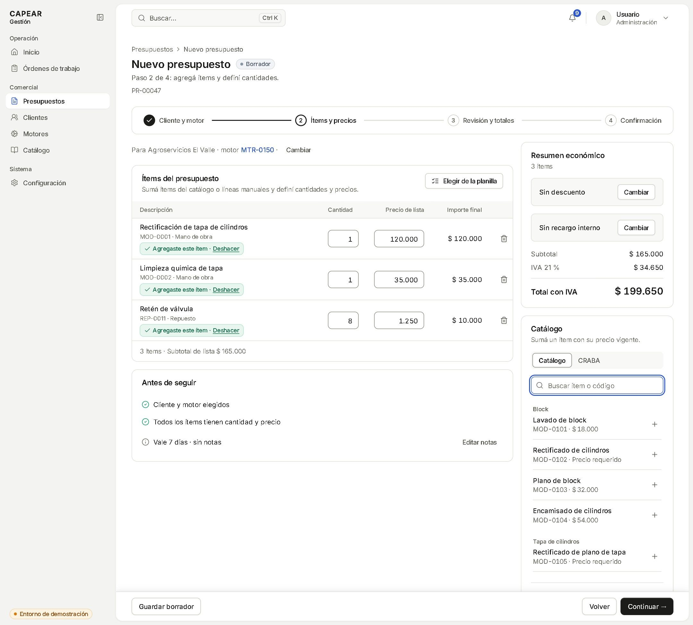

El «Resumen económico» se actualiza solo con el subtotal, el IVA y el total. Desde allí se puede aplicar un descuento («Sin descuento» → «Cambiar») o un recargo interno (sección 8.3). El panel «Antes de seguir» indica qué falta para poder continuar.

**Paso 3: Revisión y totales**

Este paso muestra «Lo que recibe el cliente»: una vista previa del documento tal como se imprimirá, con precios finales. Revise los datos, las cantidades y los totales. Si encuentra un error, presione «Volver». Si está todo bien, presione «Continuar →».

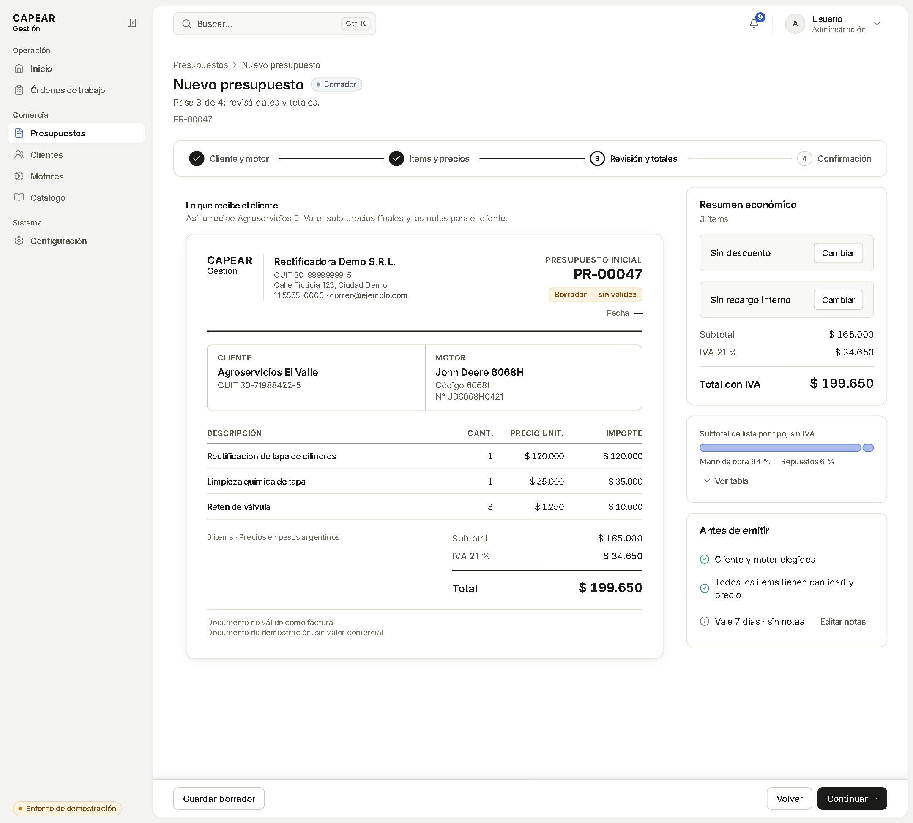

**Paso 4: Confirmación**

El resumen final repite el cliente, el motor, la cantidad de ítems, el descuento y el total con IVA. El panel «Qué pasa después» recuerda los tres pasos que siguen: emitir, enviar al cliente y registrar su respuesta. Si el motor ya tiene una orden en el taller, el panel «Antes de emitir» lo avisa, porque al aceptarse este presupuesto se crearía otra orden.

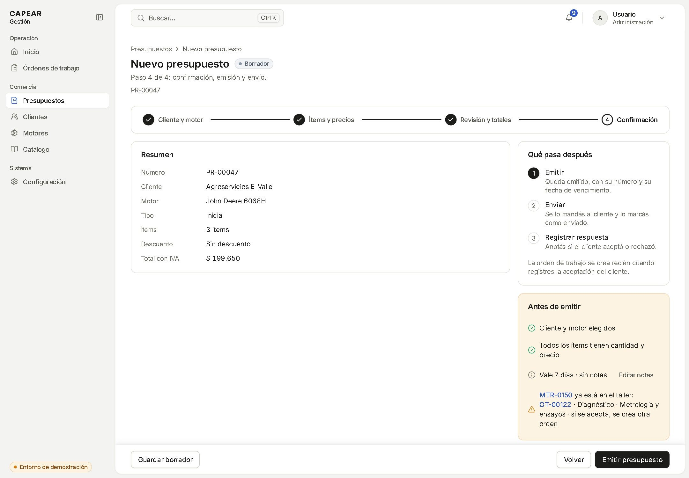

Presione «Emitir presupuesto». El sistema confirma con el mensaje «Presupuesto PR-00047 emitido» y ofrece «Descargar PDF» y «Enviar al cliente».

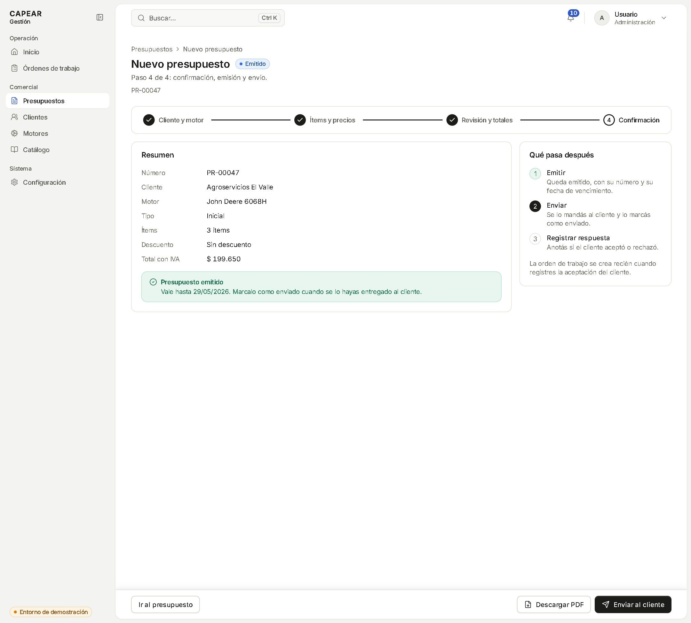

**Guardar y retomar un borrador.** En cualquier paso puede presionar «Guardar borrador». El borrador queda en la lista de presupuestos con el estado «Borrador». Al abrirlo, el asistente continúa donde lo dejó.

> **Importante.** Una vez emitido, un presupuesto **no vuelve a ser borrador** ni se edita. Si hay que corregirlo, se anula con un motivo y se crea uno nuevo.

### 8.3 Descuento y recargo interno

- El **descuento** lo determina la categoría comercial del cliente. También puede cambiarse en el presupuesto con el botón «Cambiar», indicando el motivo.
- El **recargo interno** aumenta el precio de un presupuesto por una dificultad del trabajo (por ejemplo, una pieza dañada). Se aplica después del descuento. Se agrega con «Sin recargo interno» → «Cambiar». Hay que indicar el porcentaje en «Recargo (%)» y un «Motivo» obligatorio, de hasta 280 caracteres.

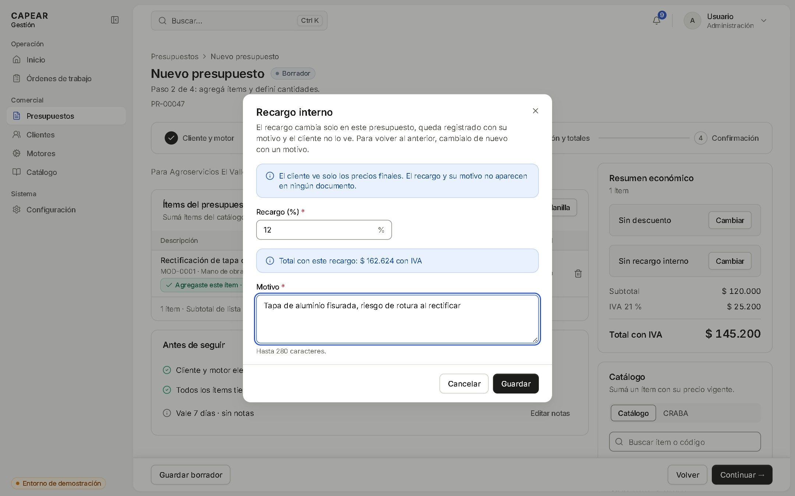

> **Importante.** El cliente **nunca ve** el descuento, la categoría comercial ni el recargo interno con su motivo. En el documento aparecen solamente los precios finales de cada línea.

### 8.4 Repuestos de la lista CRABA

Mientras arma un presupuesto, en el panel de la derecha también está la pestaña «CRABA», para consultar repuestos con su precio de referencia (sección 11.2).

### 8.5 Detalle del presupuesto

Al abrir un presupuesto se ve su detalle:

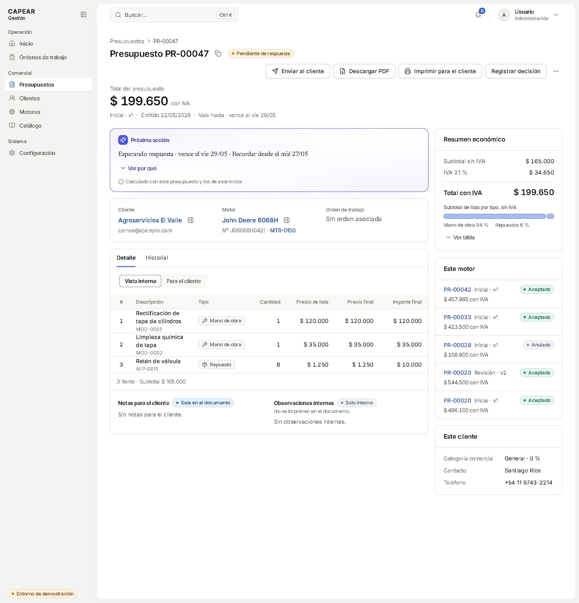

- Arriba, el número, el estado, el total con IVA, la fecha de emisión y hasta cuándo vale.
- Los botones de acción: «Enviar al cliente», «Descargar PDF», «Imprimir para el cliente» y «Registrar decisión». El menú «…» contiene «Anular presupuesto».
- La tarjeta «Próxima acción» sugiere el paso que corresponde, calculado por el sistema con reglas fijas a partir de los datos registrados, por ejemplo recordar un presupuesto que está por vencer.
- El cliente, el motor y la orden de trabajo asociada (si el presupuesto fue aceptado).
- Dos pestañas, «Detalle» e «Historial». En «Detalle» hay dos vistas: **Vista interna**, con precio de lista, precio final e importes, y **Para el cliente**, con lo que verá el cliente.
- A la derecha, el «Resumen económico» y los otros presupuestos del mismo motor y del mismo cliente.

### 8.6 Enviar el presupuesto al cliente

1. En el detalle o al terminar el asistente, presione «Enviar al cliente».
2. Se abre el diálogo con los datos de contacto del cliente y un «Mensaje» ya redactado, que puede modificar.
3. Presione «Descargar PDF» para obtener el documento y adjúntelo al mensaje: WhatsApp y el correo no adjuntan archivos solos.
4. Envíe el mensaje con alguno de estos botones: «Copiar mensaje» (para pegarlo donde prefiera), «Compartir», «Email» o «WhatsApp».
5. Cuando lo haya enviado, presione «Marcar como enviado». El presupuesto queda como «Pendiente de respuesta».

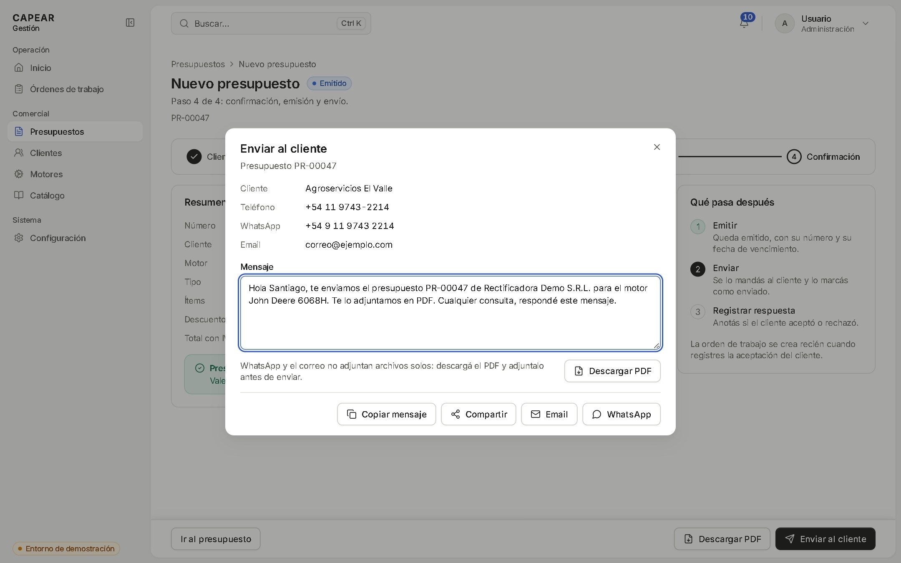

### 8.7 Documento para el cliente

El botón «Imprimir para el cliente» abre el documento en formato de hoja A4, con los datos del taller, los del cliente y el motor, las líneas con cantidad, precio unitario e importe, el subtotal, el IVA y el total, y la fecha hasta la que vale. Para imprimirlo, use la impresión del navegador (**Ctrl + P**) o «Descargar PDF».

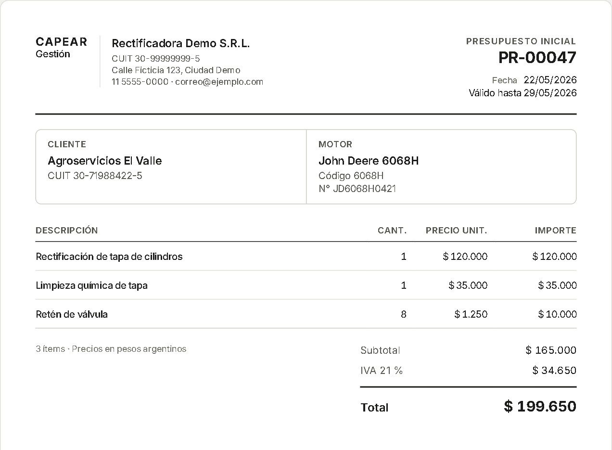

Si ya se registró una seña, el documento agrega el importe recibido y el saldo.

### 8.8 Registrar la decisión del cliente

Cuando el cliente responde, registre su decisión:

1. En el detalle del presupuesto, presione «Registrar decisión».
2. Elija **Aceptó** o **Rechazó**.
3. Complete el «Medio de confirmación» (por ejemplo, WhatsApp) y la «Persona que confirmó». La fecha se registra sola con la del día.
4. Opcional: escriba «Observaciones».
5. Presione «Confirmar aceptación» o «Confirmar rechazo».

**Si el cliente acepta**, el sistema crea automáticamente **una sola orden de trabajo** y lo lleva a ella. La orden hereda el cliente, el motor y el presupuesto; no hace falta cargar nada otra vez.

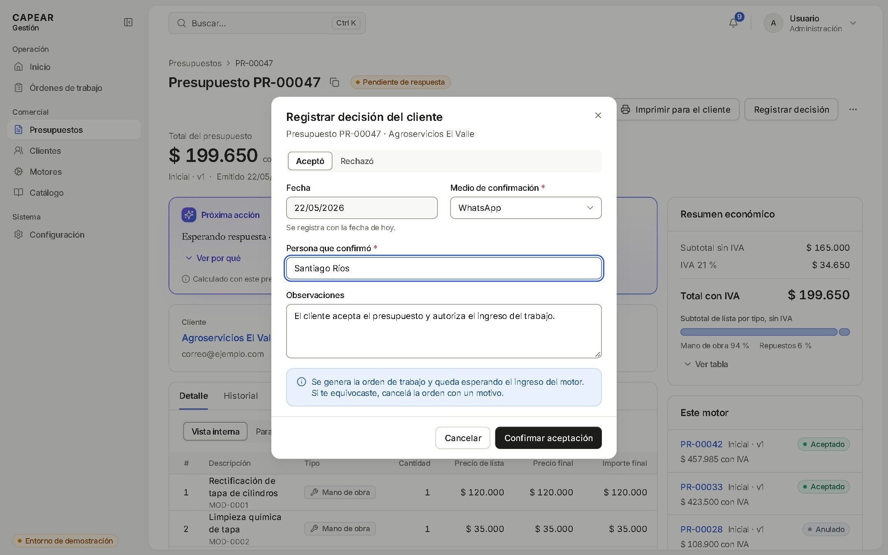

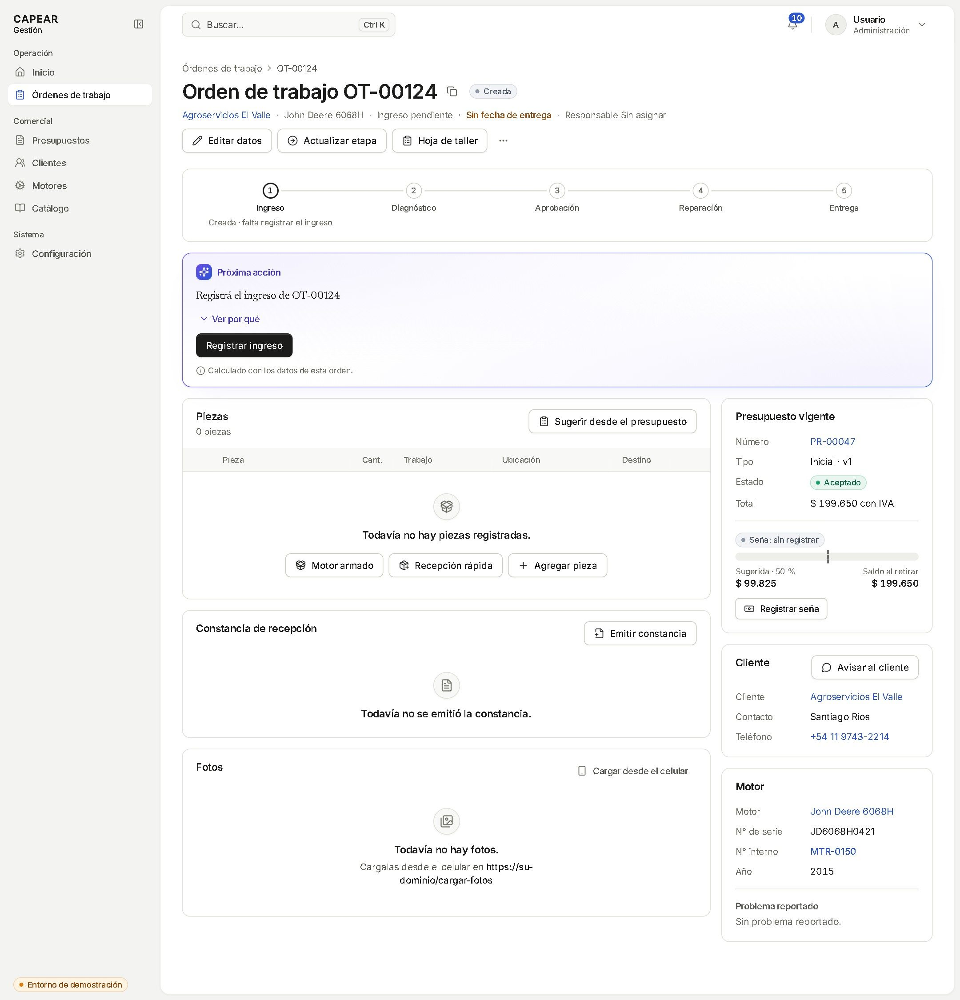

Si todavía no se registró una seña, el diálogo muestra un aviso con el importe sugerido. El aviso **no bloquea** la aceptación.

**Si el cliente rechaza**, elija el «Motivo del rechazo» de la lista (por ejemplo «Precio elevado»). Es obligatorio: sin motivo, el sistema no deja confirmar.

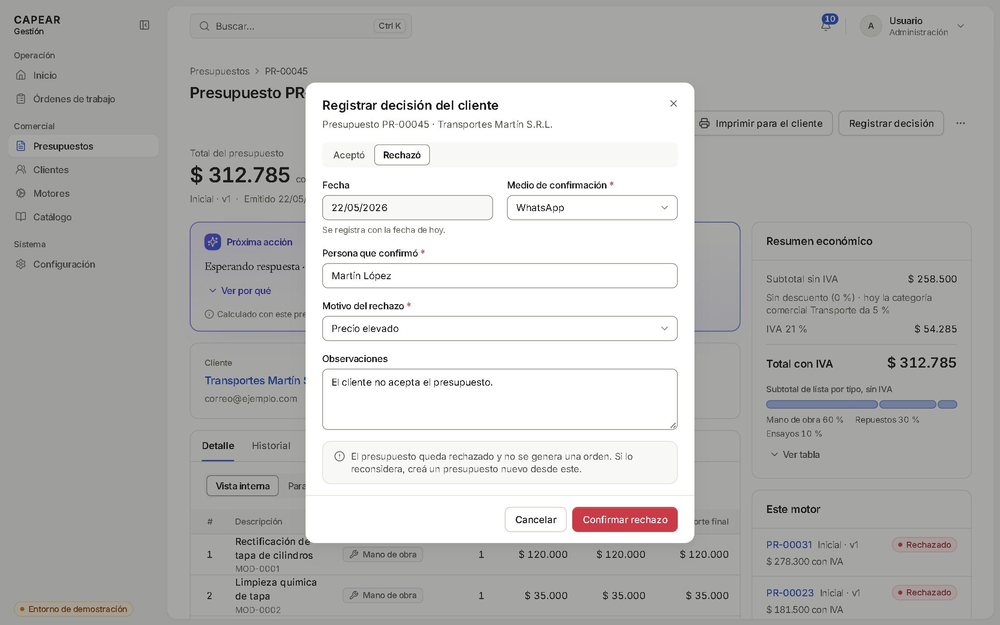

> **Importante.** Un presupuesto inicial **no tiene orden de trabajo** hasta que el cliente lo acepta. Y aceptarlo dos veces, o hacer doble clic, **nunca genera dos órdenes**: el sistema crea exactamente una.

### 8.9 Anular un presupuesto

Un presupuesto emitido no se borra. Si se emitió con un error o ya no corresponde, se **anula**:

1. Abra el presupuesto.
2. Presione el menú «…» y elija «Anular presupuesto».
3. Escriba el motivo (hasta 280 caracteres) y confirme.

El presupuesto queda con el estado «Anulado» y se conservan quién lo anuló, cuándo y por qué.

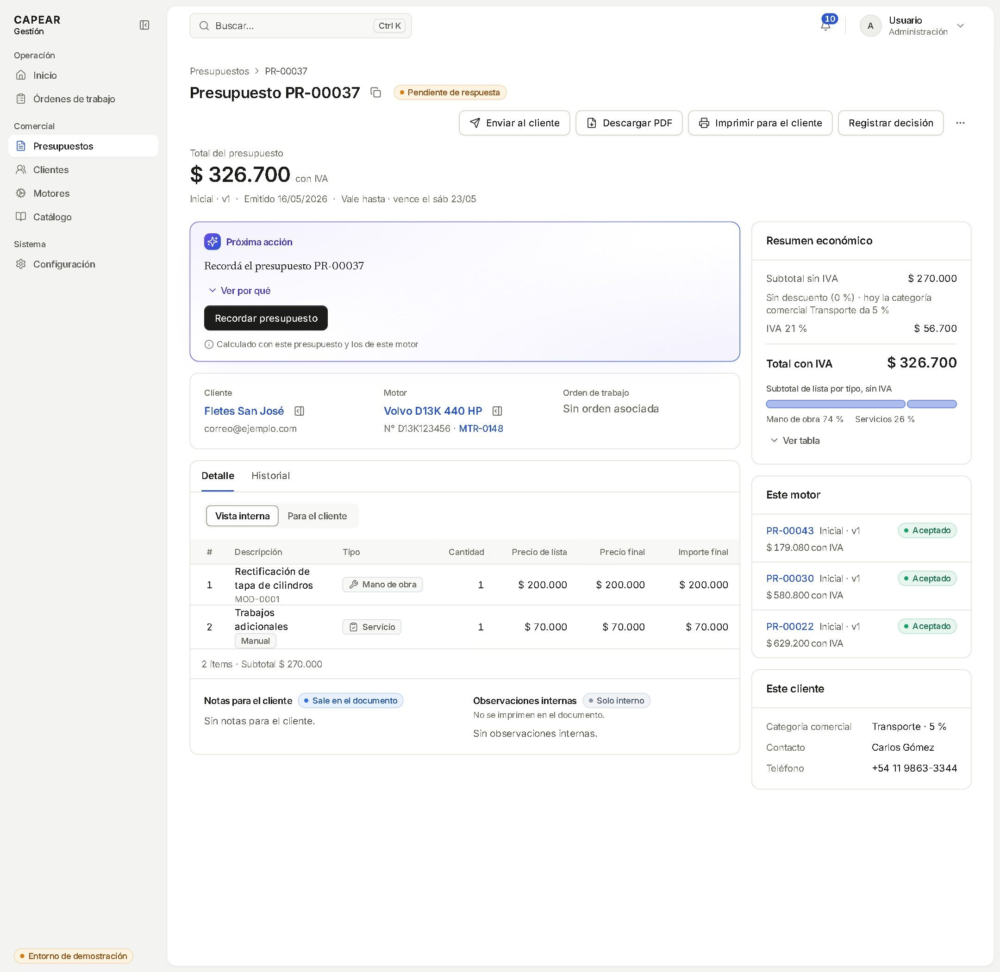

Solo se pueden anular presupuestos que todavía no tienen respuesta (borrador, emitido o pendiente, incluso vencido). Un presupuesto **aceptado** no se anula: se cancela su orden de trabajo (sección 9.9). Un presupuesto rechazado ya está cerrado.

## 9. Órdenes de trabajo

Una orden de trabajo sigue un motor desde que llega al taller hasta que se entrega. Se crea sola cuando el cliente acepta un presupuesto inicial.

### 9.1 Lista, tablero e islas

La pantalla «Órdenes de trabajo» tiene tres vistas, que se cambian con los botones de arriba a la derecha.

**Lista.** Una fila por orden, con el cliente y el motor, la etapa con una barra de avance, el responsable y la entrega estimada. Las pestañas «Todas», «Ingreso», «Diagnóstico», «Aprobación», «Reparación», «Entrega» y «Cerradas» filtran por etapa.

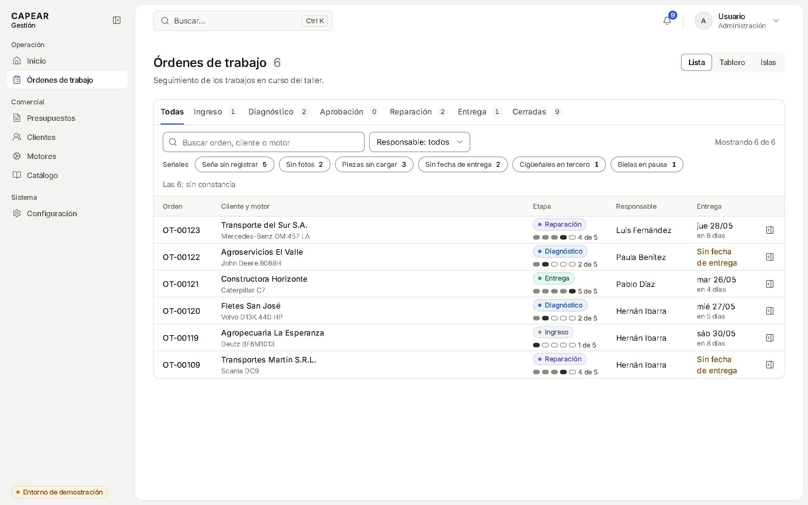

Las «Señales» son filtros rápidos, por ejemplo «Seña sin registrar», «Sin fotos», «Piezas sin cargar» o «Sin fecha de entrega». También se puede buscar por orden, cliente o motor y filtrar por responsable.

**Tablero.** Una columna por etapa, con una tarjeta por orden. Muestra el responsable, la entrega y la próxima acción. La etapa no se cambia arrastrando: se cambia desde cada orden.

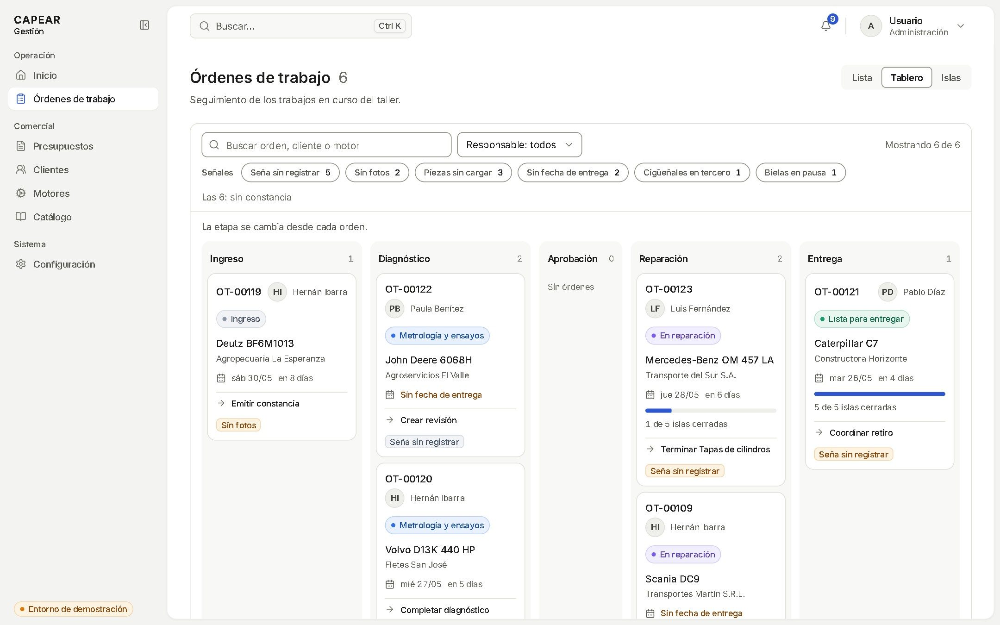

**Islas.** Una columna por isla del taller (por ejemplo «Cigüeñales», «Tapas de cilindros», «Bielas»), con las órdenes que están en cada una y su estado. Desde aquí se puede «Terminar» o «Reanudar» una isla.

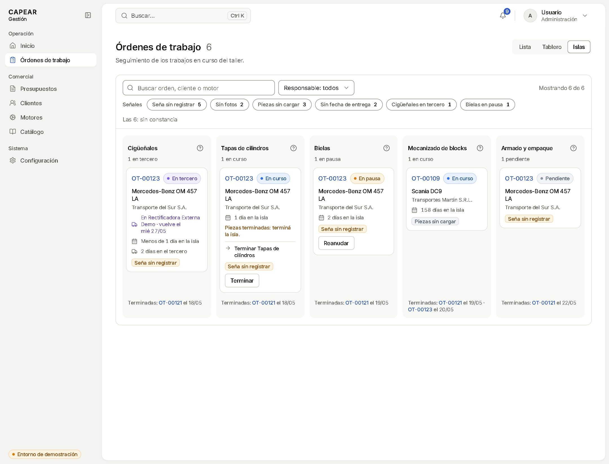

### 9.2 Etapas de una orden

Toda orden pasa por cinco etapas:

| Etapa | Qué ocurre |
|---|---|
| Ingreso | El motor llega al taller y se registra su ingreso. |
| Diagnóstico | Se desarma, se lava y se mide el motor. |
| Aprobación | Se espera la aprobación del cliente si el diagnóstico exige un presupuesto nuevo (revisión). |
| Reparación | Se trabaja en las islas del taller. |
| Entrega | El motor está listo para que el cliente lo retire. |

Una orden recién creada tiene el estado «Creada» y muestra «Ingreso pendiente» hasta que se registra el ingreso del motor.

### 9.3 Detalle de la orden

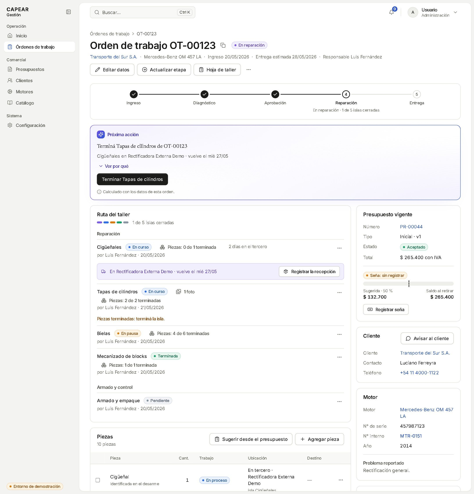

El detalle reúne todo lo de la orden:

- **Encabezado:** número, estado, cliente, motor, fechas de ingreso y entrega estimada, y responsable. Los botones son «Editar datos» (responsable, entrega estimada y problema reportado), «Actualizar etapa» y «Hoja de taller». El menú «…» tiene «Volver a la etapa anterior» y «Cancelar orden».
- **Etapas:** un recorrido con los cinco pasos.
- **Próxima acción:** la tarjeta indica qué conviene hacer ahora y ofrece el botón correspondiente, por ejemplo «Registrar ingreso» o «Terminar Tapas de cilindros».
- **Ruta del taller:** las islas por las que pasa la orden, cada una con su estado: «Pendiente», «En curso», «En pausa», «En tercero» (la pieza está en un taller externo) o «Terminada». Cuando una pieza sale a un tercero, se registra su vuelta con «Registrar la recepción».
- **Piezas**, **Presupuesto vigente**, **Cliente**, **Motor**, **Constancia de recepción** y **Fotos**.

### 9.4 Cambiar la etapa

1. En el detalle, presione «Actualizar etapa».
2. El diálogo muestra la etapa actual y la nueva. Si quedan islas sin terminar, las enumera.
3. Presione el botón de confirmación («Pasar a…»).

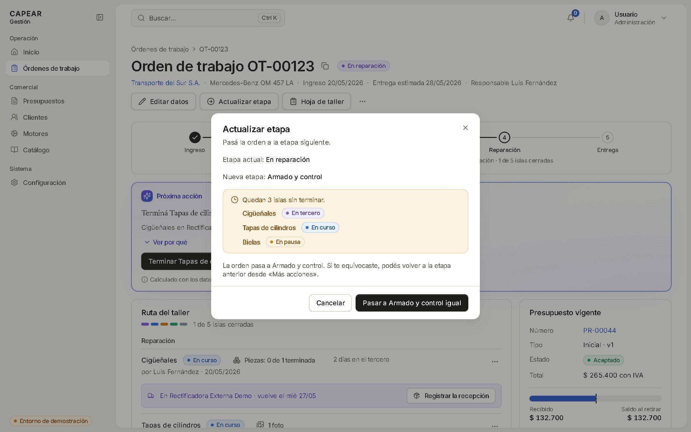

Si se equivocó, puede volver a la etapa anterior desde el menú «…» → «Volver a la etapa anterior».

### 9.5 Diagnóstico

En la etapa de Diagnóstico, el botón de la tarjeta «Próxima acción» abre la pantalla «Diagnóstico técnico»:

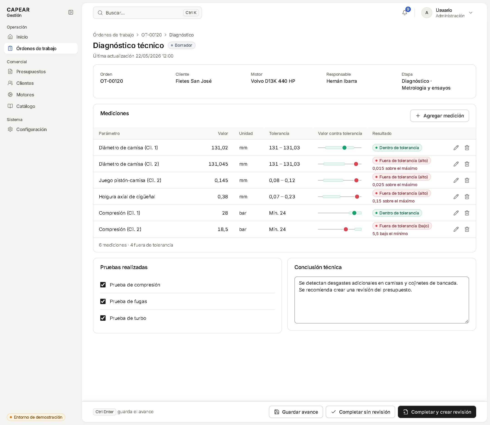

1. Cargue las **mediciones** con «Agregar medición»: parámetro, valor medido, unidad y tolerancia (mínimo, máximo o rango). El sistema marca cada una como «Dentro de tolerancia» o «Fuera de tolerancia».
2. Tilde las «Pruebas realizadas» y escriba la «Conclusión técnica».
3. Presione «Guardar avance» para seguir después.
4. Al terminar, administración y gerencia eligen: «Completar sin revisión» (la orden sigue con el presupuesto original) o «Completar y crear revisión» (se abre un presupuesto nuevo para el cliente, ver sección 9.7).

Planta puede cargar y guardar el diagnóstico, pero no confirmarlo.

### 9.6 Seña

La **seña** es el anticipo que paga el cliente. Se registra en la tarjeta «Presupuesto vigente» de la orden, una sola vez por orden.

1. En la tarjeta, presione «Registrar seña».
2. Revise el «Importe». El sistema propone un porcentaje del total (50 % por defecto), que puede cambiar.
3. Elija el «Medio» (por ejemplo, Transferencia).
4. Presione «Registrar seña».

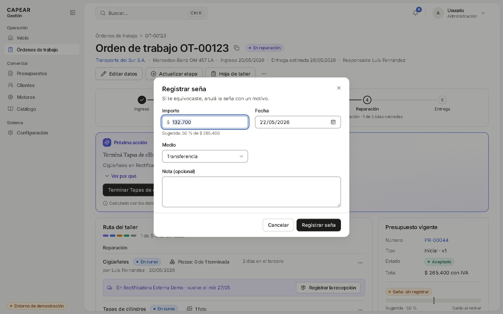

La tarjeta pasa a mostrar lo recibido, el saldo al retirar, la fecha, el medio y quién la registró.

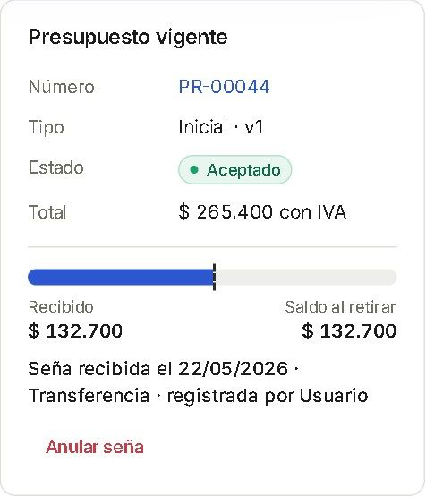

Si se cargó por error, use «Anular seña», indique el motivo y vuelva a registrarla.

> **Importante.** El sistema solo **avisa** cuando falta la seña. Nunca impide aceptar un presupuesto ni avanzar la orden. La seña no reemplaza a la facturación ni a la caja del taller: es un dato informativo de la orden.

### 9.7 Revisión del presupuesto

Cuando el diagnóstico muestra que el trabajo cuesta distinto de lo presupuestado, se crea una **revisión**, un presupuesto nuevo vinculado a la orden. Se arma con un asistente parecido al de la sección 8.2, y exige indicar el motivo de la revisión (lo lee el cliente). Después de emitida, se envía y se registra la decisión del cliente igual que en un presupuesto inicial. La revisión puede compararse con el presupuesto original en una pantalla de comparación.

### 9.8 Piezas

La tarjeta «Piezas» lista las piezas del motor, con su trabajo, su ubicación y su destino.

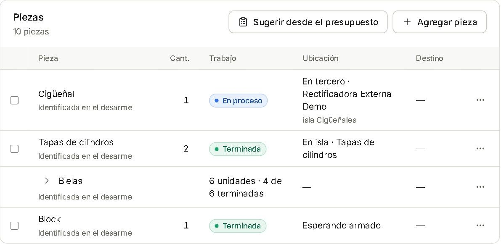

Se pueden agregar con «Agregar pieza» o «Sugerir desde el presupuesto», y registrar el motor entero con «Motor armado». Para la recepción de piezas sueltas, ver la sección 10.

### 9.9 Cancelar una orden

Si un trabajo se interrumpe, desde el menú «…» elija «Cancelar orden» e indique el motivo. Una orden no se borra: queda cancelada, con el motivo y el usuario que la canceló.

### 9.10 Fotos de la orden

La tarjeta «Fotos» reúne las fotos de la orden, agrupadas por momento (Recepción, Diagnóstico, Islas, Entrega y Otra). Se pueden filtrar por momento y mostrar las anuladas. «Elegir fotos» las sube desde la computadora, y «Cargar desde el celular» explica cómo usar la carga desde el celular (sección 13).

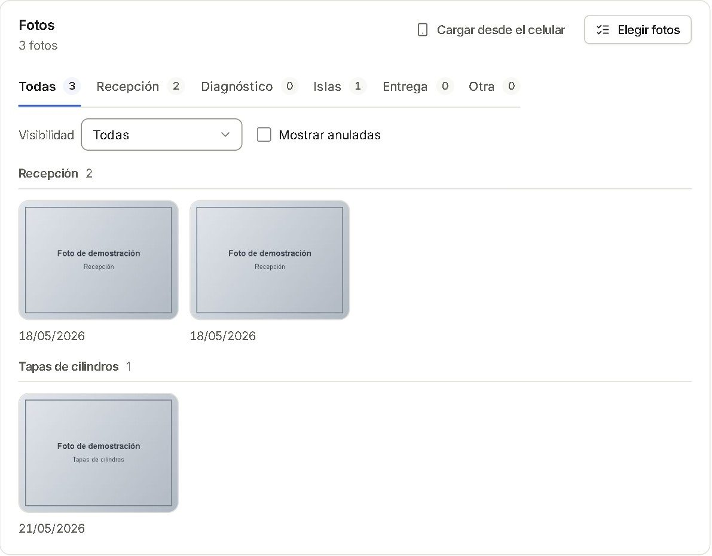

### 9.11 Avisar al cliente

El botón «Avisar al cliente», en la tarjeta del cliente, prepara un mensaje de WhatsApp sobre la orden:

1. Presione «Avisar al cliente».
2. En «Mensaje armado», elija el tipo de aviso (por ejemplo «Novedades de la orden»). El texto del «Mensaje» se completa solo con los datos de la orden y puede editarse.
3. Presione «Abrir en WhatsApp» para enviarlo, o «Copiar mensaje» para pegarlo donde prefiera.

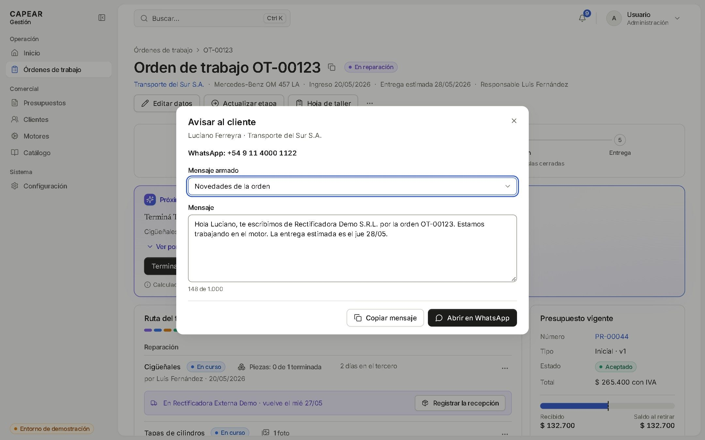

El botón de WhatsApp está deshabilitado si el cliente no tiene cargado un celular válido.

### 9.12 Hoja de taller

La **hoja de taller** es la hoja de trabajo que se imprime para la planta. Lista las operaciones aprobadas por isla, con una casilla «Hecho» para tildar a mano, un recuadro de observaciones y los repuestos aprobados.

1. En el detalle de la orden, presione «Hoja de taller».
2. Si solo necesita una isla, elíjala en el desplegable «Isla»; por defecto muestra «Todas las islas».
3. Presione «Imprimir».

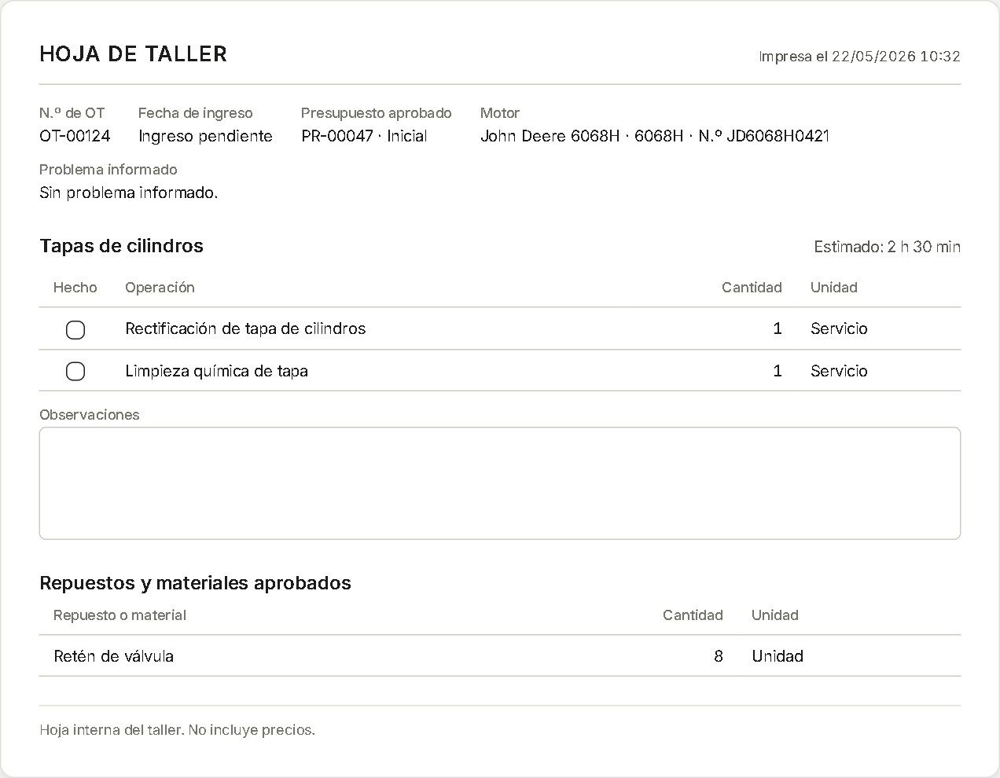

> **Importante.** La hoja de taller **no muestra ningún importe**: ni precios, ni descuentos, ni datos de contacto del cliente. Por eso todos los roles pueden abrirla.

## 10. Recepción de piezas y constancia

### 10.1 Recepción rápida

Cuando un cliente deja el motor armado, o piezas sueltas, se registra lo que llega:

1. Abra la orden y, en la tarjeta «Piezas», presione «Recepción rápida».
2. Tilde las piezas que recibió y, si son varias, indique la «Cantidad».
3. Para cada pieza tildada, elija el «Estado al recibir»: «Bien», «Con daño» o «Incompleta». También puede escribir una «Observación», que **lee el cliente** en la constancia.
4. Presione «Registrar» (el botón indica cuántas piezas son).

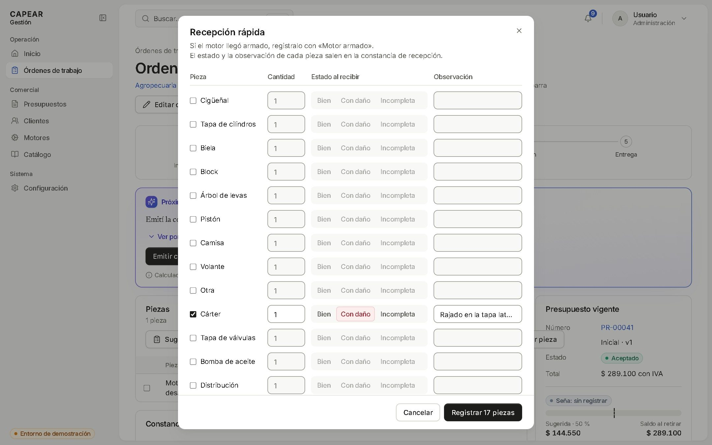

Si el motor llegó armado, regístrelo con el botón «Motor armado» en lugar de listar sus piezas.

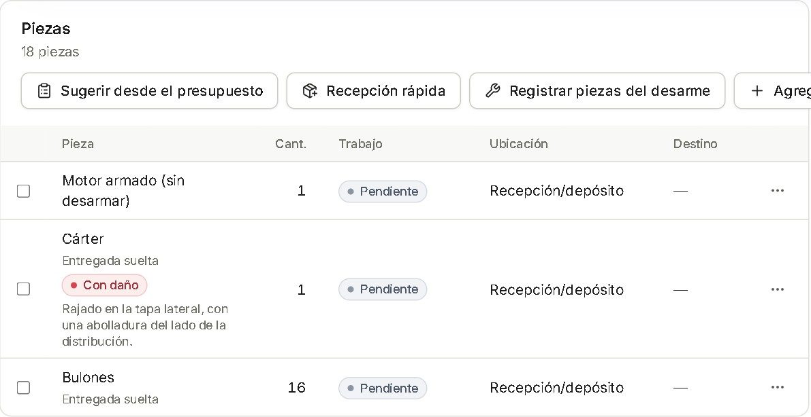

### 10.2 Constancia de recepción

La constancia de recepción es el comprobante que se entrega al cliente con lo que dejó en el taller.

1. En la orden, presione «Emitir constancia» (en la tarjeta «Constancia de recepción» o en la «Próxima acción»).
2. El diálogo muestra «Lo recibido» y las fotos de recepción disponibles. Destilde las fotos que no quiera incluir.
3. Escriba, si hace falta, las «Observaciones de recepción». Las ve el cliente: no escriba notas internas.
4. Presione «Emitir constancia».

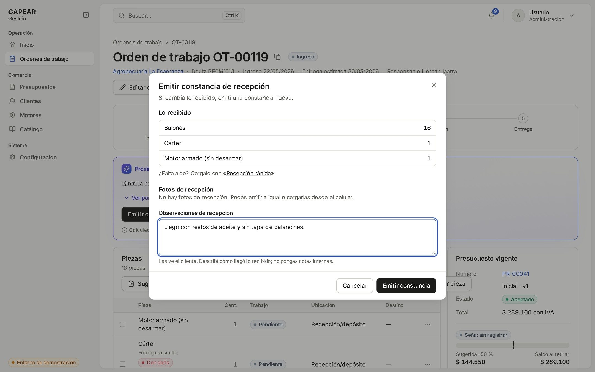

Una vez emitida, el diálogo ofrece «Ver e imprimir» y «Enviar» para mandarla al cliente. La constancia queda congelada: si cambia lo recibido, emita una nueva.

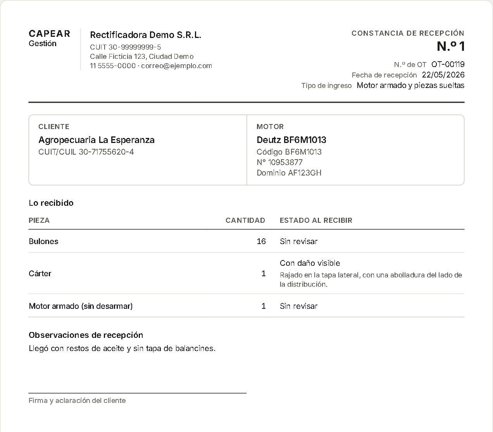

El documento incluye el número de constancia, los datos del cliente y del motor, la tabla «Lo recibido» con el estado de cada pieza, las observaciones, las fotos elegidas y una línea para la **firma y aclaración del cliente**.

La constancia no es una factura. Al entregar el motor, el sistema controla lo registrado al recibirlo y **avisa** si falta algo, pero no impide la entrega.

## 11. Lista de precios CRABA

La lista CRABA es una planilla de precios de repuestos de un proveedor. En el sistema sirve **solo como referencia de precios** al presupuestar: no es una compra ni un control de stock.

### 11.1 Cargar y activar una lista (solo administración)

Esta tarea corresponde al rol Administración, desde «Configuración» → «Listas».

1. Abra «Configuración» y elija la pestaña «Listas».
2. En «Subir lista», arrastre el archivo Excel descargado del portal del proveedor o presione «Elegir archivo».
3. El sistema deja la nueva lista como «Lista pendiente» y la compara con la «Lista vigente»: cuántas filas son iguales, cuántas cambian de precio, cuáles se quitan y cuáles son nuevas, con una descripción en palabras de los cambios más importantes.
4. Si está de acuerdo, presione «Activar» y confirme en el diálogo «Activar la lista CRABA».

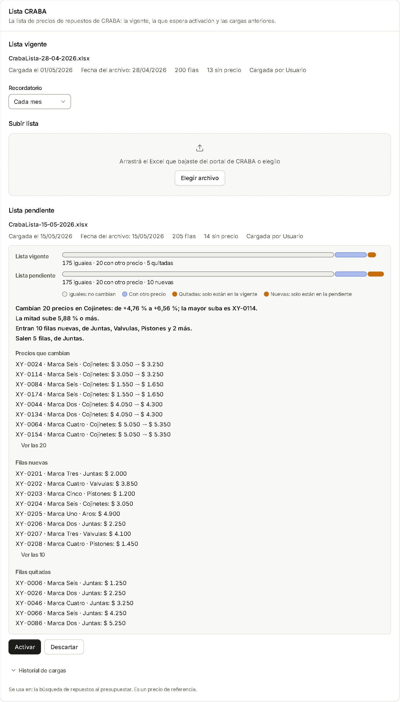

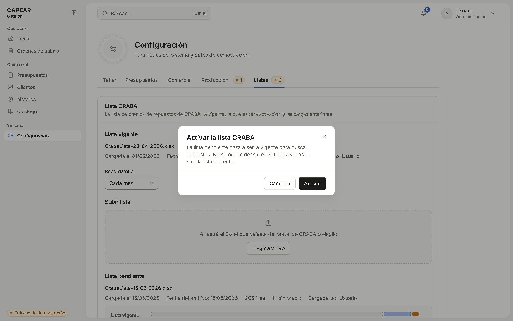

> **Importante.** Activar una lista **no se puede deshacer**. La lista anterior queda en el «Historial de cargas». El «Recordatorio» (cada semana, cada mes o ninguno) avisa cuándo conviene subir una lista nueva.

### 11.2 Buscar un repuesto al presupuestar

1. En el paso 2 del asistente de presupuestos, abra la pestaña «CRABA» del panel de la derecha.
2. Escriba parte del código o de la descripción del repuesto.
3. Cada resultado muestra la descripción, la marca, el código y el «Precio CRABA (neto, referencia)». Presione **+** para agregarlo.
4. El repuesto se agrega como una **línea manual**: el precio de referencia es solo un dato de lectura y usted escribe el precio que cobrará.

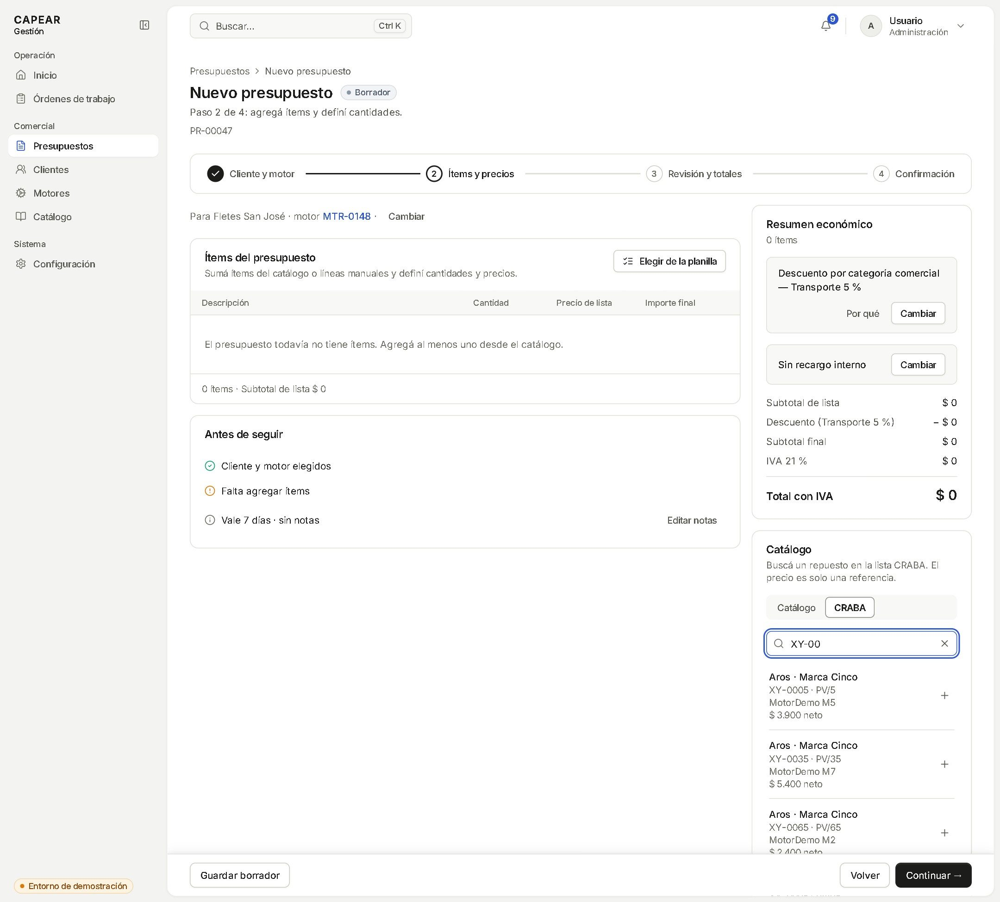

> **Importante.** El cliente nunca ve de dónde salió el precio de un repuesto: en el documento aparece solo el importe final.

## 12. Configuración

«Configuración» reúne los parámetros del sistema. Está dividida en cinco pestañas. Solo el rol **Administración** puede cambiarlos. Gerencia puede ver las pestañas «Taller», «Presupuestos» y «Comercial», pero no ve «Producción» ni «Listas», y planta no entra.

### 12.1 Taller

Contiene los «Datos del taller»: razón social, CUIT, dirección, teléfono (con prueba de WhatsApp), correo y leyenda del pie. Esos datos salen en el encabezado y el pie de los documentos para el cliente. Debajo, «Moneda, fecha y zona horaria» (pesos argentinos, dd/mm/aaaa, hora de Buenos Aires). Una vista previa muestra cómo se verá el documento con los datos guardados.

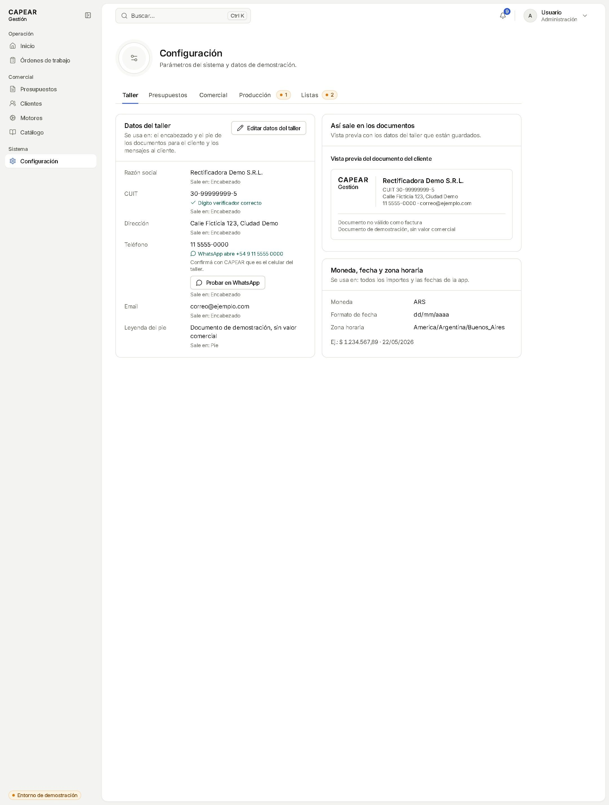

Para cambiar los datos, presione «Editar datos del taller».

### 12.2 Presupuestos

Define cómo se calculan los presupuestos:

- «Cobrar IVA» y la «Tasa de IVA (%)».
- El «Ajuste general sobre FACRA (%)», que se suma a los precios sugeridos de las operaciones FACRA.
- La «Seña sugerida (%)».
- «Precios del documento del cliente»: con el IVA aparte o con el IVA incluido.

Un ejemplo calculado muestra cómo quedan los totales con los valores elegidos. La validez por defecto (7 días) y la numeración no se cambian desde la aplicación.

### 12.3 Comercial

Contiene las «Categorías comerciales», cada una con su descuento, y los «Motivos de rechazo» que se eligen al registrar un rechazo.

- **Nueva categoría comercial**, **Usar por defecto**, **Desactivar** y el ícono del lápiz para editar el nombre y el descuento.
- **Agregar motivo**, **Renombrar** y **Desactivar** para los motivos de rechazo.

Los motivos y las categorías no se borran: se desactivan. El recuadro «Lo que ve el cliente» recuerda que el descuento, la categoría, el recargo y las notas internas nunca salen en los documentos.

### 12.4 Producción

Define las **islas del taller**, es decir, las estaciones por las que pasa cada orden en reparación, su orden y sus dependencias (las islas de reparación trabajan en paralelo y «Armado y control» va al final). Desde «Asignar isla» se vinculan los ítems del catálogo con una isla. También ordena los grupos de la «Planilla de presupuesto» que se ven en «Elegir de la planilla».

### 12.5 Listas

Contiene la lista CRABA (sección 11) y la carga del nomenclador FACRA de motores.

## 13. Carga de fotos desde el celular

La planta sube fotos de las órdenes desde el celular, sin pasar por la computadora. Funciona con cualquier celular con cámara, en posición vertical.

1. Abra la dirección de la aplicación en el celular e ingrese con su cuenta (sección 3). El sistema lo lleva solo a «Elegí la orden».
2. **Elija la orden** de la lista.

   

3. **Elija el momento** de las fotos: por ejemplo «Recepción». Presione «Continuar».

   

4. En «Sacá las fotos», presione «Sacar foto» para usar la cámara o «Elegir de la galería» para usar fotos ya sacadas. La lista «Tomas sugeridas» (por ejemplo «Los 4 lados del motor» o «Placa o número de motor») ayuda a no olvidar ninguna.

   

5. Las fotos elegidas aparecen en una lista. Tilde las tomas sugeridas que cubrió.

   

6. Presione «Subir fotos». Cada foto muestra «Subida» cuando termina, y un mensaje confirma «2 fotos subidas» a la orden.

   

7. Para seguir, presione «Sacar más» u «Otra orden». Cuando termine, presione «Salir».

Las fotos se ven enseguida en la tarjeta «Fotos» de la orden, en la computadora.

## 14. Roles y permisos

El sistema tiene tres roles. Cada usuario tiene uno solo.

| Qué puede hacer | Administración | Gerencia | Planta |
|---|---|---|---|
| Ver «Inicio» | Sí | Sí | No (entra a «Órdenes de trabajo») |
| Ver y crear clientes, motores y catálogo | Sí | Sí | No |
| Ver precios, descuentos, recargos, seña y totales | Sí | Sí | **No, nunca** |
| Crear, emitir y enviar presupuestos | Sí | Sí | No |
| Registrar la decisión del cliente | Sí | Sí | No |
| Anular un presupuesto y cancelar una orden | Sí | Sí | No |
| Ver las órdenes de trabajo y actualizar su avance | Sí | Sí | Sí, sin importes |
| Editar datos de la orden (responsable, entrega) | Sí | Sí | No |
| Cargar el diagnóstico | Sí | Sí | Sí (sin confirmarlo) |
| Confirmar el diagnóstico y crear revisiones | Sí | Sí | No |
| Registrar seña, emitir constancia de recepción | Sí | Sí | No |
| Abrir y imprimir la hoja de taller | Sí | Sí | Sí, sin importes |
| Subir fotos (celular) | Sí | Sí | Sí |
| Cambiar la «Configuración» | Sí | No (no ve «Producción» ni «Listas») | No |
| Cargar y activar la lista CRABA | Sí | No | No |

El rol de planta recibe una vista reducida: solo «Órdenes de trabajo», sin importes, sin seña y sin constancia de recepción. Del presupuesto vigente ve solo el número, nunca los montos.

> **Importante.** La restricción de importes para planta no es solo visual: el sistema ni siquiera entrega esos datos al rol de planta.

Cuando el taller trabaja con una sola cuenta de administración, todos los permisos de esa cuenta son los de la columna «Administración». El sistema todavía no tiene una pantalla para administrar usuarios: las cuentas de gerencia y de planta las crea el soporte del sistema a pedido del taller, indicando el nombre, el correo y el rol de cada persona.

## 15. Preguntas frecuentes y solución de problemas

**No recuerdo mi contraseña.** Presione «¿Olvidaste tu contraseña?» en la pantalla de ingreso y siga la indicación: un administrador del taller le genera una clave nueva.

**Veo el mensaje «Correo o contraseña incorrectos.».** Revise el correo y la contraseña. Fíjese que no esté activada la tecla de mayúsculas. Si el problema continúa, pida a la administración que revise su cuenta.

**Me equivoqué en un presupuesto que ya emití.** Un presupuesto emitido no se edita. Anúlelo desde el menú «…» → «Anular presupuesto» con un motivo y cree uno nuevo (sección 8.9).

**El cliente aceptó por error, o se arrepintió.** Un presupuesto aceptado no se anula. Cancele la orden de trabajo desde el menú «…» → «Cancelar orden», con un motivo (sección 9.9).

**Aceptaron un presupuesto y no veo la orden.** Abra el detalle del presupuesto: el campo «Orden de trabajo» tiene el enlace a la orden creada. También aparece en la lista de «Órdenes de trabajo» en la etapa «Ingreso».

**No puedo registrar la decisión ni enviar un presupuesto.** Si el presupuesto está **vencido**, el sistema no admite decisión ni envío. Anúlelo y cree uno nuevo desde «Nuevo presupuesto».

**No me deja confirmar un rechazo.** El «Motivo del rechazo» es obligatorio. Elija uno de la lista.

**El botón de WhatsApp está deshabilitado.** El cliente no tiene cargado un celular válido. Complete su teléfono en su ficha («Editar»).

**El presupuesto del paso 3 no muestra el descuento ni el recargo.** Es lo correcto: esa vista es lo que ve el cliente, que nunca ve descuentos ni recargos. Para ver el detalle interno, use la «Vista interna» del detalle del presupuesto.

**No encuentro un repuesto en la lista CRABA.** Revise el código o la descripción. Si el repuesto no figura, agréguelo como «línea manual» con el precio que corresponda.

**La carga de fotos no me deja subir.** Verifique que haya elegido la orden y el momento y que tenga conexión a internet. Si una foto muestra un error, reintente con «Subir fotos».

**Una pantalla se ve cortada o superpuesta.** Revise que la ventana del navegador tenga al menos 1280 píxeles de ancho. Si usa una pantalla pequeña, reduzca el zoom del navegador con **Ctrl + −**.

**Perdí lo que estaba escribiendo al cambiar de pantalla.** En los formularios largos (cliente, motor, ítem), el sistema pregunta antes de salir si hay cambios sin guardar. Si respondió que sí, esos cambios se pierden. En los presupuestos, use «Guardar borrador» con frecuencia.

**La pantalla muestra «No pudimos cargar la página».** Revise su conexión a internet y recargue la página (**F5**). Si continúa, avise a la administración.
