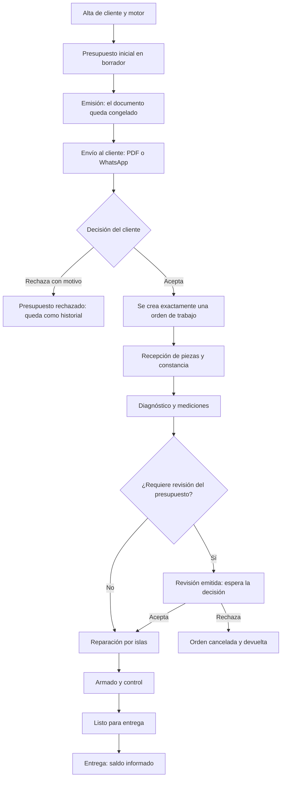
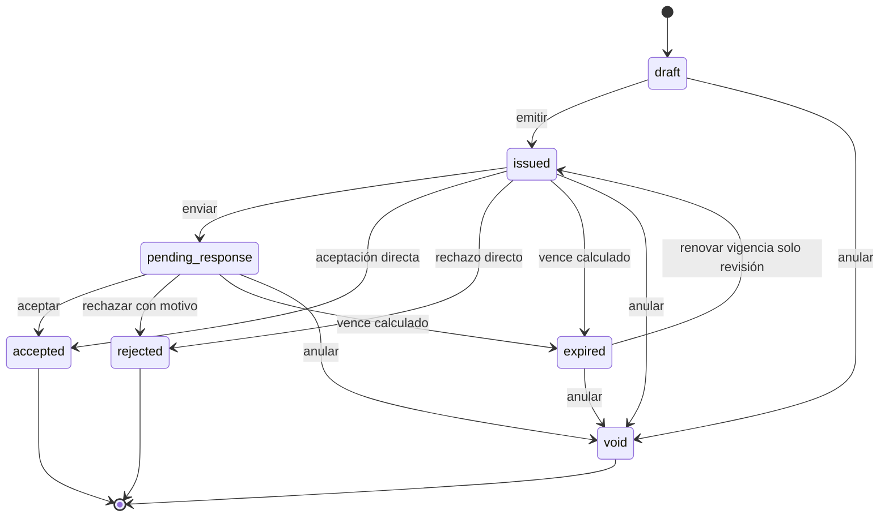
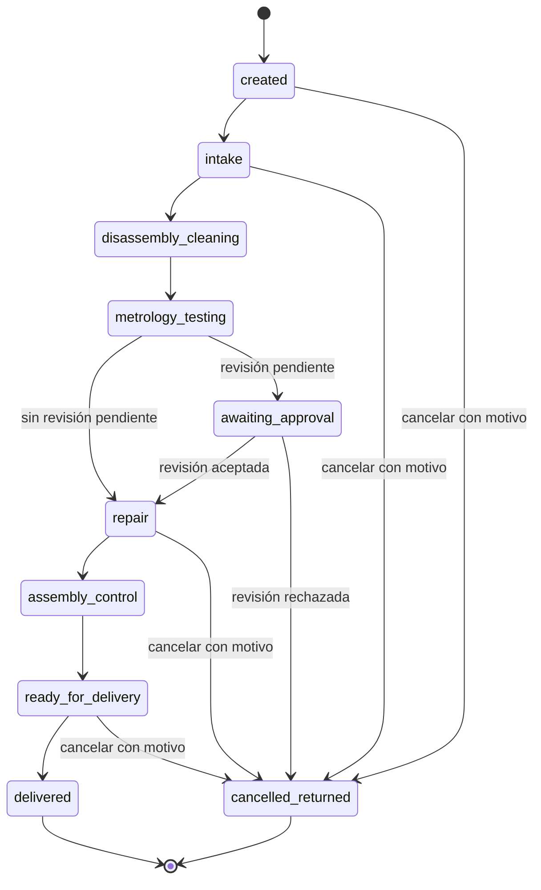
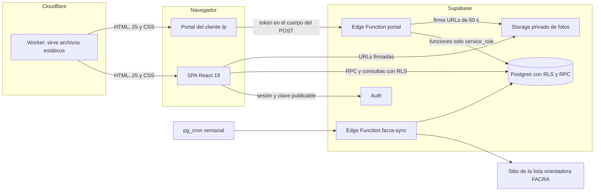
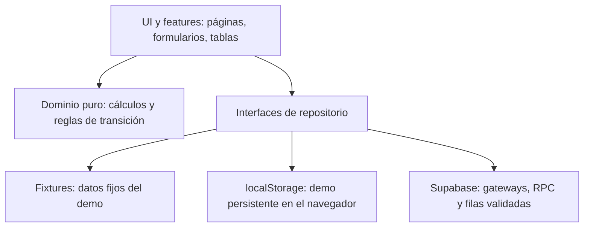
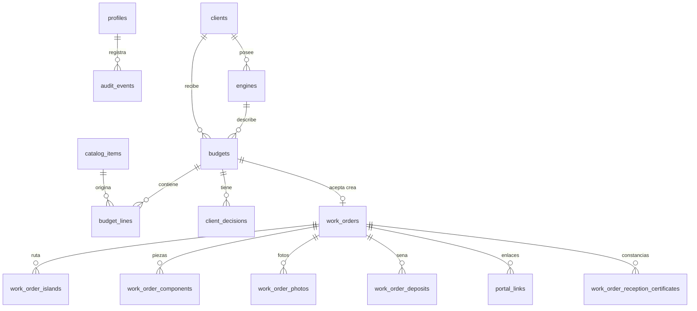
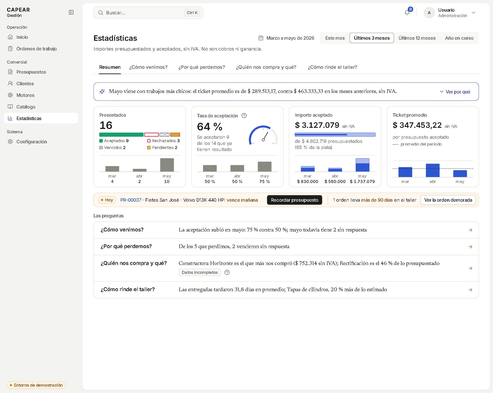
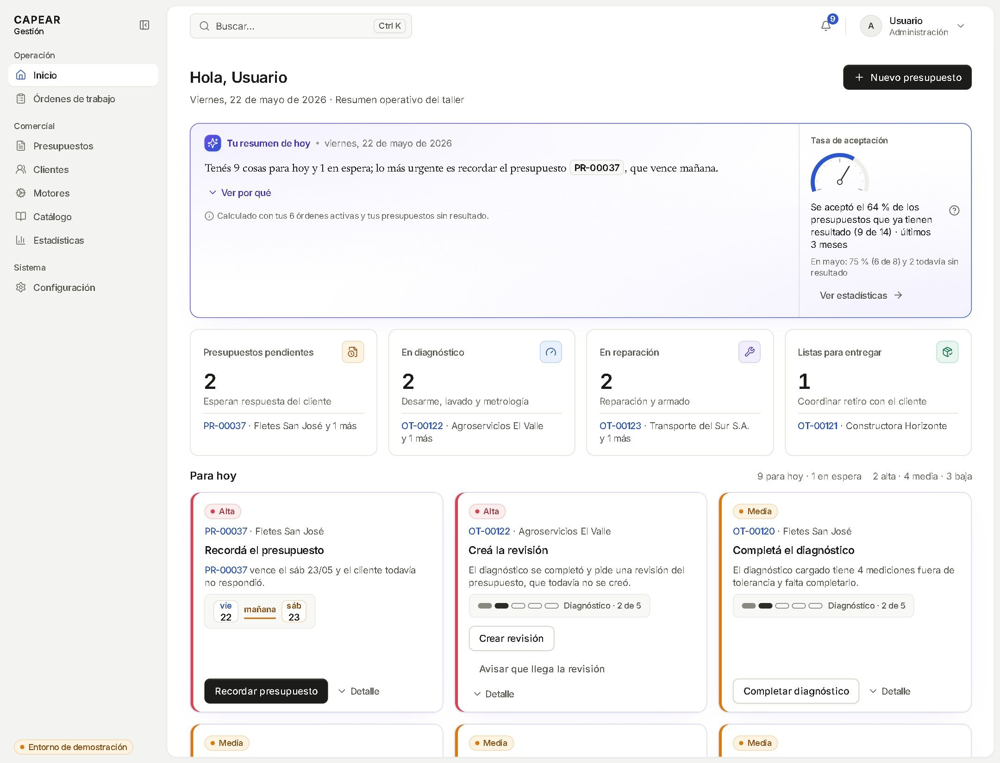
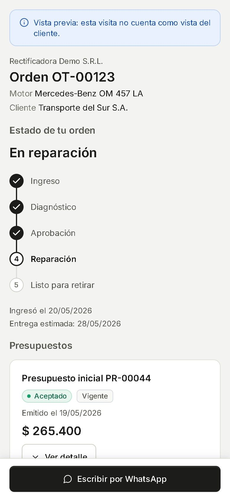

# Parte III — Informe Técnico-Funcional del Desarrollador

## 1. Introducción y alcance del informe

### 1.1 Propósito

Este documento describe, desde el punto de vista del desarrollador, el sistema **CAPEAR Gestión**: qué hace, cómo está construido, cómo se prueba, cómo se instala y cómo se despliega. Está dirigido a dos lectores: el docente que evalúa las Prácticas Profesionalizantes y el desarrollador que, en el futuro, deba mantener o extender el sistema. Cada afirmación proviene del repositorio: código, migraciones, pruebas y documentación de ingeniería.

### 1.2 El sistema en una frase

CAPEAR Gestión es una aplicación web de escritorio, escrita con React 19 y TypeScript, con un backend en Supabase, construida para un taller de rectificación de motores. Cubre el recorrido comercial y operativo inicial del taller: clientes, motores, un catálogo normalizado de ítems, presupuestos iniciales, la decisión del cliente, la creación automática de una única orden de trabajo al aceptarse el presupuesto y el seguimiento básico de esa orden.

No es un ERP genérico. El primer alcance es deliberadamente acotado y el repositorio lo declara como regla dura: quedan **fuera** el inventario y los movimientos de stock, los cobros y la caja, la facturación fiscal, las compras a proveedores, el modo sin conexión y la aplicación móvil (con tres pantallas excepcionales que sí funcionan en teléfono: el inicio de sesión, la carga de fotos y el portal del cliente). La única excepción económica acotada es registrar una seña sobre una orden (decisión D-49).

### 1.3 Alcance temporal y volumen

El desarrollo se realizó entre agosto y noviembre de 2026. El desarrollo se integró mediante 39 pull requests, del #1 al #39, hasta el 13/11/2026. La última verificación completa local (11/11/2026) arrojó 722 archivos de pruebas unitarias con 13.147 pruebas aprobadas y 203 pruebas de extremo a extremo aprobadas. El sistema está en producción desde el 12/11/2026.

### 1.4 Convenciones del documento

- Las reglas de negocio (por ejemplo, BR-01) y las decisiones del proyecto (por ejemplo, D-49) se citan con un código, que se explica en el mismo documento.
- Los nombres de roles en el código son `admin` (Administración), `manager` (Gerencia) y `plant` (Planta).
- Los identificadores internos de estados están en inglés (`draft`, `repair`, …) y las etiquetas que ve el usuario están en español.
- No se incluyen identificadores de proyecto ni credenciales. Las direcciones públicas de la aplicación de prueba y de la presentación figuran en el README del repositorio de entrega.

## 2. Descripción funcional

### 2.1 Módulos y responsabilidades

La navegación principal expone las secciones Inicio, Clientes, Motores, Catálogo, Presupuestos, Órdenes, Estadísticas y Configuración. Un usuario de planta solo accede a Órdenes (`src/app/auth/permissions.ts`). La tabla resume los módulos funcionales y su responsabilidad.

| Módulo | Responsabilidad | Roles que lo usan |
|---|---|---|
| Inicio | Resumen de lo pendiente del día y accesos directos. Su capa de asistencia («Para hoy», «En espera») es configurable por entrega. | Administración, Gerencia |
| Clientes | Alta, edición y baja lógica de clientes; categoría comercial con su porcentaje de descuento; contacto y datos fiscales mínimos. | Administración, Gerencia |
| Motores | Alta asistida del motor con marca, modelo de vehículo y motor en cascada; datos técnicos; lista FACRA asociada (1 a 13). | Administración, Gerencia |
| Catálogo | Ítems normalizados de mano de obra, repuestos, pruebas y mediciones, y servicios; historial de precios; elegibilidad de descuento por ítem. | Administración, Gerencia |
| Presupuestos | Asistente de presupuesto inicial, líneas manuales y líneas con precio sugerido FACRA, búsqueda de referencia CRABA, descuento, recargo interno, emisión, documento para el cliente y decisión (aceptado o rechazado, con motivo). | Administración, Gerencia |
| Órdenes de trabajo | Lista y ficha de la orden, etapas generales, ruta del taller por islas, piezas de la orden, constancia de recepción, control de entrega, seña y saldo, fotos, hoja de taller. | Los tres roles (planta sin datos económicos) |
| Diagnóstico y revisiones | Diagnóstico estructurado con mediciones y pruebas; revisión del presupuesto cuando el diagnóstico lo requiere; comparación inicial contra revisión. | Administración y Gerencia confirman; Planta carga el borrador |
| Fotos | Carga desde el teléfono (`/cargar-fotos`), galería de escritorio, publicación y anulación. | Los tres roles; la publicación es de Administración y Gerencia |
| Hoja de taller | Documento imprimible por planta con las operaciones aprobadas, cantidades, isla y minutos estimados; nunca contiene importes. | Los tres roles |
| Estadísticas comerciales | Importes presupuestados y aceptados, tasas, tiempos de respuesta y motivos de rechazo. No son cobros ni ganancia (BR-49). | Administración, Gerencia |
| Portal del cliente (beta) | Enlace privado y revocable por orden y página de solo lectura `/p#<token>` para que el cliente, sin cuenta, vea el estado, los presupuestos con precios finales y las fotos publicadas. | Staff crea; el cliente consulta |
| Configuración | Datos del taller, IVA, ajuste FACRA, categorías de cliente, motivos de rechazo, tipos de pieza, islas del taller, listas FACRA y CRABA, modelos de vehículo, sistema. | Solo Administración edita |

Dos módulos de apoyo atraviesan los anteriores. La **campana** de avisos por usuario reúne lo que requiere atención y permite «Avisar al cliente» por WhatsApp (D-52). La **paleta de comandos** permite buscar y saltar a registros.

### 2.2 Flujo principal de punta a punta

El flujo central del producto es: se registra al cliente y su motor, se arma el presupuesto inicial, se emite, el cliente decide, y solo si acepta nace la orden de trabajo, que luego recorre sus etapas hasta la entrega.



Puntos relevantes del flujo:

- Un presupuesto inicial no tiene orden antes de ser aceptado (BR-02). Aceptarlo crea como máximo una orden; repetir la operación o hacer doble clic no genera una segunda (BR-01). La orden hereda cliente, motor y presupuesto (BR-15).
- La orden nace en la etapa «Creada» con «Ingreso pendiente» y recorre sus etapas con transiciones controladas (sección 2.4).
- La seña se registra sobre la orden y el sistema solo **avisa** si falta al pasar a reparación; nunca bloquea (BR-48).
- Tanto la recepción como la entrega tienen controles que advierten sin impedir el avance (BR-44).

### 2.3 Máquina de estados del presupuesto

Los estados canónicos del presupuesto son `draft`, `issued`, `pending_response`, `accepted`, `rejected`, `expired` y `void`. El estado `expired` es **calculado**, nunca almacenado: un presupuesto emitido o pendiente está vencido cuando la fecha de hoy en la zona horaria de Buenos Aires es posterior a `valid_until` (D-37, BR-33). No existe tarea programada para vencerlos; tanto los repositorios como el servidor lo tratan como vencido al leerlo.



Reglas asociadas, tomadas de `docs/product/STATE_MACHINES.md`:

- **Inicial vencido:** es terminal. Solo se anula con motivo o se duplica como un borrador nuevo a precios actuales (BR-34).
- **Revisión vencida:** se renueva con motivo y la validez nunca se acorta (BR-35).
- **Decisión de una revisión:** una revisión emitida puede decidirse sin envío previo, porque el cliente puede responder por teléfono o en mostrador (D-69).
- **Rechazo:** toda transición a `rejected` lleva un motivo activo de la lista configurable (BR-47). Un rechazo no destruye el historial (BR-14).
- **Anular, no borrar:** ningún presupuesto emitido se elimina (BR-06).
- Cuando el presupuesto es de tipo inicial, la transición a `accepted` dispara la creación idempotente de la orden.

### 2.4 Máquina de estados de la orden de trabajo

Los estados canónicos de la orden son: `created`, `intake`, `disassembly_cleaning`, `metrology_testing`, `awaiting_approval`, `repair`, `assembly_control`, `ready_for_delivery`, `delivered` y `cancelled_returned`.



El diagrama muestra solo algunas de las transiciones de cancelación para mantenerlo legible: la regla completa permite cancelar cualquier orden abierta, de `created` a `ready_for_delivery` (BR-36). Además:

- **Volver a la etapa anterior** (D-67): administración y gerencia pueden retroceder una etapa manual con motivo; nunca desde `created`, `awaiting_approval`, `repair`, `delivered` ni `cancelled_returned`. La tabla de retrocesos es única para el diálogo, el menú, el demo y el SQL.
- **Orden cerrada:** una orden `delivered` o `cancelled_returned` no se reabre y es de solo lectura (BR-17, BR-36).
- **Entrega que cierra la ruta** (D-66): si quedan islas abiertas al entregar, el diálogo las lista, exige un motivo y la transacción las pasa a `skipped`. La aplicación avisa y no bloquea.
- **Islas del taller:** la reparación se organiza en una ruta de islas (estaciones), cada una con su propio estado (`pending`, `inProgress`, `paused`, `completed`, `skipped`, `blocked`). Bloquear, omitir y reabrir exigen motivo; las dependencias entre islas avisan pero permiten continuar, y el adelanto queda auditado.
- **Piezas de la orden:** cada pieza se sigue aparte del motor, con un estado de trabajo (`pending`, `in_progress`, `done`, `no_intervention`) y una ubicación (recepción, isla, esperando armado, en tercero, instalada) que son datos independientes (BR-25 a BR-31).

### 2.5 Reglas de negocio clave

La tabla recoge las reglas más determinantes para el comportamiento del sistema. Prevalecen sobre cualquier texto ilustrativo de los diseños visuales.

| Código | Regla |
|---|---|
| BR-01 | Aceptar un presupuesto inicial crea como máximo una orden; la operación es idempotente. |
| BR-02 | Un presupuesto inicial no tiene orden antes de su aceptación. |
| BR-04 | Cada línea conserva un snapshot histórico (descripción, tipo, unidad, precio y contexto tributario); cambios posteriores del catálogo no alteran el documento. |
| BR-05 | La emisión congela el documento: lo emitido nunca se recalcula. |
| BR-06 | Anular, no borrar: los presupuestos emitidos y las órdenes se anulan lógicamente. |
| BR-09 | El dinero se calcula con decimales exactos, nunca con coma flotante binaria. |
| BR-10 | Fórmula base: el descuento comercial se aplica antes del IVA y solo a líneas elegibles; después, el recargo interno se aplica a todas las líneas; redondeo mitad hacia arriba a 2 decimales. |
| BR-18 | Planta no recibe precios, subtotales, impuestos, descuentos, recargos, seña, saldo ni totales; la exclusión se aplica en base de datos y en la interfaz. |
| BR-19 | Las acciones críticas registran actor y marca de tiempo; las altas y cambios de maestros se auditan con los campos modificados, sin sus valores. |
| BR-23 | El descuento y el recargo interno nunca se muestran al cliente: ningún documento, mensaje ni vista delata su existencia. |
| BR-24 | Cada cliente tiene una categoría comercial con porcentaje; el presupuesto toma una copia del porcentaje al crearse. |
| BR-33 | El vencimiento de un presupuesto es calculado, no almacenado. |
| BR-36 | Cancelar una orden requiere motivo y cierra los intervalos abiertos de sus islas. |
| BR-39 | El precio FACRA es una sugerencia que se recalcula en borradores y se congela al emitir. |
| BR-40 | El descuento se aplica solo a las líneas elegibles según cada ítem. |
| BR-42 | La referencia CRABA nunca se precarga en un precio y nunca la ven planta ni el cliente. |
| BR-43 | La constancia de recepción queda congelada al emitirse. |
| BR-46 | Recargo interno por presupuesto, con motivo obligatorio, aplicado después del descuento y solo en borradores. |
| BR-47 | El motivo de rechazo es obligatorio, interno y proviene de una lista configurable. |
| BR-48 | El presupuesto vigente de la orden y la seña: una excepción acotada que avisa y nunca bloquea. |
| BR-49 | Las estadísticas muestran lo presupuestado y aceptado, jamás lo cobrado ni lo ganado. |
| BR-50 a BR-53 | Portal del cliente: un enlace activo por orden, vigencia posterior al cierre, lista blanca de contenido y registro de «visto» sin crear eventos de auditoría. |
| BR-54 | Estado al recibir de cada pieza, que sale en la constancia de recepción. |

## 3. Arquitectura

### 3.1 Vista general

El sistema se compone de una aplicación de una sola página (SPA) que se ejecuta en el navegador y que se comunica con Supabase, y de un Cloudflare Worker mínimo que solo sirve los archivos estáticos del sitio. Toda la lógica de negocio con garantías de integridad vive en la base de datos (funciones RPC y políticas de seguridad por fila); la SPA nunca recibe una clave de servicio.



Observaciones:

- El Worker (`worker/index.js`) delega en el binding de activos estáticos, devuelve `index.html` para rutas de la SPA, responde 404 a la ruta interna del manifiesto de Vite y agrega cabeceras de privacidad a todo HTML (`Referrer-Policy: no-referrer` y `X-Robots-Tag: noindex, nofollow`), porque el enlace del portal contiene un secreto.
- El portal es la **única puerta pública**: el rol anónimo (`anon`) no recibe nada en la base de datos. La Edge Function `portal` usa la clave de servicio y llama a funciones SQL que solo ejecuta `service_role`.
- La SPA tiene dos puntos de entrada cargados de forma diferida (`src/main.tsx`): el de la aplicación del personal y el del portal. Un cliente que abre `/p` no descarga la aplicación del personal, lo que se verifica con un script de guardia de empaquetado (`scripts/portal-chunk-guard.mjs`).

### 3.2 Capas de la aplicación



- **UI y features** (`src/features/*`, `src/components/*`): páginas y componentes organizados por módulo funcional. Los componentes no codifican el comportamiento de persistencia.
- **Dominio puro** (`src/domain/*`): cálculos monetarios, transiciones de estado, permisos, reglas de elegibilidad y formato. Son funciones puras con pruebas unitarias; el servidor tiene un espejo SQL de las reglas críticas y una prueba compara ambos resultados.
- **Repositorios** (`src/data/repositories`): interfaces por agregado (clientes, presupuestos, órdenes, fotos, portal, etc.). Cada una tiene una implementación contra `localStorage` (`src/data/storage`, usada por el demo) y otra contra Supabase (`src/data/supabase`). El contexto de repositorios (`src/data/context`) elige la implementación al iniciar según `VITE_DATA_SOURCE`. Los datos de ejemplo deterministas están en `src/data/fixtures`.

La separación se tomó como regla de ingeniería desde el inicio: la primera fase funcionó íntegramente con datos de ejemplo y el backend real se incorporó después reemplazando implementaciones de repositorios, sin tocar las pantallas (D-08, D-09, D-14, D-15).

### 3.3 Ruteo

El ruteo usa React Router 7 con rutas declarativas (`src/app/appRoutes.tsx`). Las rutas principales son `/` (Inicio), `/clientes`, `/motores`, `/catalogo`, `/presupuestos`, `/ordenes` y `/configuracion/:seccion?`, cada una con su ficha, formulario y variantes (`/clientes/:clientId`, `/clientes/nuevo`, `/presupuestos/:budgetNumber/revision`, etc.). Rutas especiales:

- Documentos imprimibles: `/presupuestos/:budgetNumber/documento`, `/presupuestos/:budgetNumber/comparacion/documento`, `/ordenes/:orderNumber/constancia` y `/ordenes/:orderNumber/hoja-de-taller`.
- `/cargar-fotos`: página de carga pensada para el teléfono.
- `/p#<token>`: portal del cliente; el token va en el fragmento, de modo que el navegador no lo envía al servidor en la petición HTTP de la página.
- Las rutas se protegen con guardas de autenticación y de rol (`RequireAuth`, `RequireRole`). Estas guardas son defensa en profundidad: la autorización real está en la base de datos.

### 3.4 Estado y datos

No se usa una librería global de estado. Un proveedor de datos asíncrono único por sesión (`WorkshopDataProvider`) entrega los datos a las pantallas, con estados de carga y reintento cuando el origen es remoto y con una instantánea inmediata en el demo (D-16). Los formularios usan React Hook Form con esquemas Zod, y las respuestas del servidor se validan con esquemas Zod antes de ingresar a la aplicación (`src/data/supabase/rows.ts`, con una prueba de deriva contra las migraciones). El reloj es inyectable: el demo usa un instante fijo y Supabase usa la hora actual de Buenos Aires (D-18), lo que permite pruebas deterministas.

### 3.5 Diseño visual con tokens

Todo el estilo se expresa a través de variables CSS definidas en `src/styles/tokens.css` (escala de grises, acento cobalto, superficies, bordes, sombras, tamaños). La regla del proyecto prohíbe codificar colores, tamaños o sombras en los estilos de cada módulo. Los componentes de interfaz compartidos (`src/components/ui`) están construidos sobre primitivas de Radix UI estilizadas con esos tokens, con iconos de `lucide-react` y animaciones de `motion`. Las tipografías se empaquetan localmente (Inter y Newsreader de Fontsource). El criterio de aceptación visual es una ventana de 1600×1000 píxeles con ancho mínimo soportado de 1280 píxeles; las tres pantallas móviles se aceptan a 390×844.

## 4. Tecnologías utilizadas

Las versiones corresponden a `package.json`. Un prefijo `^` indica que se acepta cualquier versión compatible posterior dentro de la misma versión mayor.

| Tecnología | Versión | Para qué se usa |
|---|---|---|
| React / React DOM | 19.2.0 | Biblioteca de interfaz. |
| TypeScript | ^5.9.2 | Lenguaje en modo estricto. |
| Vite | 6.4.2 | Servidor de desarrollo y empaquetado. |
| React Router DOM | 7.18.4 | Ruteo. |
| React Hook Form | ^7.62.0 | Formularios. |
| Zod | ^4.1.5 | Esquemas de validación de formularios y de respuestas del servidor. |
| @hookform/resolvers | ^5.2.1 | Integración de Zod con los formularios. |
| @supabase/supabase-js | 2.117.2 | Cliente de Postgres, Auth, Storage y Functions. |
| Radix UI (dialog, dropdown-menu, popover, tabs, tooltip) | ^1.1 a ^2.1 | Primitivas accesibles de interfaz, estilizadas con tokens propios. |
| lucide-react | ^0.468.0 | Iconos. |
| motion | 13.4.6 | Transiciones y animaciones. |
| @fontsource-variable/inter y newsreader | ^5.3.0 y 5.3.0 | Tipografías empaquetadas. |
| xlsx (SheetJS, tarball local) | 0.20.3 | Lectura de la lista CRABA en Excel y de la carga de modelos de vehículo. |
| Vitest | ^3.2.4 | Pruebas unitarias, de base de datos y de funciones. |
| Testing Library (react, jest-dom, user-event) | ^16.3.0, ^6.8.0, ^14.6.1 | Pruebas de componentes. |
| jsdom | ^26.1.0 | Entorno de navegador para las pruebas unitarias. |
| @electric-sql/pglite | 0.5.8 | Postgres embebido para probar migraciones y RPC. |
| Playwright | ^1.55.0 | Pruebas de extremo a extremo. |
| @axe-core/playwright | 4.14.0 | Pruebas automáticas de accesibilidad. |
| ESLint, typescript-eslint, eslint-plugin-react-hooks | 9.39.5, 8.71.2, 5.2.0 | Análisis estático. |
| Supabase (Postgres, Auth, Storage, Edge Functions) | servicio gestionado | Backend. Las funciones se ejecutan en Deno. |
| Cloudflare Workers | servicio gestionado | Sirve los activos estáticos y agrega cabeceras de privacidad. |
| GitHub Actions | servicio gestionado | Integración continua y respaldos programados. |
| Node.js | 22 (versión usada en CI) | Entorno de ejecución de herramientas. |

## 5. Estructura del repositorio

La estructura corresponde al repositorio de trabajo, que es privado. El repositorio de entrega publica esta documentación, la presentación web y una muestra del código en la carpeta `muestra-de-codigo/`.

```text
.
├── package.json               Scripts y dependencias
├── vite.config.ts             Configuración de Vite y de los tres grupos de Vitest
├── playwright.config.ts       Configuración de las pruebas e2e
├── eslint.config.js           Reglas de análisis estático
├── tsconfig.*.json            Configuración de TypeScript (app, funciones, herramientas)
├── index.html                 Documento base de la SPA
├── public/                    Archivos estáticos
├── vendor/                    Paquete local de SheetJS
├── worker/
│   └── index.js               Cloudflare Worker que sirve el sitio
├── scripts/                   Guardas de build, generación del seed y utilidades
├── supabase/
│   ├── migrations/            79 migraciones SQL ordenadas por fecha
│   ├── functions/
│   │   ├── facra-sync/        Edge Function de la actualización semanal FACRA
│   │   ├── portal/            Edge Function del portal del cliente
│   │   └── _shared/           Lógica de las funciones, probada con Vitest
│   └── seed.sql               Datos ficticios para entornos de validación
├── src/
│   ├── main.tsx               Punto de entrada (aplicación o portal, carga diferida)
│   ├── app/                   Rutas, autenticación, arranque, errores
│   ├── components/            Componentes compartidos (ui, layout, motion, assistant, charts)
│   ├── config/                Configuración de ejecución y módulos ocultos por entrega
│   ├── data/
│   │   ├── repositories/      Interfaces de repositorio
│   │   ├── storage/           Implementaciones sobre localStorage (demo)
│   │   ├── supabase/          Implementaciones sobre Supabase
│   │   ├── fixtures/          Datos de ejemplo deterministas
│   │   ├── photos/            Almacén local de fotos (IndexedDB) para el demo
│   │   └── context/           Selección de implementación por modo de datos
│   ├── domain/                Reglas puras: presupuestos, dinero, órdenes, islas, FACRA, CRABA, portal…
│   ├── features/              Módulos funcionales: clientes, motores, catálogo, presupuestos,
│   │                          órdenes, diagnóstico, fotos, estadísticas, hoja de taller, etc.
│   ├── portal/                Página pública del cliente
│   ├── lib/                   Utilidades: formato, reloj, hotkeys, fotos, hojas de cálculo
│   └── styles/                Tokens de diseño y estilos globales
├── tests/
│   ├── database/              68 archivos de pruebas con PGlite
│   ├── e2e/                   30 especificaciones de Playwright
│   └── *.test.mjs             Pruebas del Worker y de la guarda de build
├── docs/
│   ├── product/               Contexto, requisitos, reglas de negocio, máquinas de estado, decisiones
│   ├── engineering/           Arquitectura, seguridad, estrategia de pruebas, runbook de Supabase
│   └── design/                Sistema de diseño
└── .github/workflows/         CI y respaldos programados
```

## 6. Modelo de datos

### 6.1 Entidades principales

La base de datos es relacional (Postgres) y las columnas exactas están en `supabase/migrations/` y en `src/data/supabase/rows.ts`. Las tablas principales, agrupadas por función, son:

| Grupo | Tablas |
|---|---|
| Identidad y configuración | `profiles`, `app_settings`, `client_categories` |
| Maestros | `clients`, `engines`, `catalog_items`, `catalog_price_history`, `component_types`, `vehicle_models`, `vehicle_model_engines` |
| Presupuestos | `budgets`, `budget_lines`, `client_decisions` |
| Órdenes | `work_orders`, `work_order_components`, `work_processes`, `work_order_deposits`, `work_order_reception_certificates`, `work_order_photos` |
| Islas del taller | `workshop_islands`, `workshop_island_dependencies`, `work_order_islands`, `work_order_island_intervals` |
| Diagnóstico | `work_order_diagnoses`, `diagnosis_measurements`, `diagnosis_tests` |
| Referencias de precios | `facra_versions`, `facra_nomenclator`, `facra_operations`, `facra_operation_units`, `facra_amounts`, `facra_sync_runs`, `craba_versions`, `craba_items` |
| Portal | `portal_links` |
| Auditoría | `audit_events` |

### 6.2 Diagrama entidad-relación simplificado



El diagrama omite columnas y tablas de apoyo para mantenerse legible. Dos relaciones merecen aclaración: una orden referencia a su presupuesto inicial (`initial_budget_id`) y a su presupuesto vigente (`current_budget_id`), y una revisión es un presupuesto de tipo `revision` que referencia a la versión anterior mediante `previous_budget_id`.

### 6.3 Snapshots de precios

El principio central del modelo es que **un documento emitido no cambia nunca** (BR-04, BR-05). Para lograrlo, cada línea de presupuesto (`budget_lines`) guarda un snapshot de su descripción, tipo, unidad y precio unitario (`unit_price_snapshot`), junto con el contexto tributario del momento y metadatos como el origen del precio (catálogo, modificado, manual o FACRA). El catálogo conserva además un historial de precios (`catalog_price_history`). Consecuencias:

- Si el precio de un ítem del catálogo cambia después de emitir, el total histórico no cambia.
- El servidor es quien fija precios, IVA y descuento al guardar un borrador; nunca se toman precios del navegador, salvo por dos caminos explícitos (la línea manual y el precio modificado, BR-37).
- Los importes viajan como textos decimales y las operaciones usan aritmética decimal exacta (BR-09).
- Los borradores se recalculan al guardarse; emitir no recalcula nada.
- Las constancias de recepción y las hojas congeladas guardan su propio snapshot con una versión de formato (`format_version`), para poder leerse siempre como se emitieron.

### 6.4 Auditoría

La tabla `audit_events` registra actor, marca de tiempo, tipo de evento, entidad y metadatos. La auditoría de altas, cambios, bajas y reactivaciones de maestros la realizan disparadores de la base de datos, que guardan los nombres de los campos modificados, no sus valores, porque pueden ser datos personales (BR-19). Las acciones críticas (emisión, decisión, anulación, cambio de etapa, seña, enlaces del portal) las escriben las funciones RPC en la misma transacción. Solo los roles comerciales leen los eventos. En el modo demo esta auditoría no existe: es una excepción documentada (D-37).

### 6.5 Migraciones

Hay 79 migraciones SQL con nombre `AAAAMMDDNNNNNN_descripcion.sql`, aplicadas en orden. La primera crea el esquema base (agosto de 2026) y la última, a la fecha de este informe, es de noviembre de 2026. Las migraciones agrupan por hitos: esquema y seguridad base, modelos de lectura, diagnóstico y revisiones, islas y rutas, fotos y almacenamiento, descuentos y categorías, piezas, vencimientos y anulaciones, auditoría de maestros, líneas manuales, referencias FACRA y CRABA, recepción, recargo, motivos de rechazo, seña, hoja de taller, portal, modelos de vehículo y correcciones posteriores a la revisión de calidad. Las pruebas de base de datos (sección 9) aplican **todas** las migraciones sobre un Postgres embebido en cada prueba.

## 7. Seguridad y privacidad

### 7.1 Autenticación

La autenticación usa Supabase Auth con correo y contraseña. La aplicación valida la sesión restaurada con `auth.getUser` y luego lee el perfil en `profiles`; el rol y el estado activo salen del perfil, y un perfil ausente o inactivo no puede ingresar (D-17). El registro público está desactivado y no hay flujo de alta de usuarios en la interfaz: las cuentas las provisiona el responsable del sistema. La opción «Recordarme» decide si la sesión sobrevive al cierre del navegador.

### 7.2 Roles

| Rol | Alcance |
|---|---|
| `admin` (Administración) | Acceso total; es el único rol que edita Configuración. |
| `manager` (Gerencia) | Todo salvo editar Configuración; no ve Producción ni Listas. |
| `plant` (Planta) | Solo Órdenes, sin importes, seña, constancia ni portal. |

### 7.3 Seguridad por fila (RLS) y permisos

Todas las tablas de la aplicación tienen RLS habilitado. Las políticas verifican el rol del perfil activo. Las reglas de acceso se aplican con tres mecanismos complementarios:

- **Permisos mínimos:** se revocan los privilegios amplios y se otorgan explícitamente solo las operaciones permitidas. No hay ningún permiso de borrado para los roles de cliente.
- **Funciones RPC `security definer`:** las escrituras críticas pasan por funciones que verifican el rol, bloquean la fila, aplican la regla y registran la auditoría. Cada función tiene un `grant execute` explícito para el rol autenticado y la revocación correspondiente para `PUBLIC` y `anon`; las funciones de apoyo no son ejecutables. Una prueba de privilegios (`tests/database/privileges.test.ts`) lo verifica.
- **Concurrencia:** un cambio construido sobre datos desactualizados falla con un error de serialización y un mensaje en español; nada se aplica dos veces.

### 7.4 Planta sin datos económicos

Un usuario de planta no recibe precios, totales, impuestos, descuentos, recargos, seña, saldo ni presupuesto vigente (BR-18, D-22). La exclusión ocurre en tres niveles: las políticas de la base de datos no devuelven filas de presupuestos, líneas ni catálogo; las vistas de lectura devuelven nulo en el total para planta; y la interfaz y los repositorios omiten los campos. La excepción acotada es la **hoja de taller** (D-51): documento imprimible con las operaciones aprobadas, cantidades, isla y minutos estimados, sin ningún importe. La ruta del taller guarda instantáneas de nombres, fase y minutos estimados, de modo que planta nunca necesita leer líneas de presupuesto.

### 7.5 Portal por token, sin acceso anónimo a la base

El portal del cliente (D-54) se diseñó para exponer lo mínimo:

- El token tiene 64 caracteres hexadecimales generados en el servidor; va solo en el fragmento de la URL y en el cuerpo de una petición POST, nunca en la ruta ni en la cadena de consulta. La base lo guarda tal cual, para que el personal pueda volver a copiar el enlace, pero nunca lo escribe en los metadatos de la auditoría.
- Existe **un enlace activo por orden** (índice único parcial) y puede anularse o reemplazarse. Un enlace vence un número configurable de días después del cierre de la orden; una orden abierta no vence (BR-50, BR-51).
- El rol `anon` no recibe permisos en la base. La única puerta es la Edge Function `portal`, que usa la clave de servicio, llama a funciones solo ejecutables por `service_role` y firma URLs de fotos de 60 segundos.
- El contenido es una **lista blanca** (BR-52): estado para el cliente, fechas, presupuestos con precios finales, fotos publicadas y contacto. Nunca aparecen descuento, recargo, listas de referencia, notas internas, islas ni motivos de cancelación. Dos verificadores (`findPortalLeaks` y `findPortalPayloadShapeErrors`) revisan la respuesta de la base, la salida de la función, la vista del demo y el texto de la página, también en las pruebas e2e.
- La vista del cliente se registra en el propio enlace (primera y última vista, contador) y nunca crea un evento de auditoría, porque el cliente no es un usuario (BR-53).

### 7.6 Manejo de secretos

- El navegador usa solo una **clave publicable** de Supabase junto con la sesión del usuario. `src/config/runtimeConfig.ts` rechaza claves secretas y tokens heredados con rol de servicio.
- La clave de servicio jamás se coloca en una variable `VITE_*`: la inyecta Supabase a las Edge Functions.
- Los secretos de las funciones (por ejemplo el secreto del cron) se configuran con la herramienta de Supabase y no se versionan; el trabajo programado lo lee desde el almacén de secretos de la base (Vault) para que no quede en texto plano.
- Los archivos de entorno con credenciales se ignoran en el control de versiones y los ejemplos usan marcadores.
- La política del proyecto prohíbe datos reales de clientes en fixtures, pruebas, capturas, commits y registros (BR-20).
- Una guarda de build impide generar un build de producción con la fuente de datos de demostración y, a la inversa, impide que el build de demo se conecte a Supabase (`scripts/build-guard.mjs`).

### 7.7 Privacidad de los documentos para el cliente

Los documentos y mensajes dirigidos al cliente se construyen a partir de una función pura de proyección que contiene solo precios finales. Ninguna palabra como «descuento», «recargo», «margen» o «lista» aparece en ellos (BR-23), y pruebas dedicadas lo verifican.

## 8. Integraciones y procesos automáticos

### 8.1 Actualización semanal FACRA

La lista orientadora de mano de obra del sector (FACRA) es una referencia de precios sugeridos. Se modela con **versiones**: cada actualización crea una versión nueva con su nomenclador de motores, operaciones, unidades de cobro e importes por lista, que administración revisa y activa. La Edge Function `facra-sync` consulta el sitio de origen una vez por semana. Detalles:

- Se invoca por el trabajo programado `pg_cron` (cabecera `x-capear-cron` igual al secreto configurado) o por un administrador con la acción «Buscar actualización ahora» (JWT de un usuario con perfil administrador activo). Cualquier otro llamado recibe 403.
- La comparación de secretos se hace en tiempo constante.
- El flujo comprobable está en `supabase/functions/_shared/facra`, probado con Vitest; el punto de entrada de Deno es una capa delgada.
- Cada ejecución queda registrada en `facra_sync_runs`. Un control de salud (`facra_health`) permite que un flujo de GitHub Actions falle y avise si la última corrida falló o si no hubo corridas en los últimos 9 días.
- Un presupuesto emitido no cambia aunque se active otra versión FACRA: lo emitido está congelado (BR-39).

### 8.2 Lista de precios CRABA por Excel

La lista de repuestos CRABA es una referencia de precios, no un módulo de compras ni de stock (D-46). El administrador sube el archivo Excel desde Configuración; el navegador lo lee con SheetJS en un worker de módulo para no bloquear la interfaz, calcula una huella del contenido, valida columnas y filas y muestra la diferencia con la versión anterior antes de activar la nueva versión. Al presupuestar, la búsqueda sobre la lista activa permite agregar una línea manual, pero **nunca precarga** unidad ni precio: son obligatorios y vacíos, y el precio CRABA se muestra solo como texto de lectura (BR-42). Planta y cliente no reciben nada de CRABA.

### 8.3 WhatsApp

La integración con WhatsApp es de enlace, no de API: la aplicación construye una URL `wa.me` con el número normalizado al formato internacional argentino (`src/domain/clients/whatsapp.ts`) y un texto preparado. Se usa para enviar un presupuesto o una revisión, enviar la constancia de recepción, «Avisar al cliente» y compartir fotos. El envío lo confirma la persona en su propio WhatsApp; el sistema no envía mensajes por su cuenta (D-33, D-52).

### 8.4 Impresión y documentos PDF

Los documentos (presupuesto, comparación inicial contra revisión, constancia de recepción y hoja de taller) son páginas de la propia aplicación con estilos de impresión y se exportan a PDF mediante la impresión del navegador (`window.print`). El documento para el cliente muestra solo precios finales y puede mostrarlos con el IVA incluido mediante un ajuste general (D-65). El diseño final del documento permanece reemplazable.

### 8.5 Fotos

Las fotos se toman desde la página `/cargar-fotos`, pensada para el teléfono, con tomas guiadas por etapa. El navegador las procesa antes de subirlas (redimensionado y recodificación a JPEG mediante un lienzo) y se guardan en un bucket privado de Supabase Storage con una tabla de metadatos y políticas por fila; en el demo se guardan en IndexedDB. Toda foto nace interna: solo administración y gerencia la publican para que el cliente la vea en el portal (D-31). Se accede a ellas con URLs firmadas de corta duración. Un flujo programado de respaldos copia la base de datos cifrada y las fotos fuera de Supabase; el flujo existe en el repositorio y se habilita con una variable, pero al cierre de este informe todavía no está activado en producción (sección 14.1).

## 9. Calidad y pruebas

### 9.1 Estrategia

El proyecto adopta desarrollo guiado por pruebas (TDD) con el ciclo rojo, verde y refactor: se escribe la prueba que falla, se implementa el mínimo comportamiento, se ejecuta la prueba focalizada y la suite afectada y se refactoriza en verde. Para el trabajo puramente visual, la validación de capturas de pantalla es obligatoria. Las reglas de negocio con riesgo alto (aceptación idempotente, snapshots, planta sin datos económicos, vencimientos) están listadas como casos de invariantes que se prueban siempre.

### 9.2 Niveles de prueba

| Nivel | Herramienta | Qué verifica |
|---|---|---|
| Unitarias de dominio y de componentes | Vitest, Testing Library, jsdom | Cálculos monetarios, transiciones, permisos, formularios, filtros, estados vacíos y de error, omisión de datos económicos por rol. |
| Contratos de repositorios | Vitest | Que las implementaciones de demo y de Supabase respeten el mismo contrato. |
| Base de datos | Vitest con PGlite | Aplica las 79 migraciones sobre un Postgres embebido y prueba esquema, RPC, RLS, privilegios, idempotencia y auditoría (68 archivos en `tests/database`). |
| Funciones Edge | Vitest | La lógica compartida de `facra-sync` y `portal`, sin DOM ni APIs de Deno. |
| Extremo a extremo | Playwright | Flujos completos en navegador (30 especificaciones en `tests/e2e`): flujo canónico de presupuesto a orden, rol de planta, islas, fotos, CRABA, portal, estadísticas, recepción, entre otros. |
| Accesibilidad | axe-core con Playwright | Revisión automática de las pantallas principales; solo hay exclusiones nombradas y justificadas. Además, pruebas de teclado y foco (omitir al contenido, guarda de salida, avisos). |
| Guardas de build | `node --test` | Que el build rechace una configuración de datos incorrecta y que el Worker y el portal no carguen código del personal. |
| Análisis estático | ESLint (sin advertencias permitidas) y TypeScript estricto | Calidad y tipado del código. |

### 9.3 Integración continua

El flujo de GitHub Actions (`.github/workflows/ci.yml`) se ejecuta en cada pull request hacia `main` y en cada push a `main`, sobre Node 22, y corre en orden: instalación limpia, ESLint, verificación de tipos, pruebas con Vitest (grupos unitario, de base de datos y de funciones), build de demostración y las pruebas del Worker y de la guarda de build. Las pruebas de extremo a extremo con Playwright **no** forman parte del flujo de integración continua: se ejecutan localmente como compuerta de cada fase porque usan el navegador Microsoft Edge instalado y tardan varios minutos. Un segundo flujo (`backup.yml`) realiza respaldos programados.

### 9.4 Cifras

| Medida | Valor |
|---|---|
| Archivos de pruebas unitarias (compuerta local completa del 11/11/2026) | 722 |
| Pruebas unitarias aprobadas (11/11/2026) | 13.147 |
| Pruebas e2e aprobadas (11/11/2026) | 203 |
| Archivos de pruebas de base de datos en el repositorio | 68 |
| Especificaciones e2e en el repositorio | 30 |
| Migraciones SQL en el repositorio | 79 |

## 10. Instalación y ejecución local

Los pasos de esta sección y de la siguiente se aplican al repositorio de trabajo completo.

### 10.1 Requisitos

- Node.js 22 (la versión usada en integración continua) y npm.
- Para las pruebas e2e, el navegador Microsoft Edge instalado (el canal configurado en Playwright) y las dependencias de Playwright.
- Para trabajar contra un backend real: un proyecto de Supabase con las migraciones aplicadas.

### 10.2 Instalación

```bash
npm ci
```

Instala exactamente las versiones del archivo de bloqueo, incluido el paquete local de SheetJS.

### 10.3 Modos de datos

La variable `VITE_DATA_SOURCE` selecciona el origen de los datos:

| Modo | Valor | Comportamiento |
|---|---|---|
| Demostración (por defecto) | sin definir o `fixtures` | Los datos viven en el navegador (`localStorage` e IndexedDB para las fotos), con datos ficticios deterministas y usuarios de demostración. No requiere servidor. |
| Producción | `supabase` | Todos los datos provienen de Supabase, sin mezcla con datos de ejemplo. Requiere la URL del proyecto y la clave publicable. |

Una configuración inválida muestra una pantalla de error en lugar de iniciar. En modo Supabase se ocultan el reinicio del demo, los usuarios de demostración y las notas de entorno (D-19).

### 10.4 Variables de entorno

| Variable | Dónde se usa | Descripción |
|---|---|---|
| `VITE_DATA_SOURCE` | Build y desarrollo | `fixtures` o `supabase`. |
| `VITE_SUPABASE_URL` | Build y desarrollo | Dirección pública del proyecto de Supabase. |
| `VITE_SUPABASE_PUBLISHABLE_KEY` | Build y desarrollo | Clave publicable, apta para el navegador. |
| `VITE_HIDDEN_MODULES` | Build | Lista separada por comas de módulos que la entrega oculta (sección 12). |
| `CAPEAR_E2E_PORT` | Pruebas e2e | Puerto alternativo del servidor de pruebas. |
| `SUPABASE_URL`, `SUPABASE_SERVICE_ROLE_KEY` | Edge Functions | Las inyecta Supabase; no se definen en el repositorio. |
| `FACRA_CRON_SECRET` | Edge Function `facra-sync` | Secreto del trabajo programado. |
| `FACRA_NOMENCLATOR_URL`, `FACRA_MATRIX_URL` | Edge Function `facra-sync` | Direcciones de origen opcionales; tienen valores por defecto. |

Los valores `VITE_*` se incorporan en el build: cambiarlos exige reconstruir el sitio.

### 10.5 Scripts npm

| Script | Qué hace |
|---|---|
| `npm run dev` | Servidor de desarrollo de Vite. |
| `npm run build` | Build de producción: `tsc -b`, `vite build` y preparación del artefacto para el Worker. Exige `VITE_DATA_SOURCE=supabase`. |
| `npm run build:demo` | Build de demostración con datos locales; rechaza `supabase`. |
| `npm run typecheck` | Verificación de tipos (`tsc -b`). |
| `npm run lint` | ESLint con cero advertencias permitidas. |
| `npm test` | Todos los grupos de Vitest: unitario, base de datos y funciones. |
| `npm run test:db` | Solo las pruebas de base de datos con PGlite. |
| `npm run test:watch` | Vitest en modo observación. |
| `npm run e2e` | Pruebas de extremo a extremo con Playwright. |
| `npm run preview` | Sirve el build localmente. |
| `npm run test:sites` | Pruebas del Worker que sirve el sitio. |
| `npm run test:build` | Pruebas de la guarda de build. |
| `npm run db:seed` | Genera el archivo de datos ficticios para un entorno de validación. |

## 11. Despliegue

### 11.1 Build

El comando `npm run build` compila TypeScript, genera el sitio con Vite en `dist/client` (con el manifiesto de empaquetado para la guarda del portal) y prepara el artefacto del Worker copiando `worker/index.js` y su descriptor de hosting. Antes de construir, la guarda impide generar producción sin `VITE_DATA_SOURCE=supabase`. Las dependencias de React se separan en un fragmento propio; el portal y la aplicación del personal son puntos de entrada distintos, de modo que un cliente que abre el portal no descarga el código del personal.

### 11.2 Sitio en Cloudflare Workers

El sitio estático se publica en Cloudflare Workers con activos estáticos: el Worker entrega los archivos del build, devuelve `index.html` para las rutas de la SPA y agrega las cabeceras de privacidad descritas en la sección 3.1. El despliegue se hace con Wrangler, la herramienta de línea de comandos de Cloudflare, a partir de una configuración que se mantiene fuera del repositorio porque contiene los identificadores de la cuenta y el dominio del cliente.

### 11.3 Supabase: migraciones y Edge Functions

El procedimiento operativo está documentado en `docs/engineering/SUPABASE_RUNBOOK.md`. En resumen:

1. Crear el proyecto de Supabase, desactivar el registro público y provisionar a los usuarios.
2. Aplicar las 79 migraciones en orden (el procedimiento incluye una ejecución de ensayo previa y verificaciones de privilegios posteriores).
3. Desplegar la función `facra-sync` (autoriza por sí misma con el secreto del cron o con un administrador) y la función `portal` sin verificación de JWT, porque el cliente es anónimo y el secreto es el token del cuerpo de la petición.
4. Configurar los secretos de las funciones y programar con `pg_cron` el trabajo semanal y la limpieza del historial del propio cron.
5. Habilitar, si corresponde, el flujo de respaldos programados.
6. Reconstruir el sitio con las variables `VITE_*` del entorno y publicarlo.

Cada despliegue a producción requiere una aprobación explícita y una verificación posterior del sitio publicado.

### 11.4 Perfiles de entrega

El mismo código se entrega con distintos perfiles según el contenido de `VITE_HIDDEN_MODULES`. Ocultar un módulo no elimina su código ni sus datos: solo deja de renderizarse su ítem de menú, ruta, tarjetas, enlaces y ajustes. Hay tres perfiles en uso:

| Perfil | Fuente de datos | Módulos ocultos |
|---|---|---|
| Demostración | `fixtures` | Ninguno. |
| Validación (pruebas) | `supabase` | Los mismos que producción, para ensayar la entrega antes de publicarla. |
| Producción | `supabase` | Los diez identificadores de la sección 12. |

Un identificador desconocido en `VITE_HIDDEN_MODULES` es un error de configuración, de modo que un error de tipeo nunca publica un módulo que debía estar oculto.

## 12. Módulos configurables por entrega

La primera entrega a producción simplifica la aplicación para concentrarse en el flujo esencial (D-62, D-63, D-70, D-72, D-78). La configuración vigente es:

```text
VITE_HIDDEN_MODULES=estadisticas,portal,asistente-inicio,lecturas,proxima-accion-listas,proxima-accion-fichas,asistente-detalle,tiempos-isla,procesos,config-sistema
```

El archivo `src/config/deliveryModules.ts` define además el identificador `revisiones`, reservado para una entrega posterior: hoy no oculta nada.

| Identificador | Qué oculta | Motivo |
|---|---|---|
| `estadisticas` | La sección Estadísticas comerciales y sus accesos. | Decisión del responsable del producto: queda fuera de la primera entrega (D-62). |
| `portal` | El portal del cliente y la tarjeta de enlaces de la orden. | Es una función beta; se pospone a una entrega posterior (D-62). |
| `asistente-inicio` | «Tu resumen de hoy», «Para hoy» y «En espera» de Inicio. | Resumen calculado con reglas fijas a partir de los registros; se simplifica sin quitar ninguna forma de hacer el trabajo (D-63). |
| `lecturas` | Las lecturas breves sobre las listas, la lectura del diagnóstico y el «Resumen» de Configuración. | Misma razón: texto interpretativo opcional (D-63). |
| `proxima-accion-listas` | La columna «Próxima acción», la columna «Pendientes» de órdenes y la acción siguiente de la vista rápida. | Reduce la densidad de las listas (D-63). |
| `proxima-accion-fichas` | La tarjeta de próxima acción de las fichas de cliente, motor e ítem de catálogo. | Reduce la densidad de las fichas (D-63). |
| `asistente-detalle` | La evidencia y «Para tener al día» dentro de la tarjeta de acción siguiente de la orden y el presupuesto, y las marcas de contacto de la campana. | Detalle interpretativo opcional (D-63). |
| `tiempos-isla` | El tiempo trabajado de una isla frente a su estimación, su barra y el exceso. | El reloj cuenta las 24 horas y nadie pausa una isla al cierre del taller, por lo que mostraría horas que nadie trabajó; los intervalos se siguen registrando (D-70). |
| `procesos` | Los «Procesos» de texto libre de la orden y sus conteos en las tarjetas. | Notas que no gobiernan ningún flujo y duplican el seguimiento por islas y piezas; los datos se siguen guardando (D-72). |
| `config-sistema` | La sección «Sistema» de Configuración. | Fuera de la demostración solo contiene la descripción de los roles, que el taller no usa mientras opera con una única cuenta de administración (D-78). |

Las tres imágenes siguientes muestran, con el perfil completo (sin módulos ocultos), partes que la entrega de producción mantiene ocultas.







## 13. Decisiones técnicas relevantes

El registro completo de decisiones (D-01 a D-80) está en `docs/product/DECISIONS_AND_OPEN_QUESTIONS.md`. La tabla destaca las de mayor impacto técnico.

| Decisión | Motivo |
|---|---|
| D-01, D-02: React con TypeScript, solo escritorio | Acotar el esfuerzo a una interfaz de oficina; las únicas excepciones móviles son el inicio de sesión, la carga de fotos y el portal (D-30, D-54). |
| D-08, D-09: primero datos de ejemplo deterministas, después un backend relacional (Supabase) | Validar la experiencia sin depender del servidor y reemplazar luego las implementaciones de repositorio sin tocar las pantallas. |
| D-14, D-15: `VITE_DATA_SOURCE` elige fixtures o Supabase, sin mezcla | Evitar que datos de ejemplo se mezclen con datos reales; una configuración inválida muestra un error en lugar de arrancar. |
| D-17, D-22, D-23: perfil como fuente del rol, planta sin economía en base de datos y UI, clave publicable y registro público cerrado | La seguridad la garantizan los permisos y la RLS del servidor, no la interfaz. |
| D-18: reloj inyectable | Pruebas deterministas y fechas coherentes en la zona horaria de Buenos Aires. |
| D-21: mantener el esquema base y agregar solo lo imprescindible | Reducir el riesgo de migraciones destructivas. |
| D-28: islas del taller configurables con ruta por orden | Seguir el trabajo por estación sin imponer una secuencia rígida; las dependencias avisan, no bloquean. |
| D-30, D-31: fotos desde el teléfono con almacenamiento privado y publicación explícita | Evidencia de la orden con privacidad por defecto: toda foto nace interna. |
| D-32, D-41, D-50: descuento por categoría de cliente, elegibilidad por ítem y recargo interno, siempre ocultos al cliente | El cliente recibe solo precios finales; la política comercial permanece interna (BR-23). |
| D-33: envío del presupuesto por PDF de impresión y enlace de WhatsApp | Resolver el envío sin infraestructura de mensajería propia. |
| D-37: vencimiento calculado, no almacenado | Evitar tareas programadas y estados que puedan quedar desactualizados. |
| D-40: FACRA como precio sugerido y versionado | La mano de obra se presupuesta desde una referencia y luego se ajusta con criterio propio; lo emitido queda congelado. |
| D-46: CRABA como lista de referencia sin precarga | Evitar que un precio de referencia se confunda con el precio de venta y no abrir un módulo de compras. |
| D-47, D-79: constancia de recepción congelada y estado al recibir por pieza | Dejar constancia verificable de lo recibido, con formato versionado para leer las constancias antiguas. |
| D-49, D-53: seña con aviso que nunca bloquea y estadísticas sin cobros ni ganancia | Una excepción económica acotada al alcance original; el sistema informa pero no es caja. |
| D-54: portal por token, sin acceso anónimo a la base | Una única puerta pública con lista blanca de contenido y enlace revocable. |
| D-55, D-63: capa de asistencia («próxima acción») y posibilidad de ocultarla | Ayudar a quien opera el sistema sin que sea requisito para hacer el trabajo. |
| D-62, D-70, D-72, D-78: ocultar módulos con una variable de build, sin borrar código ni datos | Entregas por etapas desde un único código fuente, reversibles. |
| D-65: precios del documento del cliente con IVA incluido mediante un ajuste general | Atender a consumidores finales sin duplicar la lógica de precios. |
| D-66, D-67: la aplicación avisa y no bloquea; se puede volver una etapa con motivo | Reflejar el taller real: un clic equivocado no puede obligar a cancelar y rehacer la orden. |

## 14. Limitaciones conocidas y trabajo futuro

### 14.1 Limitaciones conocidas

- **Alcance deliberadamente acotado.** Quedan fuera por decisión: inventario y stock, cobros y caja, facturación fiscal, compras a proveedores, modo sin conexión, aplicación móvil general y tableros de rentabilidad.
- **Gestión de usuarios.** No hay una pantalla de administración de usuarios; las cuentas se crean fuera de la interfaz. El diseño existe pero se pospuso por decisión del responsable del producto, y el taller opera por ahora con una única cuenta de administración.
- **Módulos ocultos en producción.** Estadísticas, portal del cliente y la capa de asistencia existen y están probados, pero la entrega actual no los muestra.
- **Reloj de las islas.** El tiempo trabajado cuenta las 24 horas; hasta que cuente solo horas de taller, la entrega no muestra esa cifra (D-70).
- **Documento para el cliente.** El diseño final del PDF permanece reemplazable hasta contar con un documento fuente anonimizado del taller.
- **Seguimiento de piezas, Parte B.** El envío a terceros, las devoluciones y el destino final de cada pieza quedan reservados: ningún comando los escribe todavía (BR-31).
- **Pruebas e2e fuera de la integración continua.** Se ejecutan localmente como compuerta de fase.
- **Respaldos.** El flujo de respaldo cifrado existe en el repositorio, pero todavía no está activado en producción; es la tarea pendiente de mayor prioridad para la operación.
- **Auditoría del demo.** El modo de demostración no registra auditoría (D-37).
- **Datos del taller pendientes.** Quedan por confirmar el porcentaje de seña habitual, los datos del taller que figuran en los documentos y la lista CRABA vigente; mientras tanto el sistema usa valores provisionales configurables.

### 14.2 Trabajo futuro

- Activar de forma escalonada los módulos hoy ocultos, empezando por las estadísticas comerciales y el portal del cliente.
- Incorporar la gestión de usuarios con roles desde la interfaz.
- Completar la Parte B del seguimiento de piezas (terceros, devoluciones y conciliación en la entrega).
- Hacer que el reloj de las islas cuente horas de taller.
- Incorporar el diseño definitivo de los documentos del cliente cuando el taller aporte un modelo.
- Activar los respaldos programados de la base de datos y de las fotos.
- Evaluar la incorporación de las pruebas e2e a la integración continua.
- Definir, en una etapa posterior, la ganancia y los costos como parte de las estadísticas, hoy explícitamente excluidos.

## 15. Glosario

| Término | Significado |
|---|---|
| Aceptación idempotente | Operación que, repetida, produce el mismo resultado: aceptar dos veces un presupuesto inicial crea una sola orden. |
| anon | Rol anónimo de Supabase; en este sistema no recibe permisos sobre la base de datos. |
| Auditoría | Registro de quién hizo qué y cuándo en las acciones críticas (`audit_events`). |
| BR-xx | Código de una regla de negocio del documento de reglas. |
| Campana | Menú de avisos por usuario con lo que requiere atención. |
| Catálogo | Conjunto de ítems normalizados de mano de obra, repuestos, pruebas y servicios. |
| Constancia de recepción | Documento congelado que lista las piezas recibidas con su estado, para imprimir y enviar. |
| CRABA | Lista de precios de referencia de repuestos que el administrador carga desde Excel; nunca se usa como precio automático. |
| D-xx | Código de una decisión del registro de decisiones. |
| Demo | Modo de ejecución con datos ficticios en el navegador. |
| Edge Function | Función sin servidor que se ejecuta en Supabase, en el entorno Deno. |
| Entrega (perfil) | Configuración del build que decide qué módulos se muestran. |
| FACRA | Lista orientadora de mano de obra del sector, usada como precio sugerido y versionada. |
| Fixture | Conjunto de datos de ejemplo deterministas. |
| Hoja de taller | Documento imprimible para planta, sin importes. |
| Isla | Estación de trabajo del taller; la reparación se organiza en una ruta de islas. |
| Orden de trabajo | Documento operativo que nace al aceptarse el presupuesto inicial. |
| PGlite | Postgres embebido usado para probar migraciones y funciones. |
| Planta (`plant`) | Rol operativo sin acceso a datos económicos. |
| Portal del cliente | Página de solo lectura accesible por un enlace privado y revocable. |
| Presupuesto inicial / revisión | Presupuesto original de una orden y su versión posterior tras el diagnóstico. |
| Recargo interno | Porcentaje por presupuesto que sube los precios finales sin mostrarse nunca al cliente. |
| Repositorio (patrón) | Interfaz que oculta de dónde vienen los datos (fixtures, localStorage o Supabase). |
| RLS | Seguridad por fila de Postgres: políticas que filtran qué filas puede ver cada rol. |
| RPC | Función de base de datos invocada desde la aplicación, con verificación de rol y transacción propia. |
| Seña | Pago parcial anticipado registrado sobre una orden; se informa, no se cobra desde el sistema. |
| Snapshot | Copia congelada de los datos de una línea o documento en el momento de emitirse. |
| SPA | Aplicación de una sola página que se ejecuta en el navegador. |
| Supabase | Plataforma de backend (Postgres, Auth, Storage y Edge Functions). |
| Token | Secreto de 64 caracteres hexadecimales que identifica un enlace del portal. |
| Worker (Cloudflare) | Programa que sirve el sitio estático y agrega cabeceras de privacidad. |
